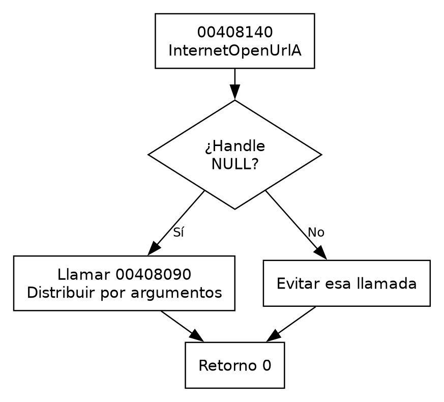
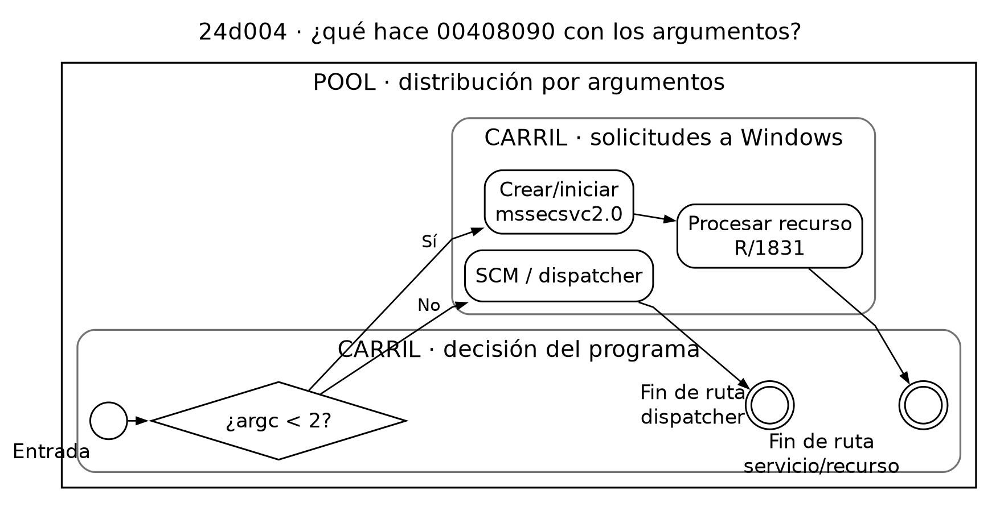
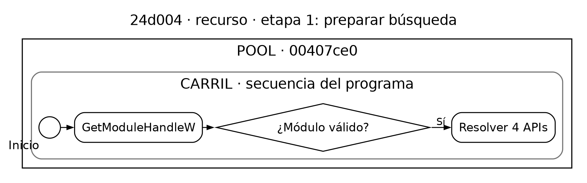
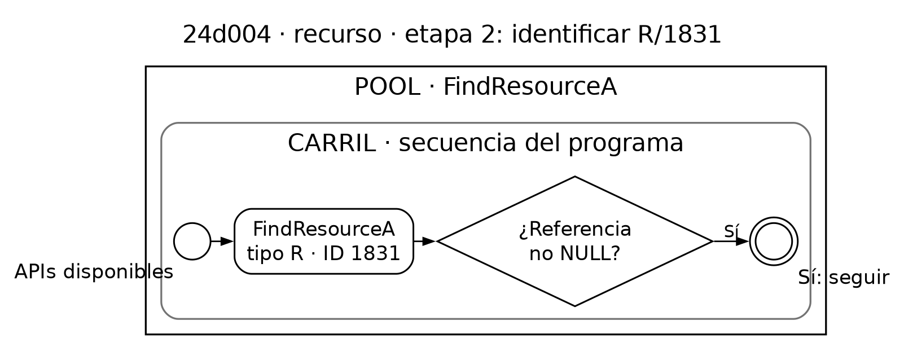
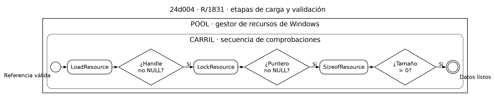
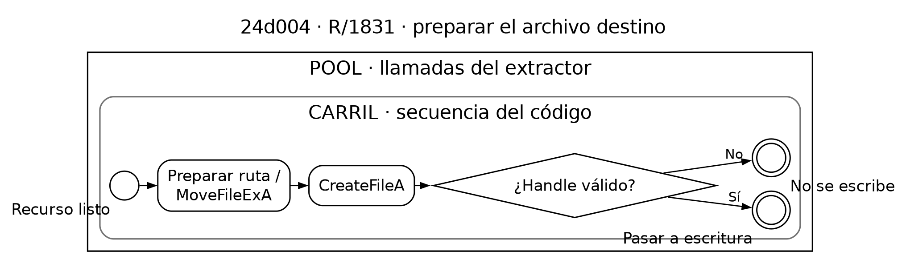
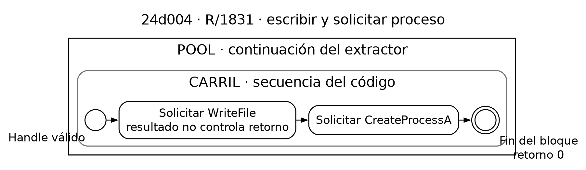

### Identidad, pregunta y evidencia

Este componente PE32 x86 tiene 3.723.264 bytes y SHA-256 24d004a104d4d54034dbcffc2a4b19a11f39008a575aa614ea04703480b1022c. La pregunta es cómo decide continuar y cómo se conecta con ed01…. El soporte son seis funciones seleccionadas, fragmentos de Listing y la relación del recurso R/1831. Las observaciones se refieren al programa importado en Ghidra, no a un proceso ejecutado.

### Decisión del kill switch: 00408140

La función copia una cadena y llama a InternetOpenA e InternetOpenUrlA. Guarda el resultado de esta última y lo compara con cero. Si es NULL, cierra handles según el código conservado y llama a 00408090. Si es no nulo, cierra los handles y evita esa llamada. Ambos caminos retornan cero. El bucle que copia la cadena no es una rutina de cifrado.

```text
0040819a  MOV EDI,EAX       ; resultado de InternetOpenUrlA
004081a3  TEST EDI,EDI      ; condición de cero
004081a5  JNZ 004081bc      ; no cero: evita la llamada
004081ad  CALL 00408090     ; camino de resultado cero
```

El Listing permite verificar la dirección de la rama. No debe invertirse la condición al explicarla: el camino NULL continúa hacia preparación. La API documenta el handle como resultado de apertura; esta función no consulta explícitamente un estado HTTP 200. Tampoco basta decir «con Internet se detiene»: el resultado depende de la operación concreta. [API1]



**Cómo leerla:** `InternetOpenUrlA` entrega un handle al programa. El rombo pregunta si ese handle es nulo. La rama NULL sigue hacia la preparación; la rama no NULL termina este camino. El código no pregunta si la respuesta web fue HTTP 200. Este flujo muestra una decisión prevista, no una conexión observada.

### Distribución por argumentos: 00408090 y 00407f20

00408090 obtiene la ruta del módulo y revisa la cantidad de argumentos (`argc`). `argc` cuenta los argumentos que recibió el programa, incluido normalmente el nombre del ejecutable. Si `argc < 2`, llama a 00407f20; con dos o más, toma la ruta de servicio y prepara StartServiceCtrlDispatcherA. Es una bifurcación del flujo de control: cada ejecución concreta sigue una de esas rutas.



En la rama corta, 00407f20 llama primero al auxiliar de servicio y después al procesamiento de R/1831. En la otra, el código consulta el Service Control Manager (SCM, administrador de servicios de Windows) y prepara el dispatcher. La figura resume ramas; los retornos de las APIs no equivalen a que el servicio haya quedado instalado.

00407f20 llama primero a 00407c40 y después a 00407ce0. No hay una condición entre ambas llamadas que valide el resultado de la primera. Por tanto, un fallo de creación de servicio no demuestra que la rutina de extracción no se alcanzaría. A la inversa, que ambas se llamen no demuestra que ambas tengan éxito.

### Solicitud de servicio: 00407c40

La rutina prepara la línea asociada al módulo con el argumento observado `-m security`, abre el administrador de servicios y solicita crear `mssecsvc2.0`. Si obtiene el handle del servicio, solicita iniciarlo y cierra handles. El resultado de StartServiceA no gobierna un reporte específico de éxito en esta función; el retorno final es cero.

Esta observación permite orientar una investigación hacia un servicio, su ruta y los registros correspondientes. No demuestra un evento System 7045 adquirido ni un servicio instalado. El nombre «Microsoft Security Center» de la cadena es parte del dato del programa y no confirma legitimidad. Debe contrastarse el ejecutable y su contexto.

### Recurso R/1831: 00407ce0

La función resuelve dinámicamente varias APIs de kernel32 mediante GetProcAddress. Después localiza el recurso de tipo R y número 0x727, obtiene sus datos y tamaño, prepara rutas y solicita creación, escritura y proceso en los caminos correspondientes. Las comprobaciones del recurso son visibles; no todas las operaciones posteriores comprueban o comunican éxito.

```text
00407d69  PUSH 0x43137c     ; referencia al tipo R
00407d6e  PUSH 0x727        ; identificador 1831
00407d73  PUSH EBX          ; módulo cero en este camino
00407d74  CALL [0040a05c]   ; FindResourceA
```

El recurso empieza en offset 204.964 del archivo y mide 3.514.368 bytes. La extracción preservada coincide con ed01… según los cotejos documentados. Esta es una relación de contenido fuerte; no demuestra el momento de lanzamiento. Las llamadas indirectas y sprintf del decompilado tienen argumentos imperfectos, por lo que su lectura exige Listing. No se interpreta una variable automática como puntero confirmado solo por su posición en el C recuperado.



Las cuatro direcciones de función que el código intenta resolver corresponden a CreateProcessA, CreateFileA, WriteFile y CloseHandle. Comprueba que estén disponibles antes de continuar.

El selector del recurso usa dos identificadores a la vez: el tipo `R` y el ID decimal `1831` (hexadecimal `0x727`). Si el módulo, las funciones o la referencia del recurso no están disponibles, el camino no llega a la carga. El identificador no es un nombre de archivo ni un puerto.



`FindResourceA` devuelve una referencia al recurso, no el contenido. Si no devuelve una referencia válida, la ruta no puede cargar esos bytes. La coincidencia tipo + ID especifica qué bloque dentro del PE intenta localizar el programa.



`LoadResource` obtiene un handle de los datos; `LockResource` obtiene un puntero a ellos; `SizeofResource` obtiene cuántos bytes tiene el recurso. Son pasos distintos, y cada uno depende del anterior. En este programa, la condición documentada es que el tamaño sea mayor que cero. El análisis independiente cotejó que el contenido extraído mide 3.514.368 bytes y coincide por SHA-256 con ed01…; ese cotejo lo hizo el analista, no lo hace esta función.



`CreateFileA` solicita abrir o crear el destino. Windows devuelve un handle o un valor inválido. Solo el handle válido conduce a la solicitud de `WriteFile`. El resultado de escritura no gobierna el retorno de esta rutina, así que el flujo estático no acredita que se hayan escrito todos los bytes.



Cuando el handle es válido, la rutina solicita escribir y luego solicita crear un proceso. El resultado de WriteFile no controla el retorno; por eso no se confirma que la escritura se completara. La rutina también solicita crear un proceso después de esa ruta. Una llamada a `CreateProcessA` es una solicitud: para acreditar creación y actividad se necesitarían eventos de proceso, archivos y tiempos de una ejecución atribuible.

### Referencia a 445: 00407480

La constante 0x1bd equivale a 445 y aparece junto a llamadas de WS2_32 por ordinal. Se reconoce un contexto de comunicación de red. El nombre descriptivo del analista facilita navegación, pero no reemplaza la identificación de prototipos, parámetros y llamadas. Esta función seleccionada no constituye una demostración integral de EternalBlue ni una conexión observada.

### Evaluación de resultados y alternativas

| Pregunta | Resultado del examen | Evidencia que falta para un efecto real |
|---|---|---|
| ¿Qué rama continúa? | NULL conduce a 00408090 | Resultado de API durante una ejecución concreta |
| ¿Contiene ed01…? | R/1831 coincide con ese componente | Ninguna adicional para la relación documentada; sí para procedencia histórica |
| ¿Crea el servicio? | Hay una solicitud condicionada | Registro, configuración y contexto de ejecución |
| ¿Explota otro host? | Rutina con constante 445 e importaciones | Cadena completa y artefactos del host/red |

Para revisar, localizar el hash, abrir cada dirección, marcar precondiciones, contrastar TEST/JNZ y registrar la relación del recurso. No contactar el dominio ni ejecutar el componente. NIST: RS.AN-03 para el razonamiento, RS.AN-07 para identidad, DE.CM-09 para futuras fuentes de ejecución y GV.OV-01 para relacionar la lección histórica de supervisión.

### Lectura por capas OSI: qué aplica y qué queda fuera

| Evidencia del código | Capa / relación | Qué puede concluirse | Qué no prueba este fragmento |
|---|---|---|---|
| `InternetOpenA` / `InternetOpenUrlA` en 00408140 | Capa 7, aplicación (WinINet/HTTP) | El programa solicita abrir una URL y ramifica por handle nulo/no nulo | Respuesta HTTP 200, contenido recibido, DNS observado o conexión efectiva |
| TCP/IP, direccionamiento y enlace que usaría Windows si WinINet comunica | Capas 4–1, dependientes de la pila del sistema | Son las capas necesarias para transportar una petición HTTP en una red habilitada | No se reconstruyen desde esta función ni se observaron en el intento bloqueado |
| `0x1bd` (445) junto a WS2_32 en 00407480 | Posible actividad de transporte/SMB; el puerto por sí solo no define OSI | Hay un indicador que merece seguirse por referencias, llamadas, parámetros y destinos | No basta para asignar toda la función a SMB, demostrar explotación, éxito o propagación |
| SCM, recursos PE, archivos y CreateProcess | Operaciones locales de Windows, fuera de OSI | El componente solicita servicio, acceso a un recurso y operaciones de archivo/proceso | Instalación efectiva, escritura real o creación/éxito del proceso |

**Idea para explicar en clase:** OSI sirve para ordenar la comunicación cuando existe tráfico. No todo el programa «pasa por capas»: control de servicios, lectura de recursos y creación de procesos ocurren dentro del sistema operativo. El código estático muestra una petición de capa de aplicación y un indicio separado asociado a 445; el PCAP externo es evidencia distinta y aporta observaciones de red que no deben atribuirse automáticamente a la ejecución local.

**Conclusión del componente:** se comprueba una decisión y un mecanismo de preparación y extracción. La historia del NHS explica por qué esos mecanismos importan, pero su ocurrencia en un hospital específico no se deriva del código local.
