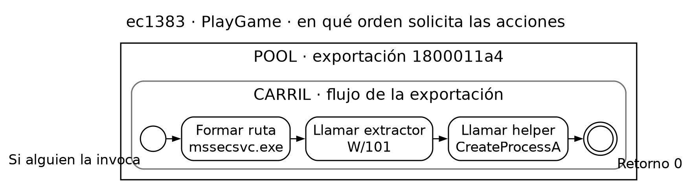
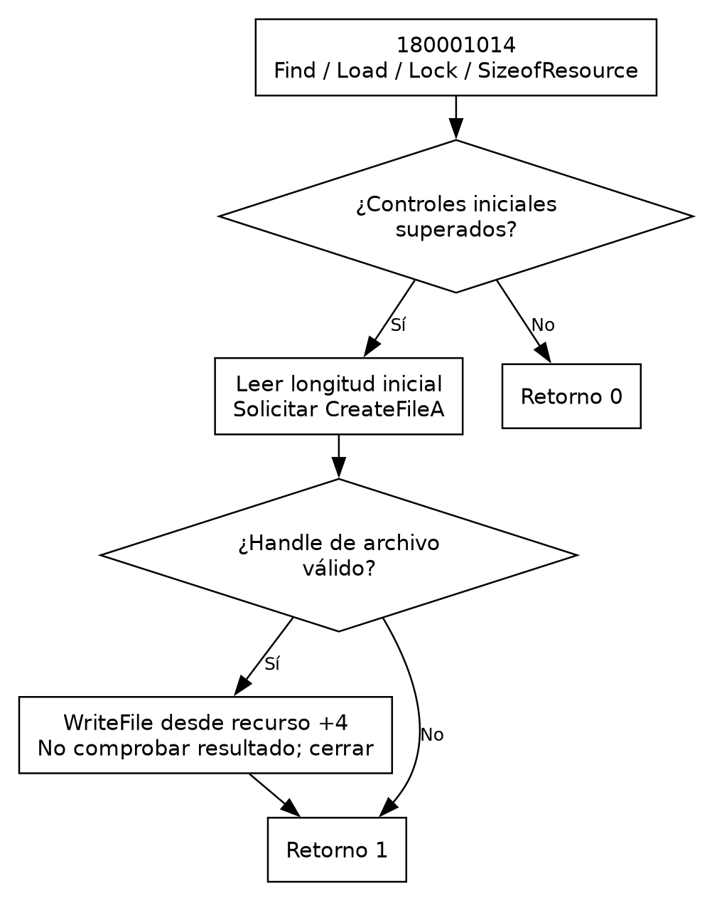
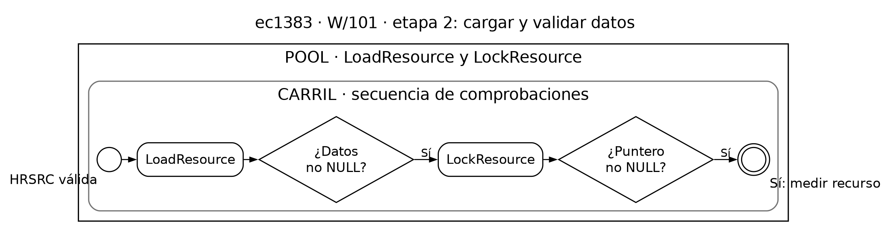
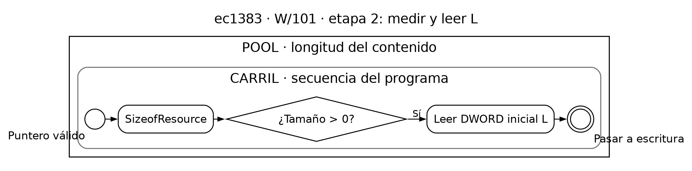
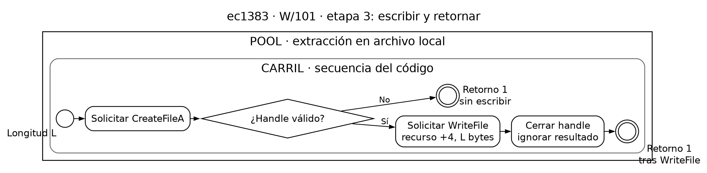

### Identidad, pregunta y evidencia

El archivo ec1383… tiene 5.298.176 bytes y SHA-256 ec138352c4726fa3b6706b30bf4692252f818108c8066e8518920dd9823a34bb. Su estructura es PE32+ x64, DLL, aunque el nombre recibido termine en .exe. La extensión es una etiqueta; la cabecera decide la interpretación del formato.

La pregunta es cómo extrae y solicita lanzar una carga y qué relación comprobada tiene con los demás. Se examinan PlayGame, la extracción de W/101 y la auxiliar de proceso. No se conoce aquí qué mecanismo externo invocó la exportación ni si ocurrió en un hospital o sandbox.

### PlayGame: 1800011a4

La exportación forma la ruta global `C:\WINDOWS\mssecsvc.exe`. Llama a 180001014 y luego a 1800010f8, retornando cero. Las instrucciones en 1800011c9 y 1800011ce son llamadas consecutivas; no aparece entre ellas una prueba del resultado de extracción.

La consecuencia es precisa: una devolución de fallo de la primera rutina no impide por sí misma que el llamador solicite la siguiente. Eso no garantiza que exista un archivo válido para lanzar. La presencia de PlayGame en la tabla de exportaciones tampoco demuestra que se haya invocado. La práctica no necesita ejecutar la DLL para responder estas preguntas.



No hay compuerta entre las dos llamadas; PlayGame no comprueba ahí el retorno de extracción. La exportación prueba que existe un punto de entrada en el archivo, no que alguien lo haya invocado.

### W/101, desde cero

W es el tipo del recurso y 101 su identificador decimal; en las instrucciones se ve 0x65. `FindResourceA` usa módulo, nombre/identificador y tipo. Obtener una referencia al recurso no ejecuta su contenido: primero Windows localiza los datos y luego el código los carga.

```text
Recurso W/101: 5.242.880 bytes
+0 a +3       DWORD little-endian: longitud 3.756.032
+4            Inicio del PE delimitado
+4 a +3756035 Tramo de 3.756.032 bytes que se pretende escribir
Después       Bytes restantes del recurso, fuera de ese tramo
```



Si `FindResourceA` devuelve NULL, no se llega a cargar el recurso. Si devuelve una referencia, el flujo continúa con la siguiente API. W/101 es notación tipo/ID del directorio PE; no representa una URL, puerto ni una capa OSI.

### Carga de los datos: LoadResource y LockResource

`LoadResource` intenta cargar los datos referidos por HRSRC. El código comprueba que el resultado sea distinto de NULL; si falla, retorna cero. Después `LockResource` obtiene un puntero a los bytes y se comprueba también que no sea NULL; si falla, también retorna cero. Son controles sucesivos: superar el primero no salta el segundo.



### Longitud y frontera del recurso: 180001014

Después de validar el puntero, `SizeofResource` obtiene el tamaño y la rutina comprueba que sea distinto de cero. Solo entonces lee el DWORD inicial como longitud L. Ese DWORD ocupa cuatro bytes y se interpreta en little-endian; por eso el contenido empieza en +4. El código entrega L como longitud para `WriteFile`.



La comprobación del binario cubre que el tamaño sea mayor que cero, pero no muestra una comparación completa de L con el tamaño disponible. El analista valida el límite `L ≤ tamaño_recurso − 4` y calcula el hash del tramo delimitado. Esta comprobación externa no se atribuye al malware.

```text
18000102a  LEA R8,[1800092b0]  ; tipo W, tercer argumento
180001031  MOV EDX,0x65       ; identificador 101
180001036  CALL [180009030]   ; FindResourceA
18000108b  MOV ESI,[RDI]      ; DWORD de longitud L
1800010c4  LEA RDX,[RDI+4]    ; inicio del contenido
1800010cd  MOV R8D,ESI        ; longitud para WriteFile
1800010d3  CALL [180009008]   ; solicitud de escritura
```

En el C recuperado, pDVar2 es DWORD*. `*pDVar2` lee el DWORD y `pDVar2 + 1` avanza cuatro bytes; el Listing lo confirma con LEA +4. La rutina copia bytes. En este fragmento no se observa descifrado.

### Solicitud de escritura y significado del retorno

`CreateFileA` solicita crear o abrir `mssecsvc.exe`. Si devuelve `INVALID_HANDLE_VALUE`, el código omite `WriteFile`, pero retorna 1. Si el handle es válido, solicita escribir desde recurso+4 por L bytes, ignora el resultado de `WriteFile`, cierra el handle y retorna 1.



Así, «retorno 1» no equivale a «archivo extraído correctamente». La comprobación externa tendría que establecer existencia, tamaño, contenido y SHA-256. El tramo delimitado mide 3.756.032 bytes y tiene el hash `93db4b26…` registrado en el inventario.

### Solicitud de proceso: 1800010f8

La auxiliar inicializa estructuras y solicita CreateProcessA con la ruta global. Si la API informa éxito, cierra los handles del hilo y del proceso. Retorna cero en ambos caminos. No hay espera del hijo en esta rutina.

Cerrar handles libera referencias de la función; no prueba que el proceso terminara. La devolución cero tampoco demuestra fallo de CreateProcessA, porque ambos resultados de esa API terminan en ese mismo valor. La conclusión estática es «existe una solicitud de lanzamiento condicionada por el entorno», no «se ejecutó el ransomware completo». [API3]

### Relación con las otras muestras y ANY.RUN

El PE delimitado desde W/101 tiene hash 93db4b26be3a4e6b724bf85830746f458cde613ad88501bcb23d2ae1ab9976c9. No coincide con 24d004…. La relación probada es ec1383… → recurso W/101 → ese PE. No se añade una flecha de identidad hacia 24d004…, ni se deduce procedencia Dionaea o uso de DoublePulsar a partir de la estructura de una DLL.

El usuario informó que ANY.RUN mostró un error 500 en su página. No hay informe de tarea disponible para verificar hash ejecutado, invocación de exportación, procesos o tiempos. Ese dato comunicado no determina si la DLL hizo algo y no demuestra que un servidor de kill switch la detuviera.

### Criterios de revisión

La revisión debe verificar formato real, orden de llamadas, aritmética de +4, longitud, identidad del PE y retornos. Para ampliar harían falta inicialización del handle de módulo, referencias a PlayGame y contexto de invocación, manteniendo separada la procedencia externa. RS.AN-03 organiza la explicación causal; RS.AN-07 exige identidad y procedencia; RS.AN-06 exige registrar qué revisión se hizo realmente.

### Lectura por capas OSI: recurso W/101 y lanzamiento local

| Evidencia | Capa / ámbito | Qué significa y qué no significa |
|---|---|---|
| `FindResourceA` tipo W, ID 101; `LoadResource`, `LockResource` | No aplica | Selecciona y accede a datos ya embebidos en la DLL. W/101 no es una URL ni un puerto. |
| Lectura del DWORD inicial y `WriteFile` a una ruta local | No aplica | Interpreta una longitud y solicita guardar bytes en el sistema de archivos. No hay encapsulado de red demostrado. |
| `CreateProcessA` en 1800010f8 | No aplica | Solicita iniciar un programa local. La API no acredita proceso resultante ni tráfico posterior. |
| Capas 7–1 | No se demuestra actividad de red en las funciones seleccionadas | Para asignar HTTP, SMB u otro protocolo se necesitan llamadas, argumentos o captura atribuibles; no se infiere por la familia o por el nombre DLL. |

**Cómo explicarlo:** las capas OSI ayudan a analizar la propagación por SMB cuando se demuestra tráfico; W/101 pertenece a la estructura del archivo PE y la extracción ocurre dentro de Windows. Son planos distintos del análisis. La DLL podría estar integrada en una cadena más amplia, pero la función observada no demuestra qué proceso la invocó ni qué comunicación siguió.

**Conclusión del componente:** ec1383… aporta un mecanismo de depósito y solicitud de lanzamiento de otra carga. Es útil para explicar arquitectura y límites de interpretación, pero su pertenencia a una cadena concreta de infección del NHS permanece no demostrada.
