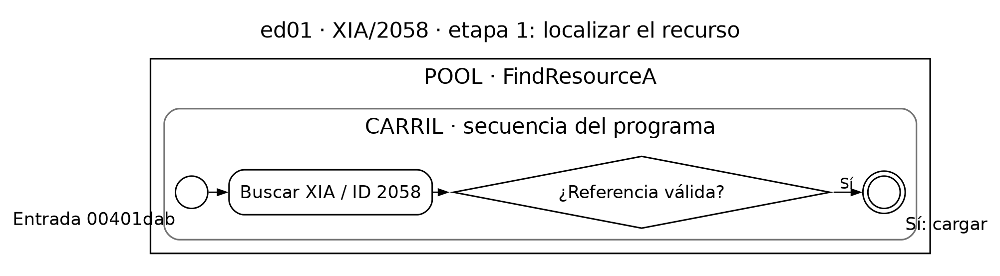
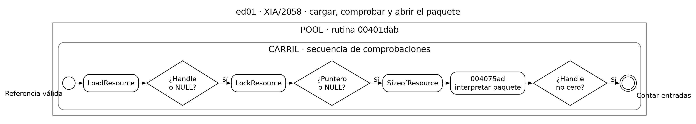
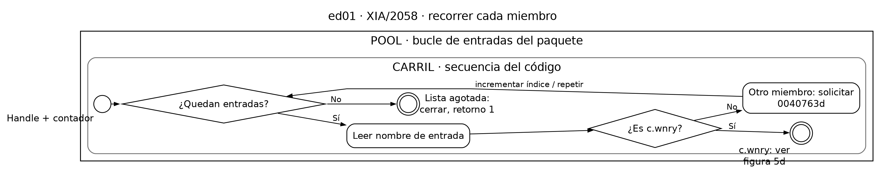
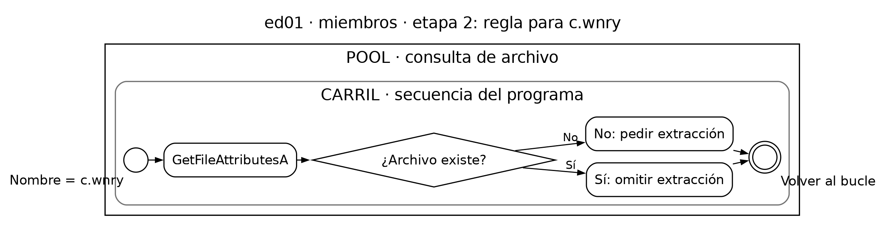
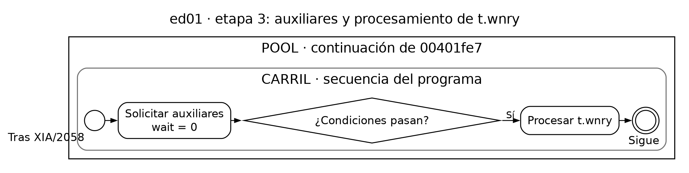
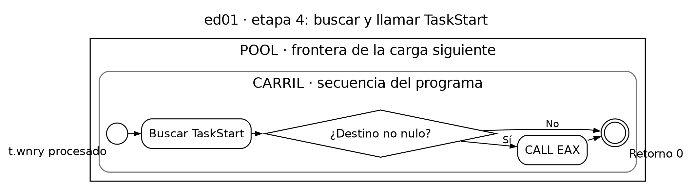
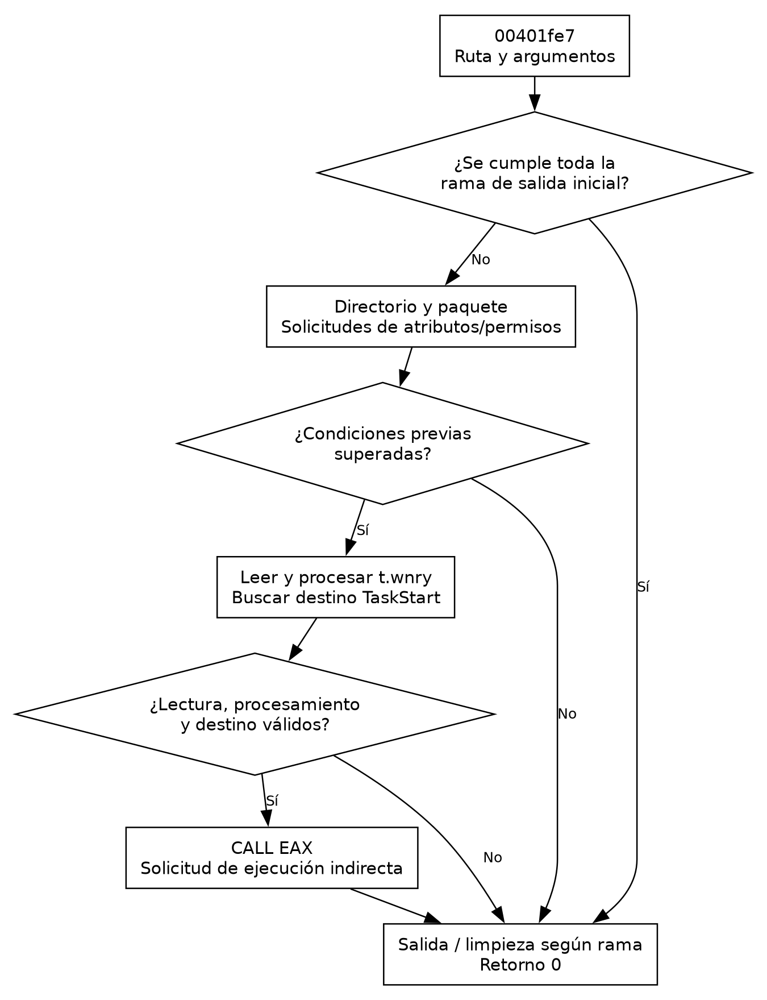
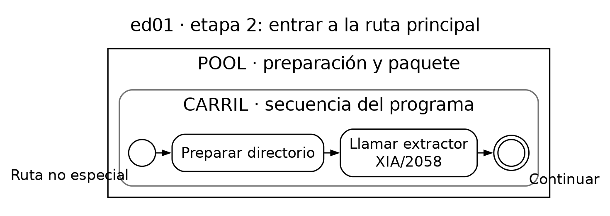

### Identidad, pregunta y evidencia

ed01… es PE32 x86, de 3.514.368 bytes, SHA-256 ed01ebfbc9eb5bbea545af4d01bf5f1071661840480439c6e5babe8e080e41aa. Coincide con el recurso R/1831 anterior. La pregunta es cómo organiza sus miembros y qué puede afirmarse sobre la carga siguiente. Se seleccionaron cuatro funciones de 244 reconocidas; no se reconstruyó toda la criptografía.

### Acceso al paquete: 00401dab

La rutina localiza el tipo XIA e identificador 0x80a, carga y bloquea el recurso y obtiene el tamaño. Pasa datos a una auxiliar y, si obtiene un resultado válido, consulta y recorre entradas. Cuando la entrada se llama c.wnry y GetFileAttributesA informa un valor válido, evita la extracción de esa entrada. En otras condiciones solicita la operación de extracción mediante una auxiliar.

```text
00401db6  PUSH 0x40f43c     ; tipo XIA
00401dbb  PUSH 0x80a        ; identificador 2058
00401dc0  PUSH [EBP+0x8]    ; módulo
00401dc3  CALL [00408100]   ; FindResourceA
00401dcb  TEST ESI,ESI
00401dcd  JZ 00401e07       ; salida de fallo
```



El formato ZIP no se deduce del nombre XIA: procede del examen del contenido, estructura y comprobaciones de CRC de la extracción estática. El paquete mide 3.446.325 bytes y tiene 36 miembros. Que la rutina termine con 1 tras cerrar el paquete no prueba que cada archivo se escribiera; incluso un conteo sin entradas puede alcanzar ese retorno. [API2; manifiesto local]



`FindResourceA` localiza los datos dentro del PE. `LoadResource` y `LockResource` obtienen acceso al contenido; `SizeofResource` consulta el tamaño; 004075ad abre o interpreta el paquete. El nombre XIA no prueba que el contenido sea ZIP: eso se comprobó fuera del flujo del malware con su estructura y CRC.



En cada vuelta, la rutina lee un nombre y toma una rama. Los miembros distintos de `c.wnry` llegan a la llamada 0040763d. El bucle incrementa el índice y vuelve a comprobar si quedan entradas. Si la lista se agota, cierra el paquete; si el nombre es `c.wnry`, el control salta a una regla especial. Al terminar la lista se cierra el paquete y el auxiliar puede retornar 1. Ese retorno solo describe la ruta de la función; no acredita el contenido de cada archivo.



Si `GetFileAttributesA` devuelve atributos válidos, el archivo ya existe y la rutina omite la extracción de `c.wnry`. Si devuelve el marcador de error, solicita extraerlo. No se ve una comparación del hash del archivo existente con el miembro: “ya existe” no significa “es el mismo archivo” ni “está íntegro”.

### Preparación y caminos: 00401fe7

La función tiene una rama inicial especial asociada a cantidad y contenido de argumentos. En ciertas condiciones intenta copiarse como tasksche.exe y puede retornar antes de la preparación principal. El informe no elimina esa salida para dibujar una secuencia más simple.

El camino posterior establece un directorio de trabajo y llama a la extracción del paquete. Solicita operaciones auxiliares de atributos y permisos por medio de 00401064 con espera cero. “Espera cero” significa que el llamador no bloquea el flujo hasta que termine el proceso auxiliar; por tanto, el orden de llamadas no demuestra que cada operación termine antes de la siguiente comprobación.



Después aparecen condiciones sobre auxiliares de preparación, lectura de t.wnry, procesamiento posterior y obtención de un destino asociado a TaskStart. Solo si esas condiciones permiten continuar se realiza la llamada indirecta. Los nombres de auxiliares automáticos no constituyen una explicación de sus cuerpos.



`CALL EAX` es una transferencia de control a la dirección que está en el registro EAX. No sabemos qué hace esa rutina solo por el destino o el nombre TaskStart; se necesitaría recuperar y analizar el cuerpo de la función apuntada.



La ruta especial depende de las condiciones de argumentos y de los resultados auxiliares; el diagrama no implica que una copia se haya completado. La rama no especial continúa al directorio de trabajo y al extractor.



El gráfico muestra el límite entre esta función y el extractor. Los resultados de la extracción deben analizarse en su propia ficha; una llamada no equivale a que el paquete se haya desplegado.

### Auxiliar de proceso: 00401064

La función solicita CreateProcessA y devuelve cero si la creación falla. Si se informa éxito, solo espera cuando el segundo parámetro es distinto de cero. Dentro de ese bloque, un resultado de espera distinto de cero conduce a solicitar TerminateProcess y, si existe el tercer parámetro, consultar el código de salida. Finalmente cierra handles y devuelve 1.

No se debe traducir «retorno 1» como «permisos cambiados». Ese valor describe el resultado de esta auxiliar, no el efecto final del programa externo. Los usos con espera cero tampoco esperan el cierre del proceso. Las condiciones pueden entenderse leyendo los parámetros concretos del llamador, no únicamente el cuerpo de la auxiliar. [API3]

### t.wnry y la frontera del análisis: 004014a6

El archivo observado tiene 65.816 bytes. Su cabecera comienza por ocho bytes WANACRY! y después `00 01 00 00`, que corresponde a 256 en little-endian. La rutina abre el archivo, comprueba tamaño y cabecera, lee campos, reserva memoria y recurre a auxiliares de transformación. En memcmp, cero significa igualdad, a diferencia de los controles de handle nulo.

La transcripción muestra un prototipo __thiscall y parámetros que requieren revisión contra el Listing. No se cambia el convenio de llamada para obtener código compilable. El campo 0x100 no demuestra por sí solo RSA ni una clave concreta; ese significado requiere seguir los datos y los auxiliares.

```text
00402125  PUSH 0x40f4f4     ; referencia a t.wnry
0040212d  CALL 004014a6     ; lectura y procesamiento
00402154  JZ 0040215a       ; evita llamada si destino es cero
00402158  CALL EAX          ; destino indirecto, no cuerpo del cifrador
```

La decompilación permite reconocer la búsqueda y llamada condicionada hacia una carga. No aporta aquí la DLL final reconstruida ni el cuerpo íntegro de TaskStart. Un paquete con contraseña, un contenedor transformado y el cifrado de documentos son capas distintas; no se equiparan sus claves o funciones.

### Evaluación y relación con NIST

El hallazgo más fuerte es la relación entre recurso, paquete y miembros, junto con las condiciones que limitan la llamada indirecta. La confianza es alta en los bytes y referencias preservados; el resultado de ejecución permanece no observado. Una ausencia de salida en un entorno externo podría tener varias explicaciones y no se resuelve con este decompilado.

Para estudiar, dibujar el árbol padre-hijo, anotar el tratamiento de c.wnry, separar las llamadas asíncronas y marcar la frontera TaskStart. La ampliación debe revisar los auxiliares de transformación y convenios de llamada antes de caracterizar el cifrador. NIST SP 800-86 organiza el examen; RS.AN-06 y RS.AN-07 requieren conservar actuación, identidad, datos y procedencia.

### Lectura por capas OSI: paquete local y ausencia de protocolo en la rutina

| Operación observada | Capa OSI | Explicación y límite |
|---|---|---|
| `FindResourceA`, `LoadResource`, `LockResource`, `SizeofResource` | No aplica | Accede al directorio de recursos PE ya contenido en el archivo. No es una descarga ni comunicación de red. |
| Abrir el paquete XIA/2058 y recorrer sus 36 miembros | No aplica | El ZIP se identifica mediante examen estático de bytes/estructura y CRC. El nombre XIA no es una capa ni prueba el formato. |
| `GetFileAttributesA`, extracción, `SetFileAttributes`/operaciones de permisos | No aplica | Son consultas y solicitudes locales de archivos/ACL de Windows. Que el código las solicite no confirma efecto. |
| `CreateProcessA`, espera y cierre de handles | No aplica | Gestión local de procesos; no es tráfico de red ni evidencia de una sesión. |
| Transporte de paquetes SMB que pudo participar en la propagación general de WannaCry | Capas 7 y 4–1, si la actividad de red correspondiente está presente | El contexto histórico y la captura externa se estudian en secciones separadas. Las funciones aquí examinadas no contienen evidencia suficiente para atribuir esa comunicación a ed01. |

**Clave didáctica:** no forzar una etiqueta OSI para cada llamada. En este módulo, las capas OSI no describen el acceso a recursos embebidos, ZIP ni permisos. Para hablar de red se necesitan funciones/protocolos identificables o artefactos de tráfico correlacionados; la relación estática de ed01 con un paquete no aporta por sí sola esos datos.

**Conclusión del componente:** ed01… organiza y prepara un paquete con un camino condicionado hacia otra carga. El análisis no demuestra el éxito de todas las extracciones, los efectos de los comandos ni la ejecución completa del cifrador.
