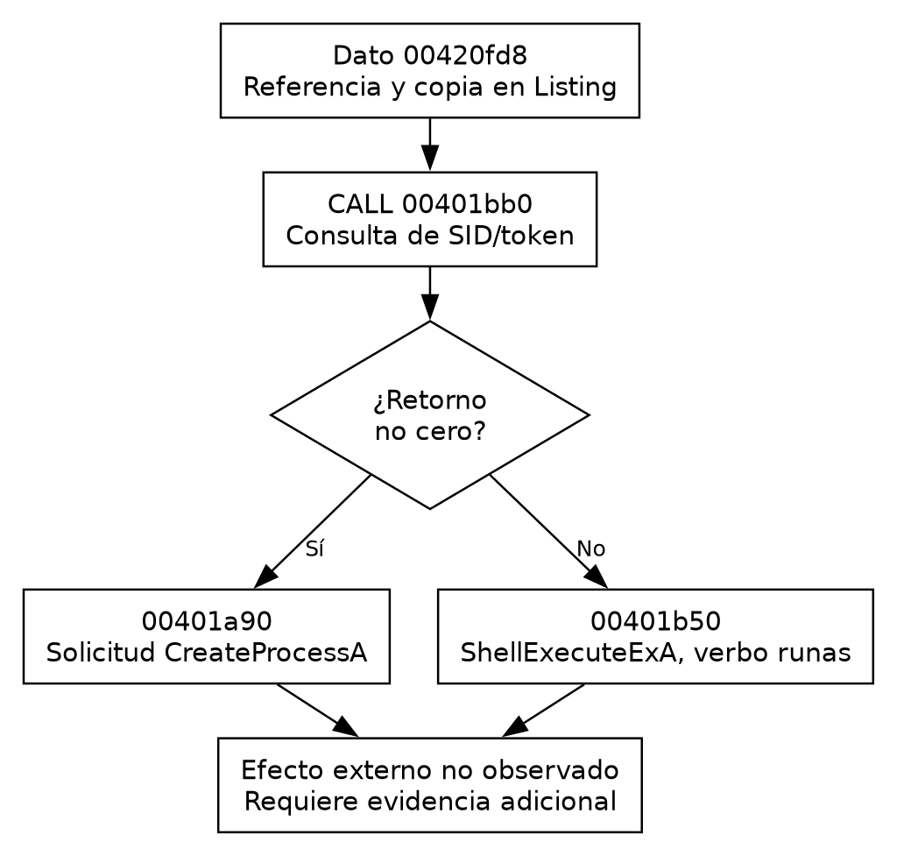
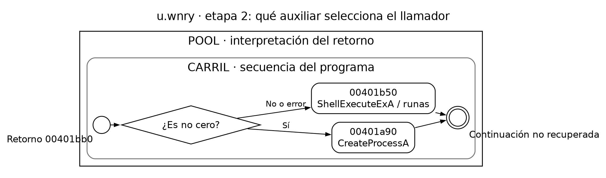
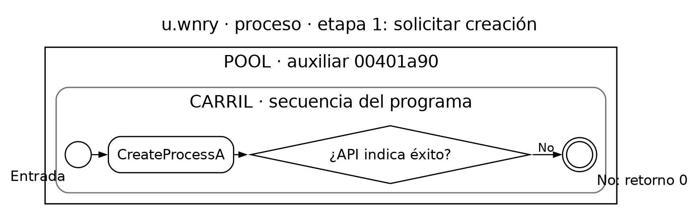
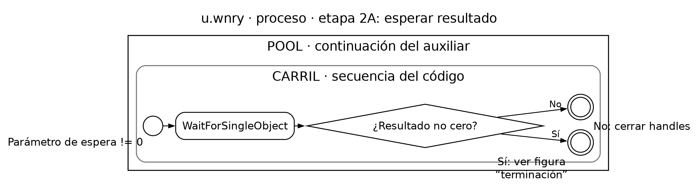
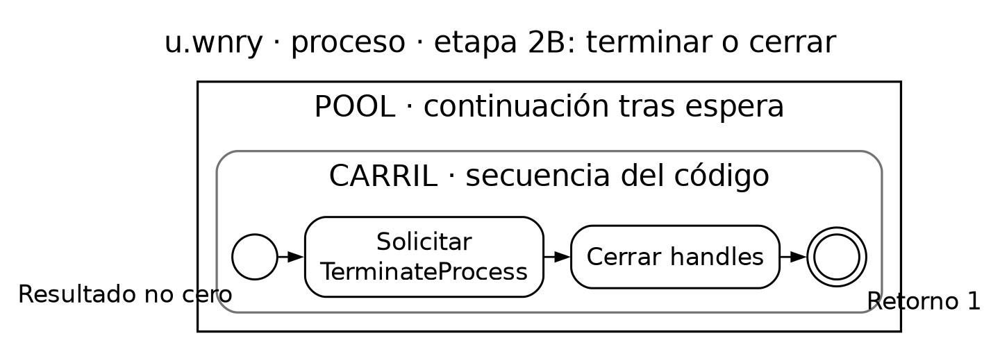

### Identidad, pregunta y evidencia

u.wnry tiene SHA-256 b9c5d4339809e0ad9a00d4d3dd26fdf44a32819a54abf846bb9b560d81391c25 y procede del paquete de ed01…. Es un PE32 x86 con 1.070 funciones reconocidas. Aquí se estudian tres auxiliares y el Listing que las conecta con una cadena contra mecanismos de recuperación.

La pregunta es qué relación existe entre el dato textual, la consulta de privilegios y la solicitud de proceso. No se pretende caracterizar todas las funciones de interfaz o descifrado a partir de esos tres cuerpos. El bloque principal que referencia la cadena no tiene una función contenedora correctamente recuperada en este proyecto; no se dispone de su decompilación completa.

### Del dato a su referencia

La cadena de interés está en 00420fd8 y agrupa operaciones contra copias sombra, catálogo y opciones de recuperación. Se describe su finalidad analítica sin ofrecerla como comando de práctica. Una cadena sin referencia podría ser dato no utilizado; aquí se conserva un camino de referencias hacia código.

```text
004066fe  MOV ESI,0x420fd8   ; dirección del dato
0040670c  MOVSD.REP         ; copia
0040672f  CALL 00401bb0     ; consulta de token
00406736  JNZ 00406750     ; selección de ruta
00406746  CALL 00401b50    ; auxiliar ShellExecuteExA
0040677c  CALL 00401a90    ; auxiliar CreateProcessA
```

Las condiciones anteriores al fragmento también pueden afectar su alcance. El Listing demuestra instrucciones y relaciones, no que el bloque se ejecutara. Un fallo del Decompiler no significa ausencia de código ni autoriza a inventar una función C para completar el informe.

### Consulta del token: 00401bb0

La función construye el SID correspondiente al grupo de administradores y consulta CheckTokenMembership. Distinguir dos resultados es esencial: BVar1 informa si la API pudo realizar la consulta; local_10 recibe el resultado de pertenencia habilitada. Si falla la construcción del SID o la consulta, la auxiliar termina con cero; también puede retornar cero tras una consulta negativa. [API4]

El flujo del llamador selecciona una ruta según ese retorno. Un valor no cero conduce hacia la auxiliar de creación de proceso; el camino cero hacia la auxiliar de ShellExecuteExA. No debe afirmarse que todo cero significa exclusivamente «usuario no administrador»: también puede representar una falla de consulta.



La consulta devuelve dos ideas que deben mantenerse separadas: si Windows pudo comprobar el token y si el grupo de administradores está habilitado. El resultado cero no permite distinguir por sí solo entre “no pertenece” y “falló la comprobación”.



La respuesta no nula selecciona la primera auxiliar; la nula selecciona la segunda. Como el helper también devuelve cero ante una consulta fallida, el rombo describe el retorno del helper, no una certeza universal sobre el usuario.

### Solicitud con runas: 00401b50

Esta auxiliar llena una estructura SHELLEXECUTEINFOA, coloca los parámetros recibidos y utiliza el verbo `runas` al solicitar ShellExecuteExA. En Windows, el verbo pide al shell iniciar la acción con elevación, normalmente mediante el consentimiento del sistema. El código demuestra la solicitud, no que se aceptara ni que el proceso obtuviera privilegios. Falta evidencia de contexto del usuario, respuesta del sistema y proceso resultante para afirmar su efecto real.

La expresión booleana del decompilado se preserva literalmente en el anexo. No se simplifica silenciosamente como una garantía de éxito, y no se atribuye a la biblioteca una vulnerabilidad de elevación solo por ver el verbo runas.

### Creación y espera: 00401a90

La auxiliar prepara estructuras y solicita CreateProcessA. La primera bifurcación separa fallo (retorno cero) de creación informada por la API. Si se informa éxito, el segundo parámetro controla si el código espera; si no espera, pasa al cierre.



La figura muestra la decisión inicial. Un parámetro de espera distinto de cero lleva a WaitForSingleObject; el resultado de esa API se analiza en la siguiente etapa. Si hay parámetro de salida, el código consulta el código de salida dentro del camino correspondiente. Después cierra handles y retorna 1 en las rutas de éxito.

Hay tres hechos distintos: la API informa creación, el proceso puede terminar, y la acción externa puede conseguir un cambio. Esta auxiliar no acredita los tres. Una solicitud de terminación tampoco demuestra que la orden prevista hubiera terminado antes. El valor de retorno no es una medición del estado de copias de respaldo.



Si el resultado de la espera es distinto de cero, el flujo puede solicitar TerminateProcess; si es cero, pasa al cierre. El diagrama siguiente aísla ese último paso para que la condición no se confunda con una terminación comprobada.



### Qué explica y qué no explica para el NHS

El mecanismo hace relevante estudiar la capacidad de recuperación. La relación es conceptual y preventiva: una organización necesita copias protegidas y verificadas ante acciones que puedan obstaculizar restauración. No se afirma que todos los respaldos del NHS se borraran, que esta ruta alcanzara cada equipo ni que los permisos se concedieran. Esos hechos necesitarían artefactos de cada entorno.

| Nivel de evidencia | Afirmación admisible |
|---|---|
| Cadena | Existe texto con operaciones potencialmente perjudiciales para recuperación |
| Referencia y Listing | Hay instrucciones que acceden al texto y llaman a auxiliares |
| Auxiliar | Puede solicitar un proceso bajo condiciones determinadas |
| Ejecución real | Pendiente: necesitaría procesos y tiempos comprobados |
| Efecto real | Pendiente: necesitaría estado de recuperación antes/después |

NIST: PR.DS-11 justifica copias mantenidas y probadas; RC.RP-03 pide verificar su aptitud antes de usarlas y RC.RP-05 verificar el funcionamiento después. Un snapshot de laboratorio no debe confundirse con la estrategia institucional de respaldo.

### Lectura por capas OSI: acciones locales relacionadas con recuperación

| Fragmento | Capa / ámbito | Interpretación correcta |
|---|---|---|
| Cadena en 00420fd8 | Dato local | La cadena no es una trama, paquete ni sesión. Las referencias muestran dónde se usa. |
| `AllocateAndInitializeSid` y `CheckTokenMembership` | Seguridad local de Windows | Construye un identificador de grupo y consulta pertenencia habilitada en el token. No consulta un servidor remoto ni demuestra privilegio efectivo fuera de ese proceso. |
| `ShellExecuteExA` con verbo `runas`, `CreateProcessA`, espera/terminación | Gestión local de procesos | Solicita una acción del shell o la creación/espera de proceso. La solicitud no confirma elevación, ejecución completa ni efecto sobre respaldos. |
| Capas 7–1 | No hay flujo OSI demostrado en el tramo seleccionado | No se observan API de red ni destino/protocolo en esta evidencia concreta. La actividad de red de WannaCry debe justificarse con otros componentes o PCAP. |

La función de cifrado de archivos tampoco se asigna a una «capa OSI»: puede operar sobre datos locales en la capa de aplicación del sistema, pero eso no es una comunicación de red. En esta ficha, la pregunta forense es qué datos y procesos locales solicita, bajo qué condiciones y con qué resultado observado.

**Conclusión del componente:** se observa una conexión estática entre datos y solicitudes de proceso relevantes para recuperación. La decompilación incompleta del llamador y la falta de ejecución impiden afirmar el efecto final. Para ampliar el estudio hay que recuperar límites y flujo del bloque sin modificar el binario original.
