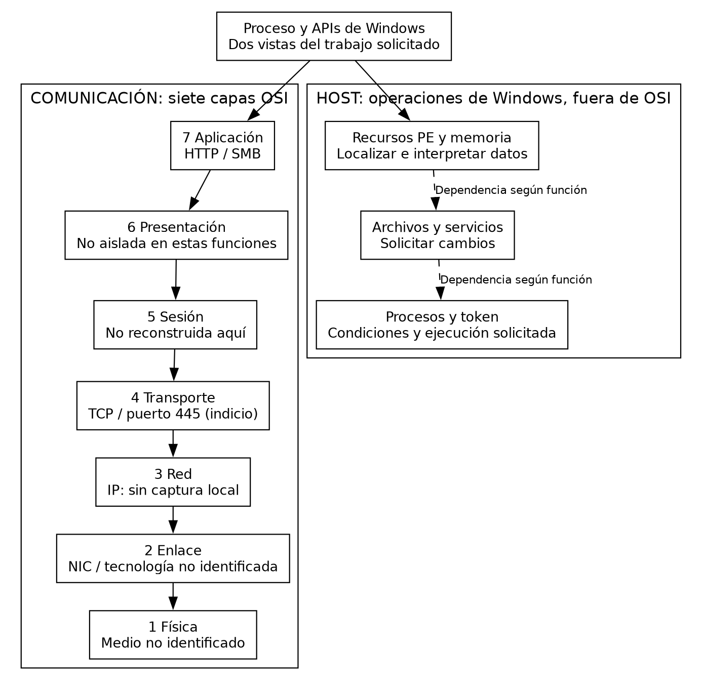

### 4.6 La pregunta central: qué hace, cómo lo hace y qué ocurre después

Para explicar WannaCry se necesitan tres vistas complementarias: **la comunicación entre equipos**, **la organización de sus componentes** y **las operaciones dentro de Windows**. OSI organiza la primera; los recursos PE y las llamadas entre funciones explican las otras dos. No existe una correspondencia de una función del malware con cada una de las siete capas. Tampoco las siete capas describen siete etapas cronológicas de la infección.

En esta revisión, «observado en el código» significa encontrado en las transcripciones y el Listing conservados del 15/11/2026. No significa ejecutado. «Histórico» procede de fuentes del incidente; «esperable» describe un artefacto que habría que adquirir y comprobar. No se capturaron paquetes en una ejecución local ni se obtuvieron registros de un hospital. La sección 5.3 de la parte práctica analiza un PCAP externo de laboratorio con el mismo SHA-256 de muestra; ese archivo no es tráfico del NHS.

La exposición utilizará esta secuencia para cada mecanismo: **entrada → condición → API y recurso → efecto solicitado → siguiente llamada → evidencia necesaria**. Cuando falte el cuerpo de una auxiliar, se señalará esa frontera. El objetivo es explicar una relación causal comprobable, incluyendo sus posibles fallos. Para el trabajo forense, cada afirmación debe quedar vinculada a adquisición/preservación, examen, análisis e informe, conforme a SP 800-86. El CSF 2.0 se usa después para discutir resultados de gestión del NHS; no clasifica funciones del malware ni sustituye el análisis de evidencia.

### 4.7 Las siete capas OSI contrastadas con el caso

El modelo de referencia separa aplicación, presentación, sesión, transporte, red, enlace y física. Sirve para ordenar responsabilidades de comunicación; no es la especificación de implementación de Windows ni una metodología de investigación forense. La definición conceptual siguiente se apoya en X.200, cláusulas 6 y 7; la aplicación al código es una interpretación del presente estudio. [OSI1]

| Capa y responsabilidad conceptual | Función/protocolo relacionado | Recursos y datos que intervienen | Evidencia y límite de la afirmación |
|---|---|---|---|
| 7. Aplicación: servicios y mensajes entre aplicaciones | HTTP para la consulta del kill switch; SMB para la propagación histórica | URL, datos de solicitud/respuesta y servicios WinINet/SMB | 00408140 llama a InternetOpenUrlA. El uso de SMBv1 se sustenta en fuentes técnicas y una captura externa de laboratorio; no hay captura local ni tráfico hospitalario |
| 6. Presentación: representación de datos intercambiados | No se identificó una operación específica de presentación de red en las 16 funciones | En una comunicación podrían intervenir formatos y transformaciones; aquí ZIP, DWORD y datos cifrados son objetos locales | El paquete y el cifrado de archivos no prueban presentación OSI. No se identificó una negociación de formato ni TLS en el material seleccionado |
| 5. Sesión: organización del diálogo entre aplicaciones | No se reconstruyó una sesión de protocolo completa | Estado de diálogo que mantuviera el protocolo, si corresponde | El nombre `session` en el código WinINet no es evidencia suficiente. No hay traza para mostrar apertura, continuidad y cierre de una sesión de WannaCry |
| 4. Transporte: comunicación extremo a extremo | TCP transportaría HTTP y SMB directo; el puerto 445 identifica el extremo SMB | Socket, puerto, estado TCP, buffers y handles de red | 00407480 contiene 0x1bd (=445) y llamadas WS2_32 por ordinal. Faltan prototipos y flujo de datos para reconstruir la conexión completa; el PCAP externo se limita a su laboratorio |
| 3. Red: direccionamiento y encaminamiento | IP llevaría paquetes entre redes según el alcance disponible | Direcciones IP, rutas, interfaces y paquetes | No hay captura del NHS para afirmar su origen/destino, rutas ni secuencia de exploración. El PCAP externo tiene IP de su propia LAN de prueba; la dirección destino de la rutina local requiere reconstruir llamadores |
| 2. Enlace: transferencia por el enlace local | Ethernet, Wi-Fi u otro enlace sería gestionado por el sistema y el adaptador | Interfaz, tramas, direcciones MAC y, según entorno, VLAN | No se conocen MAC, VLAN ni tecnología de cada hospital a partir de estos binarios. No se observa manipulación del enlace |
| 1. Física: transmisión de señales por el medio | Cable, radio u otro medio llevaría las señales de la comunicación | Adaptador y medio físico disponibles | No se observa modificación de hardware ni del medio. Esta capa es infraestructura del entorno, no una acción atribuida a estas funciones |

**Capa 7: distinguir dos conversaciones.** La consulta del kill switch y la propagación SMB cumplen objetivos diferentes. En 24d004…, 00408140 solicita abrir una URL HTTP y utiliza el resultado para decidir si llama a 00408090. La propagación mediante vulnerabilidades de SMBv1 corresponde a la explicación técnica publicada en 2017. El boletín MS17-010 describe correcciones del manejo de solicitudes de SMBv1; no describe una vulnerabilidad del número 445. [RED2; HIST1]

**Cómo sucede la consulta.** La función prepara texto en memoria, obtiene un contexto de WinINet y llama a InternetOpenUrlA. Windows gestiona los servicios subyacentes necesarios. El código seleccionado recibe un handle o NULL; no interpreta manualmente cada capa ni comprueba un estado HTTP 200. El handle es una referencia administrada por la API, no un paquete ni una dirección IP. La rama NULL llama a la preparación; la rama no nula evita esa llamada. [API1; capítulo 6]

Si hiciera falta resolver el nombre del dominio, habría que comprobar cómo se obtuvo la dirección. Una consulta DNS en la red no se deduce necesariamente de la URL: puede intervenir información ya disponible en el sistema. DNS sería un protocolo de aplicación; que produzca direcciones IP no lo convierte en capa 3. No se contacta el dominio para este estudio.

**Capas 6 y 5: lo que no está demostrado también se explica.** Una representación little-endian, una cadena ASCII o un ZIP dentro de un PE son formatos de datos locales. Eso no acredita una negociación de representación entre equipos. El cifrado de documentos transforma datos almacenados; clasificarlo automáticamente como capa 6 confundiría almacenamiento con comunicación. Tampoco se debe inventar TLS para esta URL HTTP ni atribuirle una sesión autenticada que no aparece en la evidencia. El contexto llamado session en el decompilado de WinINet no acredita por sí solo la capa 5. Las sesiones que un protocolo como SMB pueda gestionar deben estudiarse dentro de ese protocolo, sin convertir el modelo OSI en una correspondencia literal entre nombres.

**Capa 4: el puerto ayuda a formular la hipótesis.** La asignación oficial de SMB sobre transporte TCP directo es 445, equivalente hexadecimal a 0x01bd. [RED1] En 00407480 aparece esa constante, junto a un parámetro dividido en dos mitades y llamadas por ordinal. Es un indicio estático consistente con una rutina de conexión, pero los argumentos recuperados son imperfectos. El paso pendiente es identificar los símbolos de WS2_32, corregir prototipos en una copia del proyecto y contrastar la estructura de destino en Listing. No se presentará como reconstrucción completa del exploit.

Una comunicación TCP hacia 445 no demostraría por sí sola SMB malicioso. Para distinguir conexión intentada, conexión establecida, intercambio SMB y explotación harían falta evidencias diferentes. El contenido de los mensajes y el efecto en el equipo receptor importan tanto como el puerto. Este informe no incluye paquetes de explotación ni un procedimiento de propagación.

**Capa 3: destino y alcance.** Para una comunicación IP real habría que identificar origen, destino, rutas y contexto temporal. El parámetro de 00407480, sin reconstruir todos sus llamadores, no demuestra qué direcciones se recorren ni su orden. El alcance entre subredes depende también de rutas y controles del entorno. No se deduce una topología del NHS leyendo una función local.

**Capas 2 y 1: soporte, no acciones especiales demostradas.** Una comunicación externa necesita una interfaz y un medio disponibles. Eso no implica que WannaCry reprogramara una tarjeta, atacara una MAC o alterara cables. Tampoco hay evidencia aquí de suplantación de enlace. Las tramas o señales concretas requerirían información del entorno y adquisición apropiada. En la copia aislada del equipo se deshabilitaron los adaptadores; no hay observación local de propagación. La captura externa se examina por separado y describe su propia LAN de prueba.

### 4.8 Dos recorridos que el expositor debe separar

**Recorrido de red, conceptual.** Una aplicación solicita una comunicación; el sistema utiliza transporte, direccionamiento y enlace para entregar datos, si el entorno lo permite. El receptor procesa los datos con su pila y su servicio. Para SMB, debe distinguirse el servicio que interpreta mensajes de la conexión TCP que los transporta. El defecto corregido por MS17-010 está en el manejo de solicitudes SMBv1. Las capas inferiores permiten llegar al servicio; no son todas vulnerabilidades independientes. [RED2]

**Recorrido dentro del equipo, comprobable estáticamente.** En el camino seleccionado de 24d004…, una decisión precede a la preparación de servicio y extracción. R/1831 contiene ed01…; ed01… contiene el ZIP XIA/2058 con u.wnry y t.wnry. Las funciones solicitan operaciones sobre esos datos. Contener un hijo no significa que ya se haya ejecutado; escribir un archivo no significa que el proceso haya iniciado; iniciar un proceso no significa que su objetivo haya terminado.

El cifrado masivo y el impacto hospitalario pertenecen a la reconstrucción técnica e histórica contrastada. La selección local llega hasta una llamada indirecta asociada a TaskStart, sin recuperar todo el cuerpo de la carga transformada. Esa discontinuidad debe quedar visible al pasar de las funciones al relato del NHS. ec1383… se explica como una vía de extracción distinta: su PE interno tiene otro hash y no se une a 24d004… mediante una flecha de identidad.

### 4.9 Qué significa «recursos que toma»

**Recurso PE:** un bloque incorporado al ejecutable, localizado por módulo, tipo e identificador. R/1831, XIA/2058 y W/101 son pares tipo/ID. No son rutas web, puertos ni capas OSI. W/101 significa «tipo W, identificador 101»; 101 decimal se escribe 0x65 en hexadecimal. FindResourceA localiza el recurso; LoadResource y LockResource permiten acceder a sus datos. Ninguna de esas llamadas ejecuta por sí misma el bloque. [API2]

**Recurso del sistema:** un objeto o capacidad usado durante una operación: archivo, memoria, proceso, hilo, token de seguridad, servicio o conexión. Un handle permite referirse a uno de esos objetos mediante la API adecuada. Cerrar el handle libera esa referencia; no equivale siempre a borrar un archivo, detener un servicio o terminar un proceso.

| Recurso | Dónde se ve y para qué sirve | Qué medir o comprobar si se dispusiera de evidencia dinámica |
|---|---|---|
| Memoria del proceso | Buffers de texto, estructuras, punteros a recursos; GlobalAlloc en 004014a6 | Región, tamaño y vida de las asignaciones; un tamaño de archivo no es el consumo total de RAM |
| CPU | Copias, comparaciones, bucles y llamadas | Tiempo y utilización por proceso/hilo. No hay medición de consumo del malware en esta práctica |
| Disco y sistema de archivos | CreateFile, WriteFile, lectura de t.wnry y extracción de miembros | Existencia, contenido, hash, metadatos y resultado de escritura; espacio usado realmente |
| Procesos e hilos | CreateProcessA y estructuras de salida | Identidad del padre/hijo, ruta, argumentos, token, inicio y finalización |
| Servicios | OpenSCManager, CreateService y StartService | Configuración, permisos y estado del servicio; un nombre en una cadena no acredita instalación |
| Token y SID | CheckTokenMembership en u.wnry | Contexto de seguridad efectivo y resultado de consulta/elevación; no confundir usuario con privilegios efectivos |
| Red | WinINet y WS2_32 | No hay captura propia correlacionada con proceso; se revisó un PCAP externo sin telemetría del host |

**Cantidades conocidas, no estimaciones de rendimiento.** R/1831 mide 3.514.368 bytes y coincide con ed01…. XIA/2058 contiene un ZIP de 3.446.325 bytes con 36 miembros. W/101 mide 5.242.880 bytes, pero su DWORD inicial delimita 3.756.032 bytes a partir de +4. t.wnry mide 65.816 bytes. Son medidas estáticas de contenido. No se suman para calcular RAM ni disco de una infección: hay datos anidados, asignaciones no reconstruidas y operaciones cuyo éxito no se observó.

### 4.10 Cómo demostrar el «cómo» en Ghidra

1. Identificar el programa por SHA-256 y arquitectura. Una dirección solo tiene sentido junto con el programa: diferentes componentes pueden reutilizar direcciones parecidas.
2. Ir a la dirección de la ficha y mostrar Listing y Decompiler del mismo tramo. El Listing representa instrucciones; el C recuperado propone estructuras, tipos y variables para leerlas.
3. Señalar la entrada real: argumento, variable global, recurso, archivo o retorno de otra función. Seguir su referencia hasta la operación que la consume.
4. Señalar la condición y sus dos caminos. En 00408140, TEST/JNZ y la llamada a 00408090 confirman el sentido de la decisión. Una llamada no alcanzada no produce el efecto solicitado.
5. Explicar los argumentos de la API, el objeto afectado y el resultado que se comprueba. Si el prototipo es imperfecto, mostrar el Listing y declarar qué interpretación queda pendiente.
6. Seguir el llamador: qué hace con el retorno y cuál es el siguiente paso. Si ignora el resultado, explicarlo expresamente. Un nombre descriptivo añadido por el analista no sustituye esta comprobación.
7. Separar la conclusión estática del artefacto necesario para demostrar ejecución. Registrar hash, dirección, fuente, razonamiento y límite conforme al método SP 800-86.

En x86, los PUSH de los ejemplos ayudan a reconstruir argumentos; en el ejemplo x64 de W/101, EDX contiene 0x65 y R8 apunta al tipo W antes de FindResourceA. No se intercambian convenios entre arquitecturas. En el puntero DWORD* de ec1383…, sumar 1 avanza cuatro bytes: el Listing muestra explícitamente +4. Estos dos ejemplos permiten explicar el código sin memorizar nombres automáticos como pDVar2.

**Frase de comprobación para la defensa:** «En este componente y esta dirección observo esta entrada; la condición lleva a esta API sobre este recurso; el código continúa de esta forma. Para afirmar que ocurrió realmente necesitaría este artefacto». La sección 13 aplica esta estructura a preguntas del docente.

### Fuentes del enfoque OSI

[OSI1] Unión Internacional de Telecomunicaciones. (1994). *X.200: Modelo de referencia básico de interconexión de sistemas abiertos*. Texto equivalente a ISO/CEI 7498-1; cláusulas 6–7. [Ficha oficial y PDF en español](https://www.itu.int/rec/T-REC-X.200-199407-I/en).

[RED1] Microsoft. (2025, 7 de abril). *[MS-SMB], 1.9 Standards Assignments*. Asignación de TCP/445 (0x01BD). [Especificación oficial](https://learn.microsoft.com/en-us/openspecs/windows_protocols/ms-smb/acc6e3bd-3aba-42be-b15f-99397399ab51).

[RED2] Microsoft. (2017, 14 de marzo). *Microsoft Security Bulletin MS17-010*. [Boletín oficial](https://learn.microsoft.com/en-us/security-updates/securitybulletins/2017/ms17-010).

[HIST1] Microsoft Defender Security Research Team. (2017, 12 de mayo). *WannaCrypt ransomware worm targets out-of-date systems*. [Análisis técnico contemporáneo](https://www.microsoft.com/en-us/security/blog/2017/05/12/wannacrypt-ransomware-worm-targets-out-of-date-systems/).

Fuentes web anteriores consultadas el 21/11/2026. Las referencias API1–API4 están al final de la parte práctica. El mapeo OSI es explicativo y no añade observaciones de ejecución a las exportaciones conservadas.
