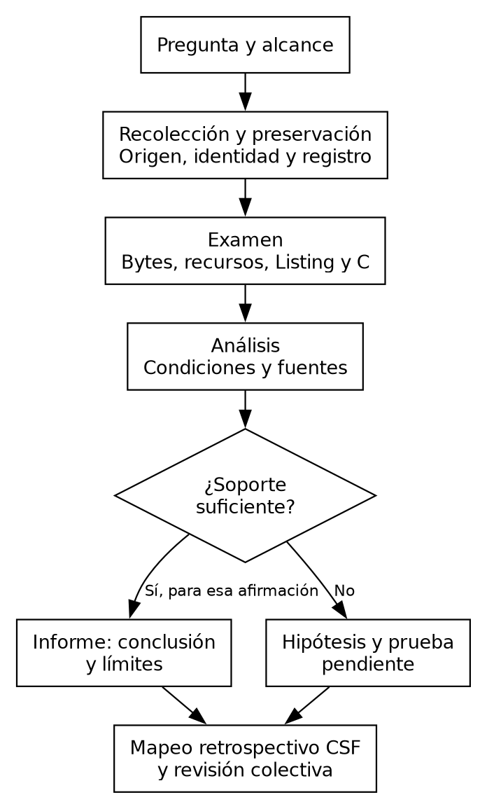
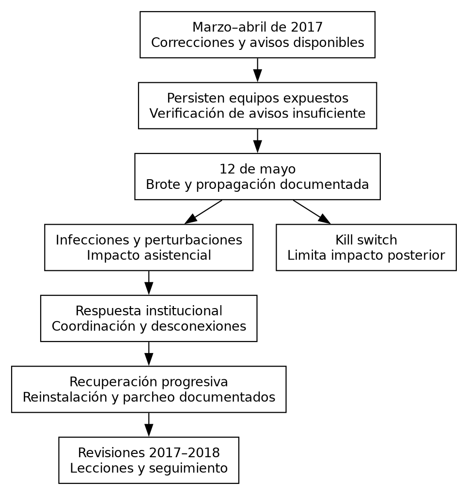
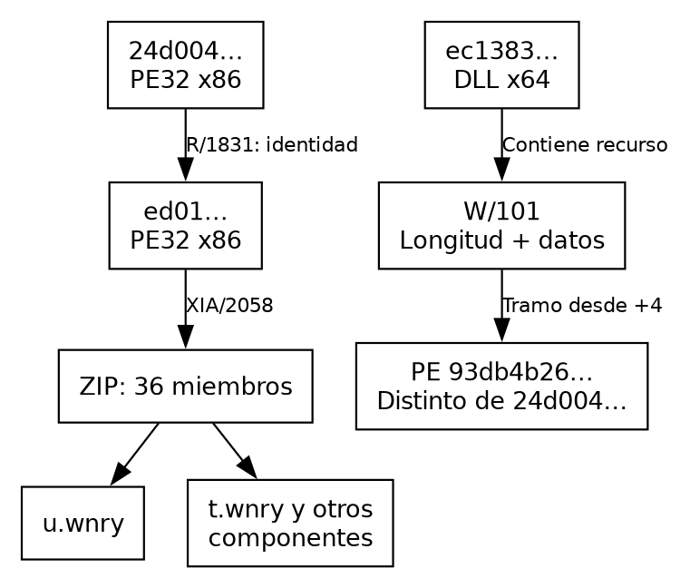

# Análisis forense documental, estático y de tráfico externo de WannaCry para explicar el caso NHS

## Resumen

El brote de WannaCry del 12 de mayo de 2017 afectó al NHS de Inglaterra mediante infecciones y perturbaciones de servicios, incluidas interrupciones preventivas. Este estudio integra fuentes institucionales, el examen estático de cuatro componentes identificados por SHA-256 y la revisión offline de un PCAP externo de laboratorio vinculado por hash a uno de esos componentes. Su objetivo es explicar la relación entre el funcionamiento del malware, la disponibilidad asistencial y las verificaciones que exige una investigación trazable.

La edición revisada del informe de la National Audit Office (NAO) registra al menos 80 de 236 trusts afectados: 34 con dispositivos bloqueados y 46 con perturbaciones. La documentación identifica 6.912 cancelaciones notificadas y una estimación de 19.494 consultas y operaciones canceladas; no son cantidades que deban sumarse. El análisis local confirma una relación de contención entre 24d004…, ed01… y el paquete que incluye u.wnry. ec1383… contiene otra carga, con hash diferente, y su incorporación a una misma cadena histórica permanece sin demostrar. [H1, resumen y figura 1; L1–L4]

NIST SP 800-86 estructura el procedimiento en recolección, examen, análisis e informe. NIST CSF 2.0 se utiliza retrospectivamente para relacionar hallazgos con resultados de gobierno, identificación, protección, detección, respuesta y recuperación. El resultado es un informe académico final dentro del alcance documental y estático. No acredita una adquisición de equipos originales del NHS, una detonación ni una evaluación exhaustiva de todo el programa.

**Palabras clave:** informática forense; WannaCry; NHS; Ghidra; análisis estático; NIST SP 800-86; NIST CSF 2.0.

## 1. Planteamiento, objetivos y alcance

### 1.1 Problema de investigación

La interrupción informática de una institución sanitaria puede impedir consultas, diagnósticos, derivaciones y coordinación clínica. Explicar WannaCry exige distinguir el mecanismo que puede comprometer un equipo del impacto que una organización realmente sufrió. Un hospital puede interrumpir servicios por infección, por desconexión preventiva o por dependencia de otra entidad. La investigación no debe representar esos casos como una única cadena idéntica. [H1, resumen 5–11]

La pregunta central es: **¿qué sucedió en el NHS, qué mecanismos se sostienen en el código local y qué evidencias permitirían comprobar los resultados de gestión y respuesta propuestos por NIST?** Se responde con dos escalas: la institucional histórica y la técnica del componente. Un vínculo entre ambas requiere evidencia adicional; compartir el nombre de una familia no basta.

### 1.2 Objetivo general y objetivos específicos

El objetivo general es reconstruir documentalmente el caso NHS y explicar mecanismos seleccionados de WannaCry mediante análisis estático trazable, con método NIST SP 800-86 y mapeo retrospectivo a CSF 2.0.

1. Conservar e identificar las fuentes, registrar su edición y distinguir su procedencia.
2. Reconstruir antecedentes, brote, afectación, contención y recuperación sin inventar eventos por hospital.
3. Interpretar cuatro componentes mediante recursos, hashes, referencias, desensamblado y pseudocódigo, explicando qué hace cada función seleccionada, cómo lo solicita y qué ocurre después.
4. Explicar qué comprueba cada observación y qué permanece sin demostrar.
5. Relacionar los hallazgos con resultados NIST y criterios de verificación, sin porcentajes de cumplimiento infundados.
6. Contrastar las siete capas OSI con los mecanismos observados, distinguiendo comunicaciones de operaciones locales, y entregar una parte práctica y guía de exposición para los ocho autores.

### 1.3 Delimitación temporal, geográfica y técnica

El objeto histórico principal es el NHS de **Inglaterra**, en mayo de 2017, con informes posteriores de 2017–2018. No se generalizan automáticamente las cifras a todo el Reino Unido. Esta revisión editorial del 21 de noviembre de 2026, hora de Bolivia, amplía el enfoque OSI y la explicación de funciones e incorpora un intento de apertura controlado en un clon aislado, bloqueado por Windows Defender antes de que se observara una ejecución efectiva. No hubo detonación ni nueva adquisición Ghidra.

El objeto técnico son tres archivos originales ya presentes y un componente derivado: 24d004…, ed01…, ec1383… y u.wnry. Se conservan 16 transcripciones seleccionadas de 1.755 funciones reconocidas por Ghidra. Ese denominador mide reconocimiento automático, no cobertura de análisis. Se utilizan exportaciones del 15 de noviembre; en esta edición no se realizó una nueva sesión de decompilación por MCP.

Quedan fuera del alcance una atribución criminal independiente, la identificación del paciente cero, el análisis de cada host hospitalario, la criptografía completa de t.wnry, la explotación de SMB y una detonación efectiva de ransomware. La práctica usa Windows 10 para ejercicios benignos y un intento de apertura bloqueado; no pretende reproducir exactamente un entorno clínico de 2017.

## 2. Marco metodológico NIST

### 2.1 Qué función cumple cada publicación

| Publicación | Aplicación en esta entrega | Límite |
|---|---|---|
| SP 800-86, 2006, capítulo 3 | Organizar recolección, examen, análisis e informe | Guía técnica; no certificación de admisibilidad ni protocolo exhaustivo |
| CSWP 29, CSF 2.0, 2024 | Mapear resultados de gestión del riesgo | Aplicación retrospectiva; no obligación atribuida al NHS de 2017 |
| SP 800-61 Rev. 3, 2025 | Integrar respuesta a incidentes y gestión del riesgo | Orientación posterior al incidente |
| IR 8374 Rev. 1, 2026 | Priorizar resultados pertinentes ante ransomware | Perfil comunitario; no prueba de implantación de controles |

Las seis funciones del CSF no reemplazan las cuatro fases del trabajo forense. Govern, Identify y Protect sostienen preparación y gestión; Detect, Respond y Recover permiten organizar resultados de respuesta, con mejora continua. No se interpretan como seis pasos rígidos que necesariamente se ejecutan una sola vez. [N1, §3; N2, §§2–3 y apéndice A; N3; N4]

El PDF antecedente también explica normas ISO. Esta entrega centra su metodología en las publicaciones NIST conservadas. No afirma haber aplicado integralmente ISO/IEC 27037 ni haber auditado los requisitos completos de las normas ISO mencionadas en el antecedente. Tampoco asigna Tiers ni madurez al NHS sin una evaluación organizacional suficiente.

### 2.2 Recolección y preservación

Se inventarían fuentes documentales, componentes, derivados y exportaciones. Se registran nombre, tamaño, hash, ubicación, relación padre-hijo y fecha de la actuación conocida. Los originales se preservan y las transformaciones analíticas se documentan por separado. El hash verifica consistencia del contenido frente a una referencia; no acredita quién obtuvo el archivo ni desde qué equipo.

La procedencia anterior de las muestras no está completamente documentada. No se completa retrospectivamente una cadena de custodia con personas, fechas o transferencias supuestas. Tampoco se denomina «adquisición del NHS» a la revisión de archivos locales. Los datos originales y sus registros permanecen fuera de Git; esta entrega publica conclusiones y transcripciones didácticas. [N1, §§3.1 y 4.2.2; L0]

### 2.3 Examen

El examen organiza y extrae información relevante: formato PE, arquitectura, recursos, cadenas, importaciones, referencias y funciones. Ghidra permite contrastar instrucciones con una representación semejante a C. El decompilado no recupera necesariamente tipos, variables, límites de función o convenios de llamada originales. Los nombres descriptivos añadidos por el analista no son descubrimientos del autor del malware.

El examen estático de un contenedor y el cálculo de sus hashes no requieren ejecutar sus componentes. Las comprobaciones automatizadas de esta edición cotejaron 49 archivos y 20 filas de la matriz NIST, además de 20 archivos editoriales y 16 transcripciones. El verificador no certifica causalidad, procedencia hospitalaria ni cumplimiento NIST. [L0–L5]

### 2.4 Análisis

El análisis transforma observaciones en conclusiones mediante una relación explícita: pregunta → dato → procedimiento → resultado → interpretación → límite. Se contrastan condiciones y retornos, se comparan hashes y se consultan fuentes históricas independientes. La presencia de una API acredita una referencia; el camino de llamadas explica una capacidad; los registros de ejecución y cambios de estado serían necesarios para demostrar un efecto real.

Las explicaciones alternativas forman parte del resultado. La ausencia de un evento puede deberse a que la acción no ocurrió, a retención insuficiente, a auditoría desactivada o a adquisición incompleta. Un resultado negativo solo adquiere significado después de describir qué fuente se examinó y qué podía conservar. [N1, §3.3]

### 2.5 Informe y revisión

El informe presenta objetivos, método, fuentes, observaciones, hipótesis, límites y propuestas. La revisión exige que otra persona pueda localizar la función, reconocer la condición y entender qué dato adicional modificaría la conclusión. La autoría es colectiva; no se inventan actas de revisión o firmas individuales. Los ocho autores deberán revisar y aceptar la entrega antes de presentarla como trabajo propio. [N1, §3.4]

La figura representa una adaptación docente de SP 800-86. Cuando una afirmación carece de soporte, se registra como pendiente y se redefine la pregunta. El mapeo CSF se aplica a resultados de gestión, no a las instrucciones del malware como si este implementara controles.

## 3. Fuentes, trazabilidad y valoración

### 3.1 Clases de afirmación

| Clase | Significado | Ejemplo de uso |
|---|---|---|
| H: histórica | Fuente institucional describe hechos de 2017 | Recuento revisado de trusts |
| T: técnica externa | Fuente técnica o PCAP de laboratorio de terceros | Comportamiento publicado o tráfico de una muestra identificada; no evidencia propia ni del NHS |
| L: local | Bytes, código o comprobación realmente examinados | Recurso R/1831 y rama del handle |
| I: inferencia | Interpretación compatible que requiere corroboración | Una restricción de salida pudo influir en una muestra |
| P: pendiente | Falta la evidencia necesaria | Creación real de proceso o restauración local |
| S: simulación | Dato ficticio producido para enseñanza | Ejercicio de decisión o archivo benigno |
| C: comunicado | Información proporcionada sin registro técnico verificable | Error 500 visto por el usuario en la página ANY.RUN |

La confianza se expresa respecto de una proposición concreta. Una identidad de contenido puede estar bien sustentada y su procedencia histórica seguir desconocida. «No evaluado» no significa «ausente»; «parcial» no es un porcentaje. Los ejemplos S nunca se integran en la cronología H.

### 3.2 Inventario resumido de fuentes

| Identificador | Material y localizador | Qué permite examinar |
|---|---|---|
| H1 | NAO, HC 414, revisión 25/04/2018 | Alcance, preparación, afectación y respuesta institucional |
| H2 | William Smart, febrero de 2018, §§2 y 4 | Respuesta, recuperación y lecciones |
| H3 | Parlamento, pregunta 181321, respuesta 23/10/2018 | Estimación económica posterior y sus límites |
| N1–N4 | Cuatro publicaciones NIST identificadas en referencias | Método y mapeo retrospectivo |
| L0 | Manifiestos y verificadores del repositorio | Integridad actual frente a referencias conservadas |
| L1–L4 | Cuatro componentes y exportaciones de 15/11/2026 | Relaciones de contenido y lógica seleccionada |
| L5 | Estado real de VirtualBox del 20/11/2026 | Preparación y aislamiento de la estación |
| T5 / L6 | PCAP de prueba externa de WannaCry revisado con TShark 4.7.4; identidad, hashes y filtros en `local/analisis-wireshark-20261121/ANALISIS.md` | Tráfico SMB observado en otro laboratorio; no tráfico del NHS ni de nuestra VM |
| A0 | INFORME_WANNA_CRY.pdf, 87 páginas | Antecedente académico aportado; no evidencia hospitalaria |

Los hashes completos están en `trazabilidad.json` y en la parte práctica. El antecedente se conserva con SHA-256 d2e04deb0e6974a597a808fa3747f01389c1b11c881b503dbc34382df2ab2459. Su página impresa 1 corresponde a la página 6 del archivo. La nueva edición no altera ese PDF ni hereda automáticamente cada una de sus afirmaciones.

### 3.3 Qué es WannaCry: familia de malware, ransomware y gusano

**WannaCry** (también escrito **WannaCrypt**, **WanaCrypt0r** o **WCry**) es el nombre usado para una familia/linaje de malware de Windows asociado al brote mundial de mayo de 2017. MITRE ATT&CK agrupa esos nombres como software relacionado bajo el identificador S0366; Microsoft también documentó esos alias. «Familia» no significa que todos los archivos tengan los mismos bytes o funciones: el SHA-256 identifica un ejemplar concreto, mientras el nombre agrupa muestras relacionadas por código, comportamiento e historia. [T1; T4]

La descripción más clara es **ransomware con capacidad de gusano**:

| Término | Qué significa aquí | Cómo se reconoce en el caso |
|---|---|---|
| Ransomware | Malware que cifra archivos o impide acceder a ellos para exigir un rescate | Componente de cifrado, extensiones/notas de rescate y demanda de pago descritos por fuentes técnicas. El análisis local no reconstruye por completo el cifrador |
| Gusano (worm) | Capacidad de propagarse automáticamente entre equipos por una red, sin requerir que una persona vuelva a abrir manualmente cada copia | WannaCry buscaba sistemas remotos y aprovechaba vulnerabilidades de SMBv1 relacionadas con MS17-010. La fuente histórica no permite identificar el paciente cero del NHS |
| Familia/linaje | Conjunto de muestras relacionadas, no un único hash ni una garantía de comportamiento idéntico | El ejemplar local 24d004… tiene SHA-256 completo en la parte práctica; la captura externa citada en [T5] atribuye ese mismo hash al binario de su laboratorio |

Por eso también se usa **ransomworm** como abreviatura descriptiva: combina el impacto de ransomware con propagación de tipo gusano. No quiere decir que cifrado y propagación sean una sola función. Microsoft describe componentes diferenciados de propagación y ransomware: un componente puede revisar la conexión del kill switch y preparar el servicio propagador; la carga de ransomware cifra datos, muestra el mensaje y puede obstaculizar recuperación. El flujo exacto varía por muestra y condiciones. [T1; T2; T3]

La distinción evita dos errores en la exposición. «Ransomware» explica qué le hace a los archivos de la víctima; «gusano» explica cómo puede alcanzar otros equipos. Una conexión TCP/445 o un paquete SMB no demuestra por sí solo que una vulnerabilidad fue explotada ni que un equipo quedó cifrado. La sección 5.3 de la parte práctica revisa una captura de laboratorio coincidente por hash, no una captura hospitalaria.

## 4. Reconstrucción del caso NHS, paso a paso

### 4.1 Situación previa y oportunidad de prevención

El NHS de Inglaterra comprendía organizaciones con responsabilidades tecnológicas distribuidas. Un trust es una entidad sanitaria, no una relación de confianza de Active Directory. La diversidad institucional impide asumir una única topología, inventario o política de copias para todos los centros. La dependencia de información y comunicaciones, en cambio, explica por qué una incidencia tecnológica podía repercutir en la asistencia. [H1, parte 1]

El 14 de marzo de 2017 Microsoft publicó MS17-010. NHS Digital difundió advertencias antes del brote. La NAO identificó que no existía un mecanismo formal para comprobar la aplicación local de esos avisos antes del 12 de mayo. Publicación, recepción, despliegue y verificación son hechos diferentes: un correo enviado no demuestra un equipo corregido. [H1, §§2.4–2.10; H2, nota 21]

La vulnerabilidad técnica debe separarse de las condiciones que permiten alcanzarla. SMB es un protocolo de aplicación; TCP 445 es el transporte habitual de SMB directo; MS17-010 es un boletín que reúne correcciones; EternalBlue denomina un mecanismo de explotación asociado. Esos conceptos no son sinónimos ni se demuestran todos mediante una constante 445 en un programa. [T1]

### 4.2 Entrada y propagación

WannaCry incorporó propagación mediante servicios SMB vulnerables. La revisión NHS considera probable una entrada por SMB expuesto; no identifica aquí un primer host universal. La NAO describe propagación por Internet, incluida la red N3, y no por NHSmail. No se adopta phishing como explicación establecida de todas las infecciones ni se inventan direcciones IP hospitalarias. [H2, §2.3; H1, resumen 12]

Un sistema alcanzable y vulnerable puede ser comprometido, y un componente propagador puede buscar otros equipos. Esa explicación de capacidad no constituye una línea temporal medida. Para construir la cadena de un hospital harían falta conexiones, archivos, procesos y eventos con relojes normalizados y procedencia acreditada. Las cuatro muestras locales permiten estudiar mecanismos, pero no sustituyen esos registros.

La mayoría de dispositivos infectados identificados utilizaba Windows 7 soportado pero sin las actualizaciones pertinentes; Windows XP representaba una minoría. Por ello, «todo ocurrió por XP» es una explicación incorrecta. La condición relevante es la combinación de plataforma, actualización, accesibilidad y actividad, no solo la antigüedad del sistema. [H1, resumen 12 y §2.5]

### 4.3 Instalación y activación de componentes

El componente local 24d004… contiene una comprobación de resultado de InternetOpenUrlA, rutinas que solicitan un servicio y un recurso que coincide con ed01…. Este segundo archivo contiene un paquete ZIP y una ruta condicionada hacia el procesamiento de t.wnry y una llamada indirecta. Son observaciones estáticas. No prueban que un servicio arrancara o que la carga se ejecutara en el NHS. [L1–L2]

La publicación original de Microsoft describe una arquitectura con componente propagador y componente de ransomware, y documenta la solicitud de rescate y artefactos asociados. Esa descripción técnica es contexto de la familia; los capítulos prácticos identifican por separado qué aspectos están respaldados por nuestros propios bytes y funciones. [T1]

### 4.4 Cifrado, presión de pago y recuperación obstaculizada

El análisis original de FireEye describe cifrado híbrido con AES-128 para datos y RSA-2048 para material de claves, junto con una interfaz de rescate. Se emplea aquí para explicar la pérdida de disponibilidad documentada, sin afirmar que se haya reconstruido localmente todo el cifrador. Cambiar una extensión o borrar el ejecutable no revierte el cifrado. La contraseña de un paquete ZIP tampoco constituye una clave de recuperación de documentos. [T2]

En u.wnry se observan referencias a una cadena de operaciones contra mecanismos de recuperación y auxiliares de consulta de token y solicitud de proceso. El análisis respalda una capacidad potencial de obstaculización; no demuestra que desaparecieran copias de respaldo en un hospital. Ese efecto necesitaría comparar registros de ejecución y estado anterior/posterior de los mecanismos afectados. [L3]

No se reconstruye un orden universal entre todas las acciones de cifrado, interfaz y comandos: pueden intervenir condiciones y concurrencia. El flujo general explica responsabilidades de componentes, mientras los diagramas prácticos respetan las ramas seleccionadas. «Hasta el final» significa seguir la explicación desde la exposición hasta la recuperación institucional, indicando dónde termina la comprobación local.

### 4.5 Detección del brote y afectación asistencial

El 12 de mayo se recibieron reportes de trusts afectados y NHS England activó la coordinación de emergencia. Algunos centros tuvieron dispositivos bloqueados; otros interrumpieron servicios o conexiones preventivamente. Hubo cancelaciones, trabajo manual y desvíos de pacientes. La clasificación debe conservar la diferencia entre infección, contacto con un indicador e interrupción. [H1, resumen 5–11; H2, §§2.5–2.10]

| Indicador | Dato adoptado | Interpretación y fuente |
|---|---|---|
| Trusts afectados | Al menos 80 de 236 | Edición revisada de H1 |
| Dispositivos bloqueados por trust | 34 trusts | No equivale a 34 equipos |
| Trusts con perturbaciones | 46 | Categoría distinta de dispositivos bloqueados |
| Otras organizaciones infectadas | 603, incluidas 595 consultas GP | No sumar 595 otra vez |
| Citas notificadas canceladas | 6.912 | Registros identificados |
| Citas y operaciones estimadas | 19.494 | Estimación total; no sumar al dato notificado |
| Urgencias que desviaron pacientes | 5 departamentos | Sin total completo de pacientes desviados |
| Costo estimado posteriormente | £92 millones | Estimación DHSC de 2018, no contabilidad exacta de mayo |

H1, resumen y parte 1, sustenta las siete primeras filas. H3 sustenta la última: la respuesta parlamentaria diferencia la estimación para el NHS del costo total para el erario y describe el uso de factores y categorías de gasto. La cifra no se atribuye al informe NAO como un total conocido durante el brote.

El resumen web original y otras publicaciones utilizaron 81 trusts. Este informe adopta los 80 del PDF revisado, conservando edición y categorías. Los 21 trusts adicionales con contactos al dominio no se suman como infecciones confirmadas: pueden incluir actividad posterior al kill switch o de seguridad. [H1, resumen y figura 1; H2, nota 3]

### 4.6 Contención y efecto del kill switch

La activación del dominio del kill switch limitó el impacto posterior de las variantes correspondientes. En la función local 00408140, la decisión concreta compara un handle con cero: si es NULL llama a 00408090; si no lo es, evita esa llamada. No se observa una comparación explícita con el código HTTP 200. El resultado final de la función es cero en ambas rutas. [H1, resumen 8; H2, §2.4; L1]

El kill switch no instala parches, no limpia los equipos ni descifra documentos afectados. Las desconexiones y otras decisiones institucionales son acciones defensivas diferentes. En un entorno sanitario, su evaluación debe contemplar la continuidad clínica y la conservación de evidencias, sin convertir una recomendación general en una orden aplicada a todos los hospitales. [H1, resumen 9–11]

### 4.7 Recuperación y cierre histórico

Durante los días siguientes se coordinaron reinstalación, actualización y recuperación de servicios. La revisión de William Smart indica que el 95 % de las consultas GP infectadas tenía los sistemas reinstalados y parcheados al 17 de mayo, y las restantes al 19 de mayo. Este porcentaje tiene ese alcance y no representa la recuperación de todos los hospitales. La documentación registra dificultades de comunicación y la importancia de canales alternativos. [H2, §§2.10–2.16]

La recuperación institucional requiere disponibilidad técnica y aceptación funcional. Un sistema que enciende puede seguir sin ofrecer consultas, resultados o citas correctamente. Conciliar registros manuales, comprobar datos y comunicar limitaciones forma parte del retorno al servicio. La práctica local verificó la restauración de un texto ficticio; no se verificaron aplicaciones clínicas ni recuperación frente a ransomware. [N2, RC.RP y RC.CO]

NHS Digital comunicó que creía que no se habían comprometido o robado datos de pacientes. Se conserva como declaración de la fuente, sin presentarla como prueba propia de ausencia absoluta de exfiltración. La investigación no identifica víctimas clínicas individuales ni daños no documentados. [H1, resumen 5]

## 5. Síntesis técnica de los cuatro componentes

### 5.1 Relaciones comprobadas

R/1831 significa recurso de tipo R e identificador 1831. El recurso de 24d004… tiene 3.514.368 bytes y coincide con ed01…. XIA/2058 es el recurso de ed01… que contiene el ZIP de 36 miembros, entre ellos u.wnry. W/101 es el recurso de ec1383…: sus primeros cuatro bytes declaran una longitud y el PE comienza en el desplazamiento +4. Su hash es 93db4b26…, diferente del de 24d004…. [L1–L4]

Los cuatro objetos sirven para estudiar mecanismos relacionados, pero no son cuatro copias del mismo archivo. Tampoco forman automáticamente una cadena lineal. La relación de ec1383… con un proceso de infección histórico concreto sigue pendiente. La coincidencia de nombres de destino no sustituye una comparación de contenido ni una prueba de ejecución.

### 5.2 Hallazgos y límites principales

| Hallazgo | Conclusión sustentada | Conclusión que no se sostiene |
|---|---|---|
| Kill switch, 00408140 | Decisión según handle NULL/no NULL | Que ANY.RUN o un hospital recibió un HTTP determinado |
| Servicio, 00407c40 | Solicitud de creación y posible inicio | Servicio instalado o iniciado efectivamente |
| Paquete, 00401dab | Acceso al recurso y bucle de miembros | Éxito de escritura de todos los archivos |
| t.wnry, 004014a6 | Cabecera, lecturas y transformaciones condicionadas | Algoritmo y carga final íntegramente reconstruidos |
| u.wnry, Listing y auxiliares | Referencias y caminos de solicitud de proceso | Elevación concedida o respaldos eliminados |
| W/101, 180001014 | Copia desde +4 por longitud declarada | Descifrado en esa rutina o escritura garantizada |

Los capítulos prácticos detallan entradas, condiciones, llamadas, retornos, evidencia faltante y criterios de ampliación. El valor del análisis reside en esa precisión, no en multiplicar funciones listadas sin interpretarlas.

### 5.3 Error 500 de ANY.RUN

El usuario aclaró que el error apareció en la **página de ANY.RUN**. No aportó un informe accesible con hash de tarea, procesos y tiempos. Se registra como información comunicada. No permite decidir si el análisis comenzó, si falló al mostrarse o si hubo actividad de la muestra. Tampoco demuestra que el kill switch detuviera ec1383… ni invalida la revisión estática, que se apoya en otra fuente.

### 5.4 Cómo explicar el mecanismo mediante OSI y operaciones locales

La explicación técnica sigue **entrada → condición → API y recurso → efecto solicitado → continuación → evidencia**. OSI organiza responsabilidades de comunicación; no es una secuencia de infección ni exige que cada función del malware corresponda a una capa. La parte práctica desarrolla la comparación de las siete capas en la sección 4, el catálogo de las 16 funciones en la sección 10 y el guion de defensa en la sección 13.

| Vista | Mecanismo y soporte | Límite que se debe explicar |
|---|---|---|
| Aplicación de red | URL HTTP y WinINet en 00408140; SMBv1 en las fuentes técnicas de 2017 | La condición local comprueba un handle; no un estado HTTP 200 |
| Transporte y red | Constante 445 y WS2_32 en 00407480; TCP/IP como soporte conceptual | El puerto no demuestra mensajes SMB, explotación ni una dirección atacada |
| Presentación y sesión | Categorías del modelo de referencia | No se identificó aquí un mecanismo específico; cifrar documentos en disco no equivale a capa 6 |
| Enlace y física | Infraestructura necesaria para comunicar equipos | No hay captura, MAC, topología hospitalaria ni modificación de hardware demostradas |
| Trabajo local del proceso | Recursos PE, archivos, memoria, servicios, token y procesos | Se comprueban solicitudes y condiciones; sus efectos requieren artefactos del sistema |

Esta aplicación del modelo es interpretativa. X.200 define la arquitectura conceptual; Microsoft asigna TCP/445 al transporte directo de SMB y MS17-010 describe fallos del procesamiento de solicitudes SMBv1. Las capas inferiores transportan datos hacia el servicio; no se presentan como siete vulnerabilidades explotadas. [OSI1; RED1; RED2]

La cadena local de contenido conecta R/1831 con ed01… y XIA/2058 con miembros como u.wnry. ec1383… aporta otra extracción y solicitud de proceso. Ninguna flecha de contención prueba ejecución ni procedencia hospitalaria. El consumo de CPU/RAM tampoco se calcula sumando tamaños de recursos: no existe medición dinámica del malware en esta práctica. La reconstrucción del impacto NHS continúa sustentada en fuentes históricas, con esa frontera explícita.

## 6. Mapeo retrospectivo a NIST CSF 2.0

### 6.1 Criterio de mapeo

Se seleccionan 20 resultados del Core. Para cada uno se distinguen hecho histórico, soporte local y prueba necesaria. Los códigos se cotejaron con la publicación conservada. Una correspondencia temática no equivale a control implantado; la evidencia insuficiente queda como pendiente o no evaluada. La matriz íntegra de trabajo está en `matriz_nist_entrega.csv`, derivada de la matriz previa con responsabilidades colectivas y sin etiquetas de participantes. [N2, apéndice A]

### 6.2 Gobernar e identificar

| Resultado | Relación con el caso | Comprobación necesaria |
|---|---|---|
| GV.OV-01 | Seguimiento de advertencias y estrategia | Registro de avisos, responsables, excepciones y cierre verificado |
| GV.RR-02 | Coordinación y autoridad de respuesta | Roles, sustituciones y canales alternativos comprobados |
| ID.AM-01 | Equipos y dependencias asistenciales | Inventario real con propietario, servicio y criticidad |
| ID.RA-01 | Vulnerabilidades y exposición | Versión, estado de actualización, servicio y accesibilidad |
| ID.IM-03 | Mejoras derivadas de actividades | Hallazgo, acción, responsable y criterio de cierre |

H1 §2.10 respalda la pregunta de supervisión; H2 §§2 y 4 aporta coordinación y lecciones. El inventario de muestras de este laboratorio no evalúa el inventario clínico del NHS. No se calcula probabilidad numérica de todos los riesgos sin datos locales.

### 6.3 Proteger y detectar

| Resultado | Relación con el caso | Comprobación necesaria |
|---|---|---|
| PR.PS-02 | Software actualizado, sustituido o retirado | Instalación efectiva de correcciones y gestión de excepciones |
| PR.IR-01 | Restricción de accesos de red | Reglas, caminos autorizados y prueba del aislamiento pertinente |
| PR.DS-11 | Respaldo mantenido y probado | Copia protegida, legible y restauración documentada |
| DE.CM-01 | Actividad de red | Registros de comunicaciones con tiempo y host |
| DE.CM-09 | Ejecución y cambios del sistema | Registros de procesos, servicios y archivos |
| DE.AE-03 | Correlación de varias fuentes | Concordancia de host, tiempo, proceso y artefactos |

La VM aislada comprueba una medida del laboratorio; no prueba segmentación hospitalaria en 2017. Las APIs orientan qué buscar, pero no son EVTX o PCAP. La cadena contra recuperación hace pertinente PR.DS-11 sin demostrar pérdida de todas las copias del NHS. [H1, resumen 12; L1–L5; N4]

### 6.4 Responder y recuperar

| Resultado | Relación con el caso | Comprobación necesaria |
|---|---|---|
| RS.AN-03 | Explicar qué ocurrió y su causa | Secuencia contrastada; alternativas y límites |
| RS.AN-06 | Actuaciones de investigación | Bitácora real, integridad y procedencia de registros |
| RS.AN-07 | Datos y metadatos del incidente | Identidad, origen, hashes, preservación y transformaciones |
| RS.AN-08 | Magnitud del incidente | Edición, denominadores, infección frente a perturbación |
| RS.MI-01 | Contención | Decisiones, alcance y efecto observado |
| RC.RP-01 | Ejecución de recuperación | Plan activado y registro de actuaciones |
| RC.RP-03 | Respaldo antes de usarlo | Integridad, legibilidad y aptitud |
| RC.RP-05 | Activos después de restaurar | Integridad y funcionamiento aceptado |
| RC.CO-03 | Comunicación de recuperación | Destinatarios, canal, contenido y constancia real de envío |

RC.CO-03 trata la comunicación de recuperación; las lecciones se vinculan aquí con ID.IM-03. Analizar memoria no equivale a contener. Un hash coincidente no demuestra que un respaldo esté libre de contaminación. La procedencia desconocida de una muestra no se repara al publicar un informe. [N2; N3; N4]

## 7. Propuestas de mejora y criterios de cierre

Las propuestas siguientes derivan del análisis; no se presentan como controles ausentes en todas las entidades del NHS ni como acciones implantadas por este equipo.

| Prioridad académica | Acción | Criterio verificable de cierre |
|---|---|---|
| Primera | Vincular cada alerta a activos y responsables | Evidencia de corrección o excepción aprobada y revisada |
| Primera | Reducir exposición de servicios innecesarios | Reglas contrastadas con necesidades y prueba autorizada |
| Primera | Mantener copias protegidas | Restauración benigna con integridad y lectura comprobadas |
| Segunda | Preparar coordinación y canales alternativos | Ejercicio de mesa registrado, con decisiones y mejoras |
| Segunda | Correlacionar registros de ejecución | Consulta validada sobre datos conocidos y falsos positivos descritos |
| Continua | Revisar dependencias clínicas | Aceptación funcional y conciliación de datos de contingencia |

RTO designa el plazo objetivo de recuperación; RPO, el punto temporal de datos que se busca recuperar. Deben definirse con responsables del servicio y análisis de impacto. Este informe no atribuye objetivos numéricos ficticios al NHS ni garantiza que una VM pueda validar continuidad clínica.

## 8. Limitaciones, discusión y conclusiones

### 8.1 Limitaciones que afectan las conclusiones

No se dispone de discos, memoria, registros de eventos ni tráfico originales de los hospitales. Se revisó con TShark 4.7.4 una captura externa de laboratorio; esta no reemplaza tráfico NHS ni una captura propia. Las muestras locales tienen identidades verificadas, pero su adquisición previa no está completamente acreditada. El análisis de 16 funciones no cubre todos los caminos, y el bloque principal de interés de u.wnry no dispone de decompilación completa. t.wnry conserva una frontera analítica sin resolver. El puente MCP no estaba activo durante esta edición; las conclusiones técnicas se apoyan en resultados preservados y cotejados.

La VM vacía preparada inicialmente se conserva. Durante esta edición el usuario autorizó una copia aislada de su Windows 10 existente: se comprobó el escritorio y winver, que mostró Windows 10 Pro 1903, compilación 18362.356. Es un sistema previamente instalado, no una instalación nueva del equipo. Las herramientas descargadas no se declaran validadas en ese invitado. Se ejecutó una práctica benigna de integridad, restauración de un texto ficticio y observación de Bloc de notas. No se realizó captura de RAM, restauración clínica, explotación ni detonación. La parte práctica registra los resultados y el desfase observado entre los relojes del invitado y del anfitrión.

### 8.2 Respuesta a los objetivos

La reconstrucción documental permite explicar una exposición conocida, un brote de propagación automática, afectación directa e indirecta, coordinación de emergencia y recuperación progresiva. Las cifras se conservan con edición y denominador. La explicación supera la idea de que todo dependió de Windows XP o de un único hospital inicial identificado. La captura de laboratorio coincidente por hash muestra tráfico SMB asociado a la propagación de ese ejemplar, sin atribuirlo al NHS.

El análisis técnico confirma relaciones de contenido y decisiones del código. 24d004… permite estudiar la condición del kill switch, la solicitud de servicio y R/1831; ed01… permite estudiar el paquete y las condiciones hacia la carga; u.wnry conecta datos con auxiliares de privilegios y procesos; ec1383… explica extracción y lanzamiento solicitado mediante W/101. Los retornos de estas rutinas no demuestran por sí solos resultados externos.

NIST aporta un método para conservar, examinar, razonar e informar, y un lenguaje para plantear verificaciones organizacionales. No produce evidencia que falte ni convierte el caso en una certificación. La conclusión defendible es una reconstrucción documental acompañada de análisis estático verificable, con una separación explícita entre capacidades, acontecimientos y propuestas.

### 8.3 Cierre de la entrega

Esta edición entrega el informe general y una parte práctica completa para el alcance declarado. Los pendientes de adquisición, validación de herramientas, cobertura de funciones y revisión humana se conservan abiertos. Una ampliación deberá identificar nuevas fuentes, fechas y resultados, sin reescribir retrospectivamente lo que se sabía en esta edición.

## Referencias

[OSI1] Unión Internacional de Telecomunicaciones. (1994). *X.200: Modelo de referencia básico de interconexión de sistemas abiertos*. Cláusulas 6–7. [Ficha oficial, con PDF en español](https://www.itu.int/rec/T-REC-X.200-199407-I/en). Consulta: 21/11/2026.

[RED1] Microsoft. (2025, 7 de abril). *[MS-SMB], 1.9 Standards Assignments*. [Especificación de TCP/445](https://learn.microsoft.com/en-us/openspecs/windows_protocols/ms-smb/acc6e3bd-3aba-42be-b15f-99397399ab51). Consulta: 21/11/2026.

[RED2] Microsoft. (2017, 14 de marzo). *Microsoft Security Bulletin MS17-010*. [Boletín oficial](https://learn.microsoft.com/en-us/security-updates/securitybulletins/2017/ms17-010). Consulta: 21/11/2026.

[H1] National Audit Office. (2018, 25 de abril). *Investigation: WannaCry cyber attack and the NHS* (HC 414; revisión del informe de 2017). [PDF institucional](https://www.nao.org.uk/wp-content/uploads/2017/10/Investigation-WannaCry-cyber-attack-and-the-NHS.pdf). Copia preservada: `fuentes/NAO-WannaCry-NHS.pdf`.

[H2] Smart, W. (2018, febrero). *Lessons learned review of the WannaCry ransomware cyber attack*. Department of Health and Social Care. [PDF institucional](https://www.england.nhs.uk/aac/wp-content/uploads/2018/02/lessons-learned-review-wannacry-ransomware-cyber-attack-cio-review.pdf). Copia: `fuentes/NHS-lessons-learned-2018.pdf`.

[H3] UK Parliament. (2018, 23 de octubre). *Respuesta a la pregunta escrita 181321: costo del incidente WannaCry*. [Respuesta parlamentaria](https://questions-statements.parliament.uk/written-questions/detail/2018-10-18/181321). Consulta: 20/11/2026, hora de Bolivia.

[N1] Kent, K., Chevalier, S., Grance, T., y Dang, H. (2006). *Guide to integrating forensic techniques into incident response* (NIST SP 800-86). [DOI](https://doi.org/10.6028/NIST.SP.800-86).

[N2] National Institute of Standards and Technology. (2024). *The NIST Cybersecurity Framework (CSF) 2.0* (NIST CSWP 29). [DOI](https://doi.org/10.6028/NIST.CSWP.29).

[N3] Nelson, A., Rekhi, S., Souppaya, M., y Scarfone, K. (2025). *Incident response recommendations and considerations for cybersecurity risk management: A CSF 2.0 community profile* (NIST SP 800-61 Rev. 3). [DOI](https://doi.org/10.6028/NIST.SP.800-61r3).

[N4] Souppaya, M., Barker, W. C., Fisher, W., y Kent, K. (2026). *Ransomware risk management: A CSF 2.0 community profile* (NIST IR 8374 Rev. 1). [DOI](https://doi.org/10.6028/NIST.IR.8374r1).

[T1] Microsoft Defender Security Research Team. (2017, 12 de mayo). *WannaCrypt ransomware worm targets out-of-date systems*. [Investigación original](https://www.microsoft.com/en-us/security/blog/2017/05/12/wannacrypt-ransomware-worm-targets-out-of-date-systems/). Contexto histórico, no resultado de ejecución local.

[T2] Berry, A., Homan, J., y Eitzman, R. (2017, 23 de mayo). *WannaCry malware profile*. FireEye; conservado por Mandiant/Google Cloud. [Investigación original](https://cloud.google.com/blog/topics/threat-intelligence/wannacry-malware-profile). Contexto de cifrado y componentes; sin reproducción de su código operativo.

[T3] National Cybersecurity and Communications Integration Center (NCCIC), U.S. Department of Homeland Security. (2017). *WannaCry ransomware* [fact sheet]. [CISA, PDF](https://www.cisa.gov/sites/default/files/FactSheets/NCCIC%20ICS_FactSheet_WannaCry_Ransomware_S508C.pdf). Describe ransomware con componente de gusano y explotación de SMBv1.

[T4] MITRE ATT&CK. (s. f.). *WannaCry, S0366*. [Registro de software y nombres asociados](https://attack.mitre.org/software/S0366/). Consulta: 21/11/2026.

[T5] Szili, D. (2017, 18 de mayo). *PCAP of WannaCry spreading using EternalBlue* [captura enviada desde entorno de prueba]. En B. Duncan, Malware-Traffic-Analysis.net. [Entrada y metadatos del PCAP](https://www.malware-traffic-analysis.net/2017/05/18/index2.html). El sitio identifica el ejemplar por SHA-256 `24d004a104d4d54034dbcffc2a4b19a11f39008a575aa614ea04703480b1022c`; PCAP completo y hashes en el expediente local. No representa tráfico del NHS.

[L0–L6] Proyecto académico. (2026, 15 y 21 de noviembre). *Manifiestos, exportaciones estáticas, revisión de PCAP externo y verificaciones locales*. Referencias exactas y hashes en `trazabilidad.json` y en el expediente de Wireshark local; muestras, PCAP y registros originales excluidos de Git. Documentación de consulta: `docs/analisis-ghidra-codigo.md`, `docs/guia-capas-decompilado-desensamblado.md`, `docs/verificacion.md` y `local/analisis-wireshark-20261121/ANALISIS.md`.

[A0] Autores consignados en la portada. (2026). *Análisis forense digital del ataque de ransomware WannaCry contra el Servicio Nacional de Salud del Reino Unido (NHS)*. Informe académico aportado de 87 páginas, conservado sin modificación. Revisión editorial en `revision_antecedente.md`.
