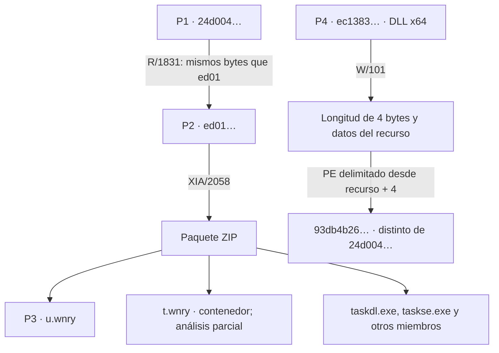
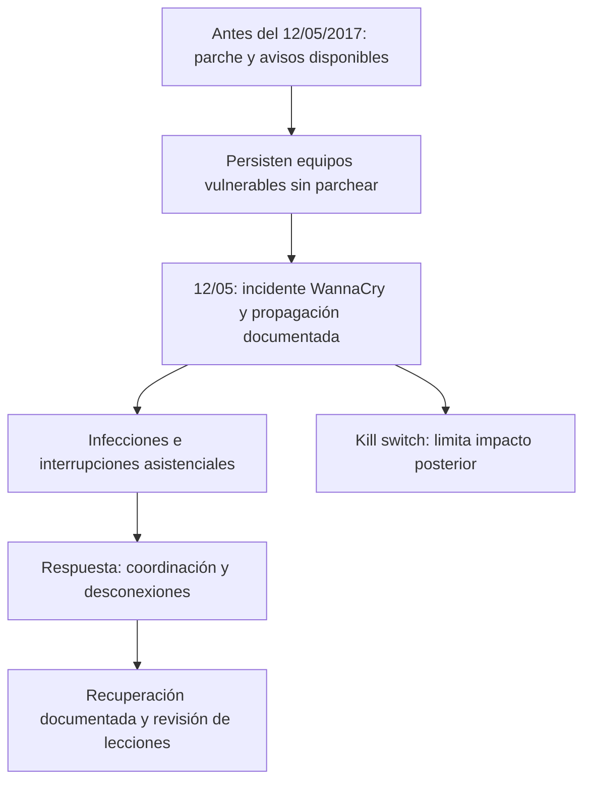
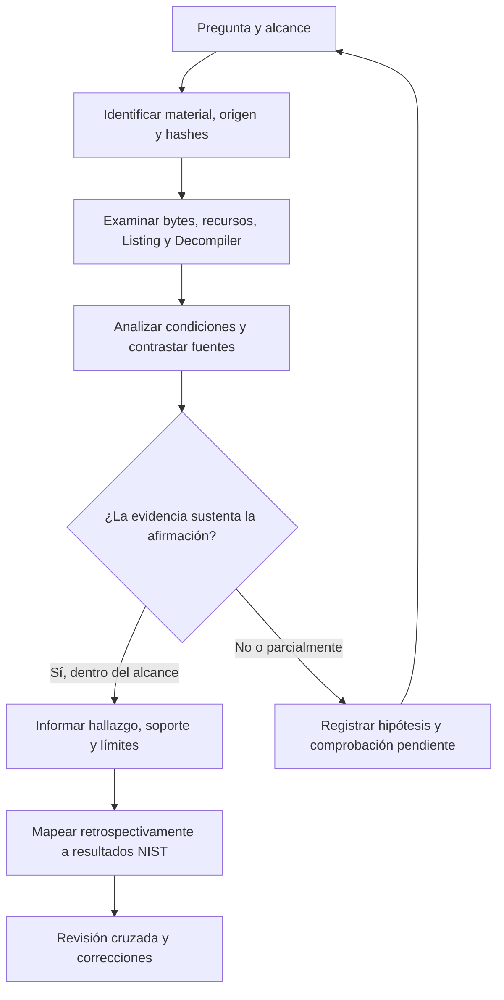
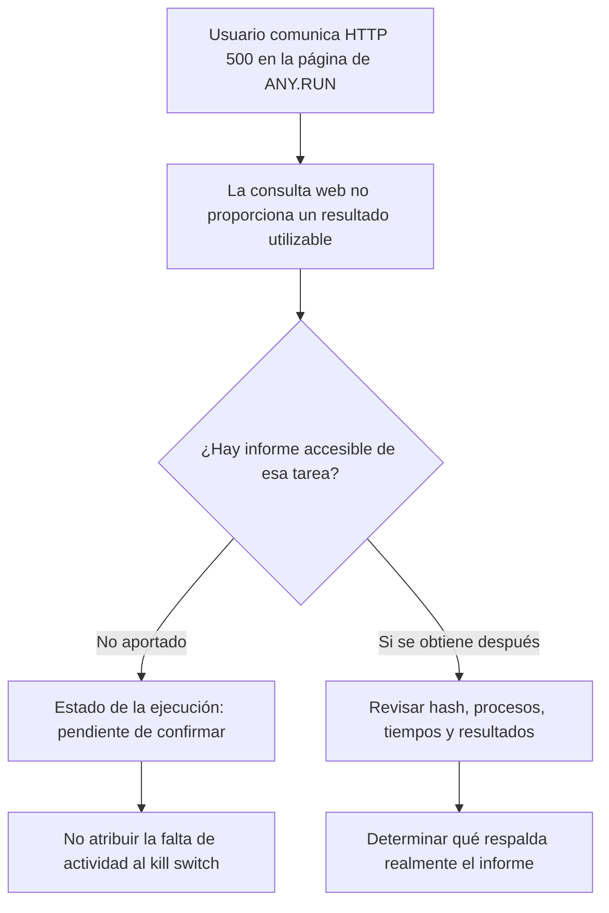

# Diagramas y análisis general: componentes, NHS y evidencia

[Equipo](README.md) · [Alcance de las 16 funciones](ALCANCE-Y-AMPLIACION.md) · [Informe](../docs/informe-forense.md)

Estos diagramas explican **rutas seleccionadas del código examinado**, no una
ejecución registrada ni todas las funciones de WannaCry. Se basan en las
transcripciones y en los contrastes de Listing enlazados. No se ejecutaron muestras
para dibujarlos. Fecha de elaboración: 15/11/2026.

## Cómo leerlos

- Un rectángulo representa una operación o un grupo de operaciones descrito.
- Un rombo representa una condición; sigue la etiqueta de cada salida.
- Una salida «retorno 0/1» pertenece a esa función: no significa automáticamente
  «ataque fallido/exitoso».
- Una flecha significa lo indicado por el título: **contenido**, **flujo del
  código**, **secuencia histórica** o **procedimiento de análisis**. No intercambiar
  esos significados.
- Los diagramas omiten inicializaciones repetitivas y agrupan algunos controles;
  las notas indican esos límites. Los cuadernos de código conservan el detalle.

En GitHub abre la vista Preview. Los bloques están en
[Mermaid](https://mermaid.js.org/syntax/flowchart.html). En un editor que no los
renderice se verá su texto; utiliza GitHub para leerlos visualmente. No necesitas
Windows, muestras ni ejecutar código para verlos.

| Recorrido | Diagramas | Código de referencia |
|---|---|---|
| [P1: 24d004…](p1-24d004/diagramas.md) | Decisión inicial, servicio, recurso R/1831 | [6 funciones](p1-24d004/codigo.md) |
| [P2: ed01…](p2-ed01/diagramas.md) | Paquete, preparación, transición desde t.wnry | [4 funciones](p2-ed01/codigo.md) |
| [P3: u.wnry](p3-u-wnry/diagramas.md) | Consulta de token y rutas; proceso y espera | [3 funciones](p3-u-wnry/codigo.md) |
| [P4: ec1383…](p4-ec1383/diagramas.md) | PlayGame, W/101, solicitud de proceso | [3 funciones](p4-ec1383/codigo.md) |

## 1. Mapa general de contenido comprobado

**Las flechas de este diagrama significan contención/extracción estática, no
orden de ejecución ni propagación de un hospital a otro.**

R/1831, XIA/2058 y W/101 son **tipo e identificador de recurso**. No son carpetas
ni números de puerto. Los hashes y límites se detallan en el
[análisis estático](../docs/analisis-ghidra-codigo.md). No dibujamos una conexión
ec1383 → 24d004: esa identidad no existe y su participación en una misma cadena
de infección concreta no está demostrada.

## 2. Qué explica cada componente y qué falta

| Componente | Conclusión estática sustentada | No permite afirmar por sí solo |
|---|---|---|
| 24d004… | Una comprobación de handle selecciona una ruta; existen solicitudes de servicio y acceso a R/1831 | Que una respuesta HTTP concreta llegó a un hospital o que se ejecutó toda la propagación |
| ed01… | Se accede al paquete y hay un camino condicionado de procesamiento/llamada indirecta | Que reconstruimos todo el cifrador o que cada orden externa terminó |
| u.wnry | La cadena tiene referencias a un bloque con auxiliares de token y ejecución | Que se concedieron privilegios o se borraron copias de un equipo |
| ec1383… | PlayGame prepara la ruta y llama a extracción y creación de proceso | Que se invocó esa exportación, que escribió correctamente o que la muestra procede del NHS |

La conclusión conjunta es que las muestras contienen **componentes y decisiones
compatibles con mecanismos descritos en el caso**, con relaciones de contenido
comprobadas. No constituyen una reconstrucción del incidente de un hospital.
Faltan artefactos de ese host y procedencia histórica de las muestras.

Hay tres distinciones que deben aparecer en la exposición: **contener no es
ejecutar; solicitar una operación no es completarla; y observar una capacidad
en código no demuestra su efecto histórico**. El código orienta qué buscar en
registros, procesos y archivos; no reemplaza esas evidencias.

## 3. Secuencia histórica del NHS, separada del código local

El diagrama resume la secuencia documentada, no un árbol de procesos de nuestras
muestras. El kill switch y la respuesta son hechos diferentes; no se atribuye
al kill switch la recuperación de documentos ya afectados.

Fuentes: [NAO, resumen y §§2.4–2.10](../fuentes/NAO-WannaCry-NHS.pdf) y
[NHS, §§2.3–2.16](../fuentes/NHS-lessons-learned-2018.pdf), con localizadores
detallados en [informe, sección 4](../docs/informe-forense.md#4-reconstrucción-de-lo-ocurrido).
La entrada por SMB expuesto se presenta como **probable** en la revisión NHS;
no se identifica aquí un paciente cero. Distinguir organizaciones infectadas
de organizaciones que sufrieron interrupciones.

## 4. Procedimiento forense y mapeo NIST

[SP 800-86, capítulo 3](../fuentes/NIST.SP.800-86.pdf) organiza el método forense;
el [CSF 2.0](../fuentes/NIST.CSWP.29.pdf) se usa retrospectivamente para formular
preguntas de gestión. Este flujo es una adaptación docente, no una secuencia
obligatoria de funciones del CSF ni una certificación.

| Función CSF | Pregunta para el caso | Qué aporta este trabajo |
|---|---|---|
| Govern | ¿Quién debía verificar avisos y decidir la respuesta? | Contraste documental y reparto de responsabilidades |
| Identify | ¿Qué activos y vulnerabilidades estaban implicados? | Preguntas de inventario; un hash de malware no inventaría hospitales |
| Protect | ¿Cómo se protegían software, redes y respaldos? | Mecanismos relevantes y criterios; sin evaluación completa del NHS |
| Detect | ¿Qué registros confirmarían servicio, proceso o tráfico? | Pistas desde el código; no EVTX/PCAP adquiridos |
| Respond | ¿Qué sucedió y con qué evidencia se sostiene? | Hallazgos estáticos trazables y límites de causalidad |
| Recover | ¿Los respaldos y la operación restaurada se comprobaron? | Criterios propuestos; no restauración clínica demostrada |

Los códigos y estados concretos permanecen en [matriz-nist.csv](../docs/matriz-nist.csv).

## 5. El error 500 de ANY.RUN

**Información comunicada por el usuario:** el error 500 apareció en la página
de ANY.RUN. No se aportó un informe accesible que permita confirmar qué ocurrió
en su entorno de análisis. Este es un dato comunicado, no una observación de
tráfico del malware realizada por este equipo.

HTTP 500 describe un error del servidor al atender una petición,
según [RFC 9110 §15.6.1](https://www.rfc-editor.org/rfc/rfc9110.html#section-15.6.1).
No determina si la tarea comenzó, terminó o solo falló al mostrarse. No se dibuja
una flecha desde el error web hacia el flujo de ec1383: no hay causalidad comprobada.
El error tampoco invalida los hallazgos estáticos, que tienen otra fuente.

## 6. Guion para explicar el conjunto

1. Mostrar el mapa de contenido y explicar R/1831, XIA/2058 y W/101.
2. P1 explica una decisión y distingue solicitud de servicio de éxito real.
3. P2 explica paquete, condiciones y frontera de la llamada indirecta.
4. P3 explica referencia, consulta de token y efecto aún no demostrado.
5. P4 explica los cuatro bytes de longitud y los retornos que no acreditan éxito.
6. Contrastar esos mecanismos con las fuentes NHS, sin atribuirles un host concreto.
7. Cerrar con evidencia faltante y resultados NIST que ayudarían a investigarla.

Los cuatro cuadernos contienen 16 funciones seleccionadas de 1.755 reconocidas.
Estos diagramas no amplían por sí mismos la cobertura. El inventario exhaustivo,
la caracterización completa de t.wnry y la revisión de todos los caminos siguen
pendientes, como explica [alcance y ampliación](ALCANCE-Y-AMPLIACION.md).
