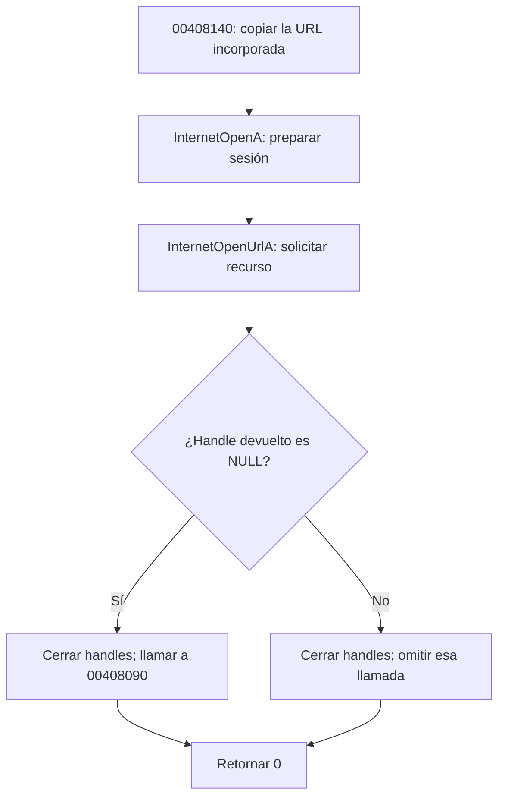
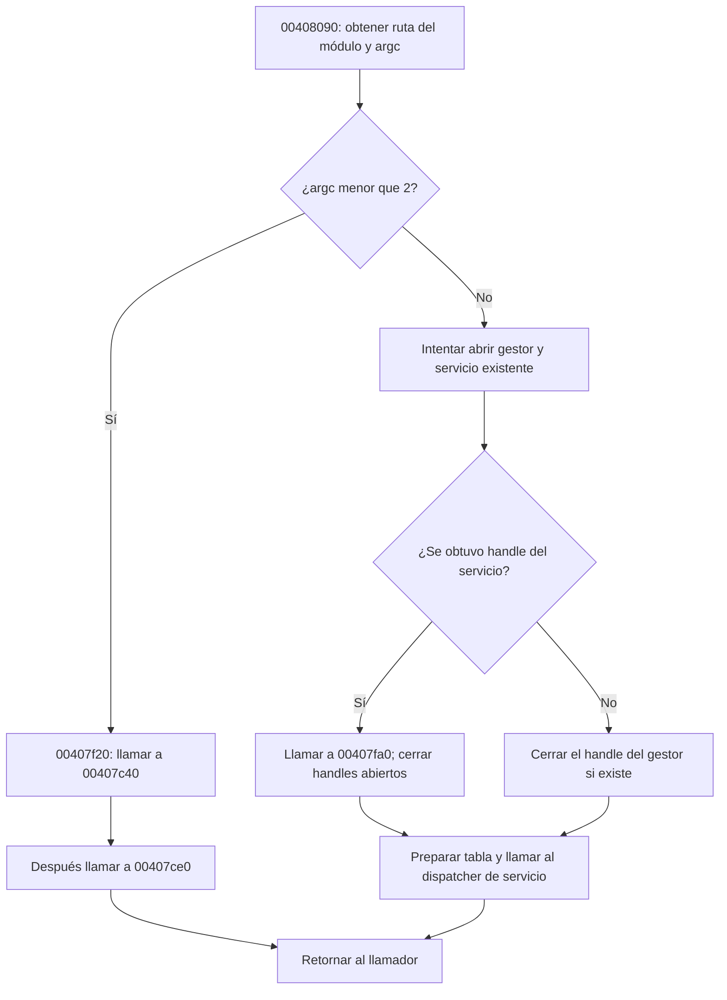
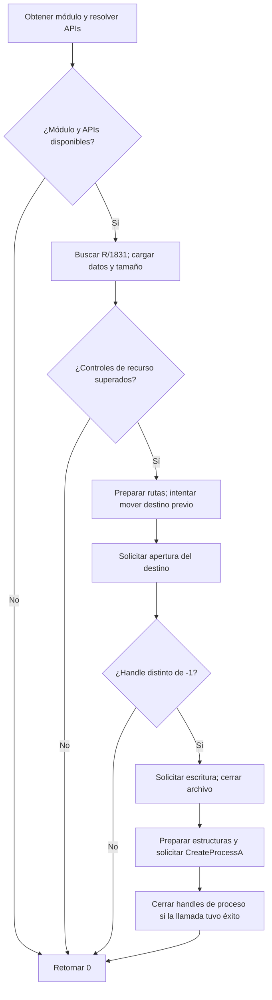

# P1 — Flujos de 24d004…

[Mapa y análisis general](../DIAGRAMAS-Y-ANALISIS.md) · [Guía P1](README.md) · [Código](codigo.md)

Son rutas estáticas seleccionadas. Cada flecha representa el orden previsto por
el código bajo las condiciones indicadas, no una ejecución observada. Se omiten
inicializaciones y detalles que no cambian la decisión representada.

## A1. Decisión inicial: 00408140

Referencia: [Comprobar_KillSwitch](codigo.md#f-00408140).

**Lectura:** la condición es el valor del handle, no una comparación explícita
con HTTP 200 o HTTP 500. En Listing, `004081a3 TEST EDI,EDI` y `004081a5 JNZ`
corroboran la decisión; `004081ad` contiene la llamada posterior.

Ambos caminos retornan 0. Ese retorno no permite distinguir éxito o fracaso
global de la actividad. El cierre con handle nulo que aparece en la transcripción
se conserva como observación del código, no como recomendación de programación.
No se contactó el dominio para elaborar el diagrama.

## A2. Selección de ruta: 00408090 y 00407f20

Referencias: [distribución](codigo.md#f-00408090), [dos llamadas](codigo.md#f-00407f20)
y [solicitud de servicio](codigo.md#f-00407c40).

`argc` es la cantidad de argumentos, contando el nombre del programa. La rama
izquierda no comprueba el retorno de `00407c40` antes de llamar a `00407ce0`.
La rama derecha referencia `LAB_00408000`; el diagrama no caracteriza todo el
código alcanzable desde esa etiqueta ni el efecto completo de `00407fa0`.

Dentro de **00407c40**, el control observado es:

| Paso | Resultado | Continuación |
|---|---|---|
| Abrir gestor con OpenSCManagerA | Handle nulo | Retornar 0 |
| Solicitar CreateServiceA | Handle no nulo | Solicitar StartServiceA y cerrar handle del servicio |
| Solicitar CreateServiceA | Handle nulo | Omitir StartServiceA |
| Después del intento de creación | Ambas rutas | Cerrar gestor y retornar 0 |

La rutina no usa el retorno de StartServiceA para emitir un resultado distinto.
La llamada no acredita un servicio instalado o iniciado en un hospital.

## A3. Recurso R/1831: 00407ce0

Referencia: [extracción](codigo.md#f-00407ce0) y
[contraste de argumentos en Listing](../../docs/guia-capas-decompilado-desensamblado.md).

Los controles agrupados son los retornos de FindResourceA, LoadResource y
LockResource, y tamaño distinto de cero. La escritura no se representa como
«verificada»: el retorno de WriteFile no se usa como condición antes de la
solicitud de proceso en el flujo examinado. Tampoco se comprueba aquí el éxito
del intento de mover el destino previo.

Los prototipos de algunas llamadas indirectas y `sprintf` son imperfectos en
el Decompiler. Listing permite seguir los datos hasta WriteFile; los argumentos
de ruta documentados componen `C:\WINDOWS\tasksche.exe` en ese camino.
La identidad R/1831 = ed01 se sustenta en la extracción y el cotejo de bytes/hashes,
no únicamente en la presencia de WriteFile.

## Análisis que debe exponer P1

El componente combina una decisión inicial con rutas de servicio y depósito de
otro componente. Las condiciones evitan afirmar una secuencia única para cualquier
entrada. El orden de dos llamadas tampoco garantiza que la primera operación
haya tenido éxito.

La función `00407480`, relacionada con la constante 445, queda fuera de estos
tres flujos: su revisión seleccionada no explica toda la propagación. No añadir
una flecha «infectar otro equipo» sin analizar y sustentar ese camino.

**Pregunta al revisor P2:** si falla la solicitud de servicio, ¿el llamador
omite automáticamente R/1831? El código de `00407f20` no contiene esa condición.
