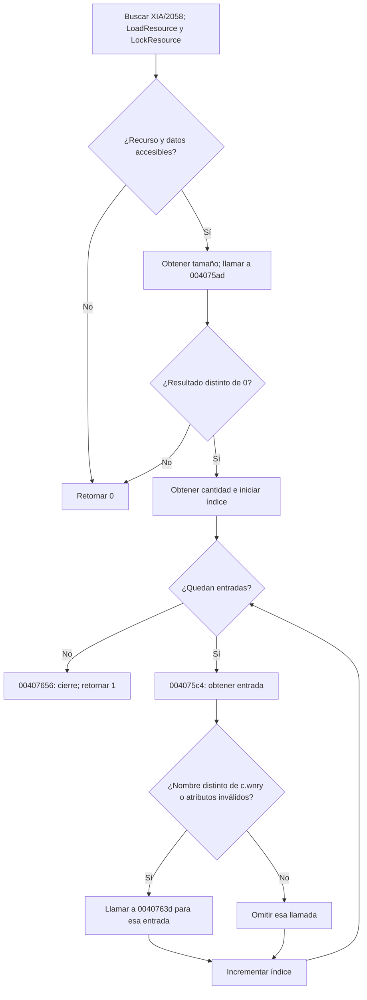
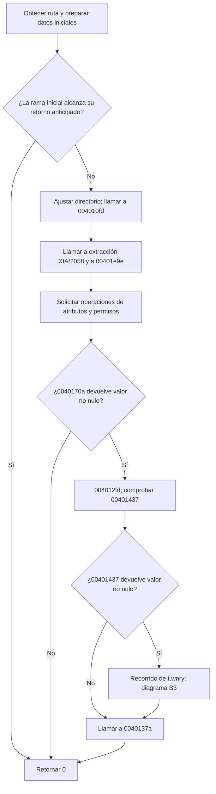
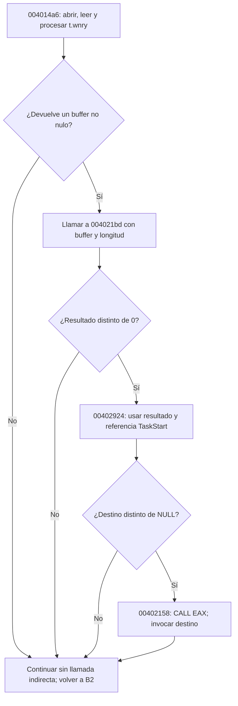

# P2 — Flujos de ed01…

[Mapa y análisis general](../DIAGRAMAS-Y-ANALISIS.md) · [Guía P2](README.md) · [Código](codigo.md)

Estos flujos resumen condiciones de las funciones seleccionadas; no representan
una extracción o ejecución dinámica registrada. Los nombres automáticos se
mantienen cuando la semántica completa todavía no se ha caracterizado.

## B1. Acceso al paquete XIA/2058: 00401dab

Referencia: [Extraer_Paquete_XIA_2058](codigo.md#f-00401dab).

La condición exacta usa `GetFileAttributesA == 0xffffffff`; se suele interpretar
como archivo no disponible, pero el código no distingue aquí todas las causas
de fallo de esa consulta. Un paquete abierto sin entradas llega al retorno 1.
El retorno 1 tampoco certifica que cada extracción interna haya sido correcta.

La identificación del contenido como ZIP procede del examen de sus bytes y de
la extracción estática documentada. El nombre XIA, por sí solo, no define un formato.

## B2. Preparación general: 00401fe7

Referencia: [Preparar_Paquete_Y_Permisos](codigo.md#f-00401fe7).

La primera decisión agrupa una rama del código: `argc == 2`, coincidencia del
argumento, retorno no nulo de `00401b5f`, intento de copia, atributos válidos de
`tasksche.exe` y retorno no nulo de `00401f5d`. No es un control único ni prueba
que CopyFileA haya tenido éxito: el código sigue comprobaciones posteriores.

La extracción se llama sin comprobar su retorno en este punto. Las operaciones
de atributos y permisos pasan por `00401064` con espera igual a cero. Por ello
«se pidió una operación antes que otra» no demuestra «la primera terminó antes».
El [flujo común de creación/espera](../p3-u-wnry/diagramas.md#c2) explica la
estructura de control compartida con esa auxiliar de P2.

## B3. Frontera de t.wnry y llamada indirecta

Referencias: [lectura/procesamiento](codigo.md#f-004014a6),
[llamador](codigo.md#f-00401fe7) y [Listing](../../docs/guia-capas-decompilado-desensamblado.md).

Dentro de `004014a6` se agrupan las siguientes comprobaciones, que pueden
impedir obtener el buffer:

| Etapa | Condición visible / límite |
|---|---|
| Archivo | Apertura válida y controles de tamaño |
| Cabecera | Lectura y comparación de ocho bytes con WANACRY! |
| Campo siguiente | Lectura y valor 0x100, es decir, 256 |
| Procesamiento | Lecturas adicionales, retornos de auxiliares, reserva y controles de longitud |
| Salida | Solo el camino que asigna el resultado devuelve el buffer; otros dejan el valor nulo |

No se han caracterizado completamente las rutinas de transformación. Tampoco
se infiere un algoritmo únicamente por el valor 256. `CALL EAX` es una transferencia
a una dirección obtenida en ese camino, no la implementación del cifrador.
Las firmas recuperadas de algunas llamadas necesitan contraste en Listing.

## Análisis que debe exponer P2

ed01 funciona como componente que prepara datos y otras etapas. La relación
con A es de contenido comprobado; sus rutas internas están condicionadas. El
ZIP, la lectura de t.wnry y la ejecución de una carga son operaciones distintas.

**Pregunta al revisor P3:** si se obtiene un paquete o un buffer, ¿ya se ha
demostrado cifrado de archivos? No: faltan caracterización de la carga y evidencia
de ejecución/efecto. Mantener esos dos límites separados.
