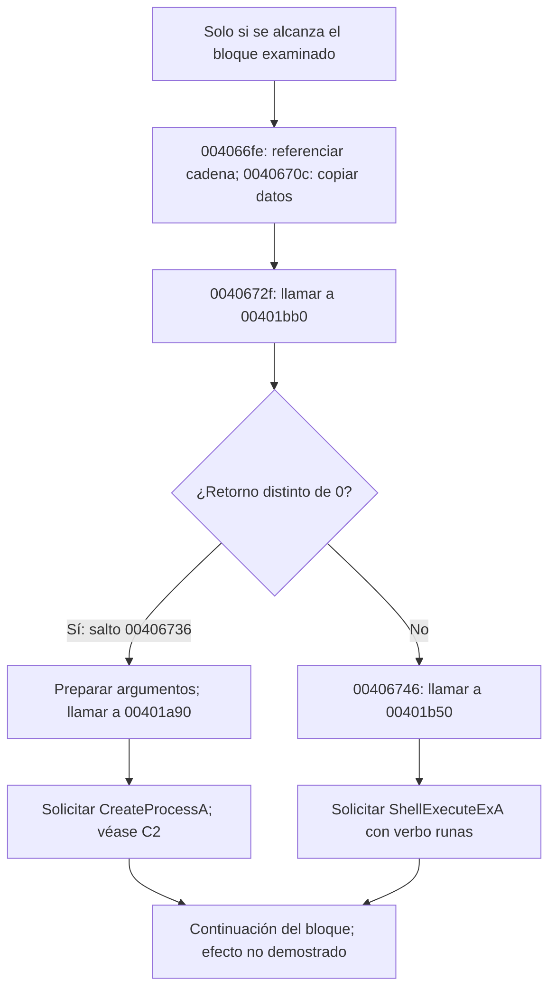
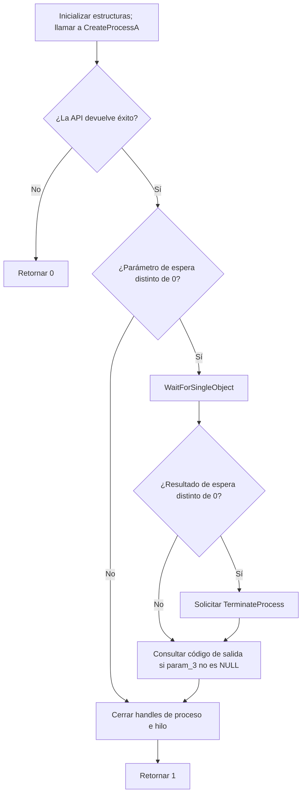

# P3 — Flujos de u.wnry y auxiliares de proceso

[Mapa y análisis general](../DIAGRAMAS-Y-ANALISIS.md) · [Guía P3](README.md) · [Código](codigo.md)

El bloque que referencia la cadena no tiene una función contenedora correctamente
recuperada. El primer diagrama combina Listing de ese bloque con las auxiliares
decompilables; no presenta una decompilación completa inexistente.

## C1. Referencia, consulta de token y selección de ruta

Referencias: [00401bb0](codigo.md#f-00401bb0), [00401b50](codigo.md#f-00401b50),
[00401a90](codigo.md#f-00401a90) y [Listing](../../docs/guia-capas-decompilado-desensamblado.md).

Hay condiciones anteriores al bloque: no se afirma que toda ejecución de
u.wnry alcance este punto. La cadena se estudia como datos y referencias; el
diagrama no contiene instrucciones para ejecutar operaciones contra respaldos.

Dentro de **00401bb0**, la consulta se interpreta así:

| Situación | Resultado del auxiliar |
|---|---|
| Falla AllocateAndInitializeSid | Retorna 0 sin realizar la consulta siguiente |
| Falla CheckTokenMembership | Fuerza local_10 a 0, libera SID y retorna 0 |
| Consulta correcta, resultado negativo | Libera SID y retorna 0 |
| Consulta correcta, resultado positivo | Libera SID y devuelve ese resultado |

Por tanto, la rama de retorno cero no equivale siempre a «se comprobó que no
pertenece al grupo». Puede incluir un fallo de consulta. Del mismo modo, solicitar
`runas` no demuestra que se hayan concedido privilegios.

## C2. Creación de proceso, espera y resultado

Referencia principal: [00401a90 en u.wnry](codigo.md#f-00401a90).
La estructura de decisiones también aparece en
[00401064 de ed01](../p2-ed01/codigo.md#f-00401064), aunque las variables y la
disposición del código difieren. No son afirmaciones de identidad binaria.

El retorno 1 refleja que se superó la comprobación de creación del proceso.
No certifica éxito de su objetivo: incluso el camino que solicita terminarlo
puede llegar a ese retorno. El código trata los resultados de espera distintos
de cero de la misma manera; no se dibuja únicamente «timeout» porque sería más
específico que la condición observada.

Consultar el código de salida es otra operación y su resultado se almacena por
un parámetro de salida, si corresponde. Cerrar un handle tampoco demuestra por
sí solo que el proceso haya terminado. En ed01, las llamadas de atributos y
permisos examinadas pasan espera cero y omiten ese bloque de espera.

## Análisis que debe exponer P3

La cadena y sus referencias sustentan una capacidad potencial. Los auxiliares
explican cómo se consulta un contexto y se solicita ejecutar una orden. La cadena
de evidencia para demostrar efecto requeriría además ejecución, privilegios,
tiempo y estado de recuperación antes/después. Esos hechos no aparecen por
dibujar una flecha entre dos funciones.

**Pregunta al revisor P4:** si el auxiliar devuelve 1, ¿puede afirmarse que se
borró un respaldo? No. El retorno de creación, el código de salida y el estado
real del respaldo deben distinguirse.
