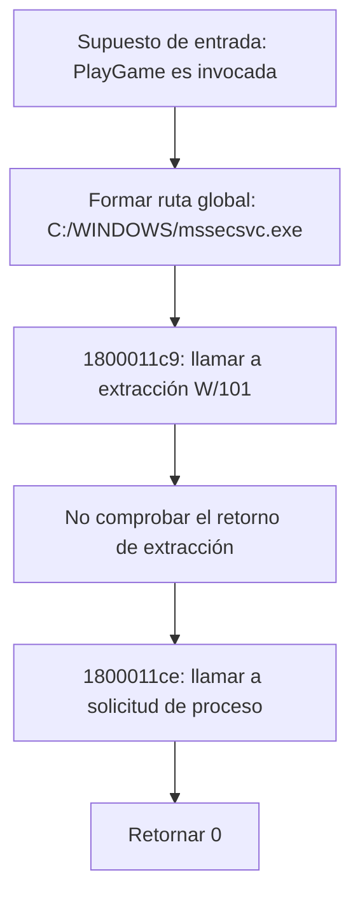
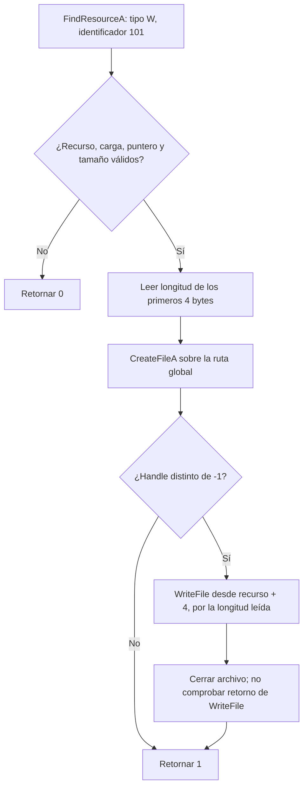
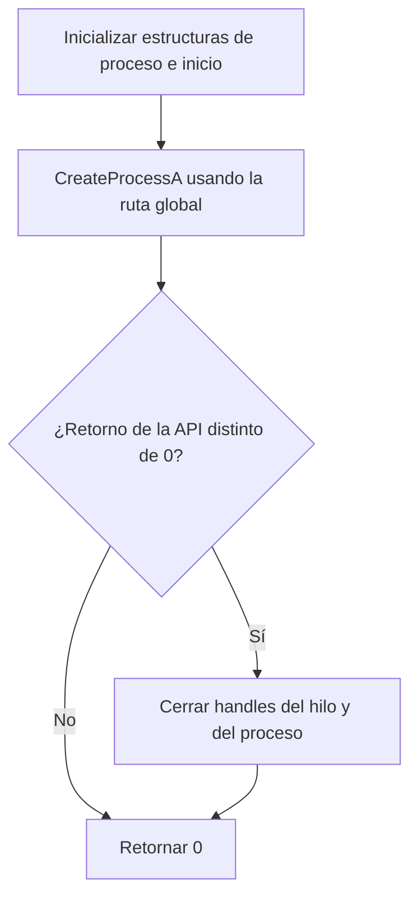

# P4 — Flujos de ec1383…, W/101 y PlayGame

[Mapa y análisis general](../DIAGRAMAS-Y-ANALISIS.md) · [Guía P4](README.md) · [Código](codigo.md)

ec1383… tiene estructura de DLL x64 pese a la extensión `.exe`. Estos diagramas
describen lo previsto **si se alcanza la función indicada**. No demuestran que
PlayGame fuera invocada, por qué medio, ni que la muestra se ejecutara en ANY.RUN.

## D1. PlayGame: 1800011a4

Referencia: [PlayGame](codigo.md#f-1800011a4).

Las barras de la etiqueta representan la ruta Windows que el código forma con
barras invertidas: `C:\WINDOWS\mssecsvc.exe`. La ruta es un dato global usado por
las dos auxiliares. No existe aquí un `if` entre sus llamadas. Si la primera
devuelve un resultado de fallo, el llamador sigue solicitando la siguiente
operación; eso no garantiza que esta última tenga éxito.

Una función exportada no se ejecuta necesariamente solo por cargar la biblioteca.
El origen de la invocación y la inicialización completa siguen siendo parte de
la [ampliación pendiente](../ALCANCE-Y-AMPLIACION.md#p4).

## D2. Extracción W/101: 180001014

Referencia: [Extraer_Recurso_W_101](codigo.md#f-180001014).

El rombo inicial agrupa los controles de FindResourceA, LoadResource,
LockResource y `SizeofResource != 0`, evaluados en ese orden. **No representa
una comprobación completa de límites de longitud**: el primer DWORD se usa
después como longitud sin que esta rutina lo compare con el tamaño total.
El extractor estático del proyecto sí hace comprobaciones propias; no atribuirlas
al malware.

`DWORD` ocupa cuatro bytes. Por eso `pDVar2 + 1`, siendo `pDVar2` un puntero a
DWORD, corresponde a `recurso + 4`. W es el tipo y 101 el ID; no son una carpeta.
La rutina examinada copia ese tramo; no contiene una operación de descifrado.

**Hallazgo decisivo:** el retorno 1 también se alcanza si falla CreateFileA.
Y, si se llega a WriteFile, su resultado no gobierna el retorno. No etiquetar
esta salida como «carga escrita correctamente».

## D3. Solicitud de proceso: 1800010f8

Referencia: [Crear_Proceso_Carga](codigo.md#f-1800010f8).

La función devuelve 0 en ambos caminos, así que ese valor tampoco demuestra
por sí solo fallo de CreateProcessA. No hay espera del proceso hijo en esta
rutina. Cerrar los handles no significa que el hijo terminara ni que consiguiera
el efecto esperado.

## Análisis que debe exponer P4

Se observa un mecanismo de extracción y solicitud de lanzamiento, conectado
por PlayGame. El PE extraído tiene hash `93db4b26…`, diferente de `24d004…`;
no se puede dibujar una identidad entre ambos ni atribuir su uso histórico sin
evidencia adicional.

El usuario aclaró que el HTTP 500 apareció en **la página de ANY.RUN**. No se
ha aportado un informe que confirme ejecución de esta ruta. Esa incidencia web
no es un nodo del flujo de la DLL y no prueba que el malware se detuviera.
Véase [análisis del error 500](../DIAGRAMAS-Y-ANALISIS.md#5-el-error-500-de-anyrun).

**Pregunta al revisor P1:** ¿pueden coexistir un retorno 1 de la extracción y
ausencia de un archivo escrito correctamente? Sí: el diagrama D2 muestra por qué.
